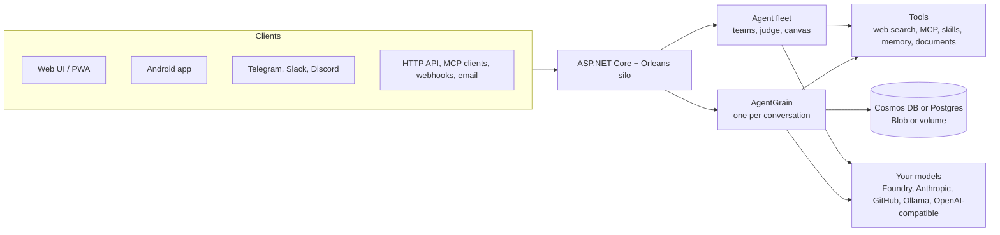
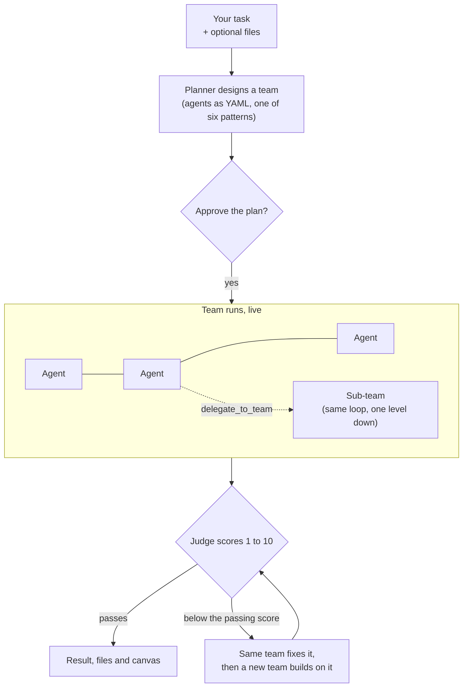
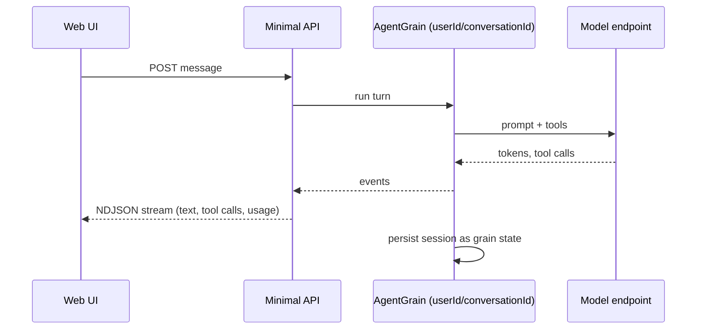

# Agent42

[](LICENSE)


**A personal AI agent you can run yourself.** Chat with any model you bring (Azure AI Foundry, GitHub Models, Anthropic,
Ollama, any OpenAI-compatible endpoint), give the agent tools, memory and schedules, and when a task is too big for one
agent, hand it to a **fleet** that designs its own team, runs it and judges the result.

One Orleans grain per conversation wraps a Microsoft Agent Framework agent. Replies stream into a vanilla-JS web UI
(an installable PWA, with an Android app), a Telegram, Slack or Discord bot, or an HTTP API. It runs offline on a canned
model, self-hosted with Docker and Postgres, or on Azure Container Apps behind Entra ID.

## Highlights

| | |
|---|---|
| **Bring your own models** | No built-in model and no operator key. Every user adds their own providers; keys are stored encrypted. |
| **[Agent fleet](#agent-fleet)** | A planner designs a team of agents for a task, runs it in one of six patterns, lets agents spawn sub-teams, and a judge scores the result. |
| **Tools you choose** | Web search, MCP servers (with a local bridge and a Chrome extension), skills, code interpreter, document Q&A, long-term memory, reminders. |
| **Custom agents** | Named agents with their own tools, callable over an HTTP API, as an MCP tool, from email, or from a chat app. |
| **Anywhere you are** | Web, PWA, Android app, Telegram, Slack, Discord, push notifications, voice. |
| **Yours to host** | `docker compose up` with Postgres and no Azure account, or Bicep and GitHub Actions for Azure Container Apps. |



## Features

Everything below is what you get as a signed-in user in the web app. For a developer
walkthrough of each feature (how it works, how Agent Framework and Orleans fit in, with flow
diagrams and code) see [`docs/features/`](docs/features/README.md). Features that need setup outside this repo
(an account, an app registration, a redirect URI) have a guide in
[`docs/integrations/`](docs/integrations/README.md).

### Chat

- **Streaming replies** — answers stream in token by token, with tool calls and token
  usage shown as they happen. A turn with many tool calls folds them into one collapsible
  group, and reloading a chat replays them.
- **Stop generation** — stop a reply mid-stream; what you saw is what the conversation keeps.
- **Reasoning** — reasoning models show their thinking in a collapsed section above the reply.
- **Rich replies** — Mermaid diagrams, highlighted code with a copy button per block, LaTeX math
  and charts render inline, in the chat and in share links.
- **Artifacts** — the model builds pages, small apps, SVG diagrams, documents and code files that open
  in a sandboxed side pane, with versions, copy and download; share links show them too.
- **Follow-up suggestions** — up to three suggested next prompts under each reply; tap one to
  send it.
- **Conversation history** — every chat is saved and listed in the sidebar, so you can leave
  and resume any conversation later, or delete one. A reply whose connection dropped (for
  example a backgrounded phone) is recovered from the saved conversation.
- **Pins, groups and search** — pin chats to the top, file them into your own named groups
  (drag and drop on desktop), and search inside the messages themselves, not just the titles.
- **Incognito chats** — a chat that is never saved and never appears in the sidebar.
- **Share links** — share a conversation as a read-only link that works without signing in;
  revoke it at any time.
- **Model picker** — choose which model answers a conversation, and switch models
  mid-conversation.
- **Voice** — dictate a message, or start hands-free voice mode: the reply is spoken (by the
  browser, or by a text-to-speech model you configure) and the app listens again. On speakers
  the mic closes while the assistant talks; on a headset you can interrupt it.

### Bring your own models

- **User-configurable providers** — add, edit, and delete your own model providers from
  **Preferences → model providers**: Azure AI Foundry, any OpenAI-compatible endpoint,
  GitHub Models, or a local runtime like Ollama / vLLM.
- **Your keys, encrypted** — provider API keys are stored encrypted, never shown back to
  you, and changes take effect immediately (no restart).
- **Default models** — pick the chat model new chats start on, plus the embedding model for
  documents and an optional speech model. The app ships with no built-in models of any kind —
  you configure your own; until you do, the composer stays gated with an empty picker.

> Heads-up: picking a third-party model sends that conversation's content (your messages,
> document excerpts, image links, your location) to that provider, outside the sign-in
> tenant. That's why the pick is always explicit.

### Tools the agent can use

You choose which of these an assistant may use — as a **personal default** (Preferences →
default tools), a **per-conversation** override (the composer's "Tools" popover), or baked
into a **custom agent**. Availability is also capped by what the chosen model supports.

- **Web search** — searches the web and reads pages for current facts, prices, and recent
  events; can follow a named link one click deeper to reach content behind "read more".
- **Read web documents** — fetches a PDF, Office or text file from a link and adds it to the
  conversation's documents, so the agent can quote from it.
- **Current location** — uses your location (with your permission) for local weather,
  what's nearby, travel times, and "where am I".
- **Scheduled reminders** — the agent can set durable reminders that fire later (once or
  repeating) and prompt it to follow up — even when you're not watching.
- **Push notifications** — the agent can send you a notification itself, for example when a
  reminder finds something worth telling you.
- **Long-term memory** — when the deployment has it enabled, the agent remembers facts across
  conversations (via Hindsight). It is a selectable tool, so you can turn it off.
- **Remote MCP servers** — add your own MCP servers (Preferences → MCP servers) and their tools
  become available to the agent. Google Calendar is reached this way: it used to be built in, and
  ADR 0063 moved it to a standalone MCP server outside this repo.
- **Skills** — reusable markdown playbooks the agent loads on demand when a task matches. Two
  ship with the app, and you can upload your own (a `SKILL.md` or a `.zip`).
- **Code interpreter** — runs code to compute, analyze, and produce results (on models
  that support it).
- **Document Q&A** — see *Files & documents*.
- The current date/time is always available.

Each skill and each MCP tool can be switched on or off individually.

### Files, images & documents

- **Image attachments** — attach images to a message; vision-capable models can see them.
- **Document upload** — drop in PDFs, Office files, or text; the agent automatically pulls
  the most relevant excerpts into its answers (retrieval-augmented), so you can ask
  questions about your own documents.
- **Image generation** — pick an image model to generate a picture from a prompt, or edit
  an existing image in the conversation. Generated images reappear when you reload.

### Custom agents

- **Build your own agents** — create named agents with their own persona/instructions and
  their own enabled tool set.
- **Continuous or per-chat memory** — an agent can start a fresh thread each time, or run
  in *continuous* mode where every start resumes one ongoing conversation (keeping the last
  24 hours).
- **Research agent** — every user gets a built-in Research agent that plans a question into
  steps, searches, checks its own answer, and shows a live checklist while it works.
- **Agent fleet** — for tasks too big for one agent, see [Agent fleet](#agent-fleet) below.
- **Run agents from outside the browser** — each agent gets its own API key (shown once)
  and a fire-and-forget endpoint, so a webhook, cron job, or automation tool (e.g. n8n)
  can hand it a prompt and files with no browser session. The result shows up as a new
  conversation you open later.
- **Call an agent from another MCP host** — opt an agent in, and Claude Desktop, Copilot or
  any MCP client holding its key can call it as a tool and get the reply back.

### Agent fleet

A page of its own (`/fleet/`, linked from the sidebar). Describe a task and a **planner** designs a team of agents for
it, the team runs, agents can hand sub-tasks to sub-teams of their own, and a **judge** scores the result.



- **Six patterns** — Sequential, Concurrent, GroupChat, Handoff, Magentic and Staged. The planner picks one and
  writes the agents; invalid plans are sent back to it to fix.
- **Recursive and bounded** — agents can delegate to sub-teams, within a depth, agent and token budget.
- **Your models and tools** — everything runs on the providers you added, with the tools your chat defaults select
  (overridable per task). Copilot agents in a team can write files and run commands.
- **Files in, files out** — attach documents (they become searchable in the task's workspace), read the files the team
  wrote, and watch a shared, versioned **canvas** fill with pages, diagrams and code while the task runs.
- **Live and durable** — a graph view of teams and agents, a team to-do list, and a replay of the full event log. Reload
  the page mid-task and nothing is lost. Follow up a finished task and the next team starts from its results.
- **From a chat** — turn on the `fleet` tool and a chat agent can start a task itself, and gets the result back as a
  new message when it finishes.
- **Share, analyze, improve** — share a finished task as a read-only link, ask an analyzer agent to diagnose a run,
  optionally add a self-review loop on the result, and let a nightly opt-in "dream" turn lessons from past runs into
  better teams.

Details: [`docs/features/agent-fleet.md`](docs/features/agent-fleet.md).

### Chat apps, Copilot and Android

- **Chat apps** — connect your own Telegram, Slack or Discord bot and talk to Agent42 from there. Replies stream by
  editing one message, files, images and voice notes work, and only the paired owner is answered
  ([`docs/features/chat-apps.md`](docs/features/chat-apps.md)).
- **GitHub Copilot** — sign in with GitHub to use your own Copilot plan, and give chats a Copilot agent with a shell and
  file tools that works in its own workspace.
- **Android app** — a signed companion app (`tools/Agent42.Android`) that wraps the web app and adds full-duplex voice.
- **Inbound email** — give a stored agent its own address; mail sent to it runs the agent.

### Remote MCP servers

- **Add your own tools via MCP** — connect your own remote HTTP MCP servers in
  **Preferences → MCP servers**, and their tools become available to the agent with no
  extra setup. **Test** shows the tools a server offers.
- **Authentication options** — none, a static header, client-credentials, or an
  interactive OAuth sign-in flow; secrets are stored encrypted. When an OAuth sign-in
  expires, the chat offers a **Reconnect** button.
- **Local bridge** — reach an MCP server that only listens on your own machine (such as a
  browser-automation server): a small downloadable helper dials out to Agent42 and asks you
  in its console before it runs any tool that isn't read-only.
- Each server, and each of its tools, can be turned on/off individually in the tool picker.

### Notifications & sharing (installed Android/Chromium PWA)

- **Install as an app** — Agent42 installs as a PWA.
- **Push notifications** — get a Web Push notification, titled with the agent's name, when
  an agent finishes a reply while you're away (e.g. a fired reminder or an external run).
- **Android Share sheet** — share text, links, images, or documents from other Android
  apps straight into a new chat or an agent; the content is prefilled and you review and
  send it yourself.

### Preferences & account

- **Sign-in** — single sign-on with Entra ID in production. A second Entra account can be
  mapped onto the same data.
- **Configuration health** — a read-only **Preferences → Configuration** tab that shows
  which features are fully configured, degraded, or off, so nothing fails silently.
- **Usage** — a token-usage dashboard per model, application and user.

### Diagnostics

- **`/logs`** — a live OpenTelemetry console (traces, logs, metrics) from an in-memory
  buffer.
- **`/dashboard`** — the Orleans dashboard, restricted to one configured owner.

> The usage dashboard and `/logs` are cross-user by design: any signed-in user sees every user's
> usage, and `/logs` shows full prompts and replies. The deployment's Easy Auth allowlist is what
> keeps that audience small.

## Architecture



Grain state lives in Cosmos DB (or Postgres when self-hosted), together with durable reminders. Any
OpenAI-compatible endpoint can serve a chat.

- **Backend** — `src/Agent42.Backend/` — minimal API (the `AgentApi.*` partials, one per
  feature folder, all called from `MapAgentApi`) co-hosted with an Orleans silo; streams each
  turn as NDJSON events (text deltas, tool calls, token usage). Also hosts the agent MCP server
  (`/api/agent-mcp`), the local-bridge socket, and the SearXNG UI proxy. Serves the static
  frontend from `wwwroot/`.
- **Agents** — `src/Agent42.Agents/` — `AgentGrain` (chat, model switching, tools,
  reminders, RAG, skills, the research loop) plus the per-user index, provider, agent registry,
  MCP, skills, share-link and push grains.
- **ServiceDefaults** — `src/Agent42.ServiceDefaults/` — shared Aspire/OpenTelemetry wiring.
- **AppHost** — `src/Agent42.AppHost/` — Aspire orchestration for the full local stack.
- **Frontend** — `src/Agent42.Backend/wwwroot/` — static vanilla JS as native ES modules in
  `js/` (composition root `main.js`), with marked + DOMPurify; deliberately no build step.
- **Tools** — `tools/Agent42.DevHost` (offline dev loop with a canned LLM) and
  `tools/Agent42.LocalBridge` (the local-bridge helper, released as self-contained binaries).
- **Tests** — `tests/` — xUnit with the Orleans TestingHost.
- **Infra** — `infra/` (Bicep, incl. a self-hosted SearXNG search sidecar) +
  `.github/workflows/deploy.yml` (build → ACR → deploy).

Conversation content stays server-side in the grain (history is persisted as serialized
session state), so any model — including stateless third-party endpoints — can run a chat.

## Run locally

Full walkthrough, with every variable and troubleshooting: [`docs/setup/local.md`](docs/setup/local.md).

```powershell
# Restore
dotnet restore Agent42.slnx

# Offline dev loop — canned LLM, in-memory grains, no Azure or Docker needed.
# UI at http://localhost:61326
dotnet run --project tools/Agent42.DevHost

# Full stack — Aspire orchestration with the Cosmos emulator (needs Docker).
dotnet run --project src/Agent42.AppHost
```

No model endpoint or key is needed to start the backend: chat, embedding and speech models
are all added per user at runtime (Preferences → model providers). The managed identity
(`DefaultAzureCredential`) is used for blob storage. Optional feature keys (Google Maps,
Hindsight, VAPID) go in user secrets; each one missing just switches its feature
off, as the Configuration tab shows.

## Self-host with Docker

No Azure account needed: `Storage:Provider = local` keeps state in Postgres and on a volume.

```bash
cp .env.example .env          # set POSTGRES_PASSWORD and SEARXNG_SECRET
docker compose up -d --build  # UI at http://localhost:8080, bound to loopback only
```

There is no authentication in this mode, so keep it on localhost or put an authenticating proxy in front. What differs
from the Azure deployment, and its limits, are in [`docs/features/self-hosting.md`](docs/features/self-hosting.md).

## Run your own

Three ways, from least to most setup. The repo ships no operator credentials, owners or identities: everything specific
to a deployment is a variable or a secret you set.

1. **Offline** (`tools/Agent42.DevHost`): canned LLM, in-memory grains, nothing to configure. Good for hacking on the UI.
2. **Self-host** (above): `docker compose`, Postgres, no Azure account. No authentication, so keep it local.
3. **Azure Container Apps**: run `infra/bootstrap.sh` and set what it prints (step by step in
   [`docs/setup/azure.md`](docs/setup/azure.md)). Owners (`ACCESS_OWNERS`), push contact
   (`VAPID_SUBJECT`), inbound email domain and identity aliases start empty; see
   [`docs/features/azure-deployment.md`](docs/features/azure-deployment.md).

There is no operator model: each user adds their own model providers in Settings (ADR 0018/0019), so a fresh install
shows an empty model picker until a provider is added. The legal pages, the Android app's default URL and the Chrome
extension's fallback server point at the maintainer's own instance; change them if you publish your own.

## Test & lint

```powershell
dotnet test Agent42.slnx                       # xUnit + Orleans TestingHost, fake chat client — no network
dotnet format Agent42.slnx --verify-no-changes # lint
dotnet build Agent42.slnx                       # type check
```

## HTTP API

All routes sit behind Easy Auth (Entra ID) except the entries on
`globalValidation.excludedPaths` in `infra/modules/container-app.bicep`: the automation endpoint
(`/api/agent-run`, ADR 0022), the agent MCP server (`/api/agent-mcp`, ADR 0070), the
local-bridge socket (`/api/local-bridge`, ADR 0076), and the read-only share surface
(`/api/share/*`, `/shared`, `/shared/*`, ADR 0035/0042). Those are publicly reachable and
self-enforce their own credential, failing closed. Note the matching rule: an entry is an
**exact** match unless it ends in `/*` (ADR 0042). In production the user is the Entra ID
principal; locally everything maps to a single `local-dev` pseudo-user.

**Chat & conversations**

- `POST   /api/chat/{conversationId}` — send a message; NDJSON stream of events back
- `POST   /api/chat/{conversationId}/stop` — stop the reply in progress
- `GET    /api/conversations` — the user's conversations, pinned first, then most recent
- `GET    /api/conversations/{id}/messages` — visible history for resuming a conversation
- `DELETE /api/conversations/{id}` — delete a conversation (and revoke its share link)
- `GET    /api/conversations/{id}/model` — the model this conversation currently uses
- `GET    /api/conversations/{id}/agent` — the agent this conversation is bound to
- `POST   /api/conversations/{id}/attachments` — upload an image or document
- `GET    /api/conversations/{id}/attachments/{attachmentId}` — fetch an attachment
- `GET/PUT /api/conversations/{id}/tools` — read / set the per-conversation tool selection
- `PUT    /api/conversations/{id}/pin` — pin or unpin
- `PUT    /api/conversations/{id}/group` — file into a custom group
- `GET/POST/PUT/DELETE /api/conversation-groups[/{groupId}]` · `PUT /api/conversation-group-order` — custom groups
- `GET    /api/search` · `POST /api/search/reindex` — search message text, rebuild the index

**Sharing**

- `GET/POST/DELETE /api/conversations/{id}/share` — show, create, revoke a share link
- `GET /api/share/{token}` · `GET /api/share/{token}/attachments/{attachmentId}` — public,
  token-authenticated read-only view (rendered by the `/shared` page)

**Models, tools & skills**

- `GET /api/models` — the user's resolved model catalog
- `GET /api/tools` — the selectable-tool catalog (per-user; includes skills and MCP tools)
- `GET/POST/PUT/DELETE /api/providers[/{key}]` — manage the user's model providers
- `PUT /api/default-model` · `PUT /api/default-embedding-model` · `PUT /api/default-speech-model`
- `GET/POST /api/skills` · `DELETE /api/skills/{id}` — list, upload, delete skills
- `POST /api/speech` — text-to-speech with the user's speech model

**Agents**

- `GET/POST/PUT/DELETE /api/agents[/{id}]` — manage custom agents (the first `GET` seeds the
  Research agent)
- `POST /api/agent-run` — external, key-authenticated run of a specific agent
  (`multipart/form-data` + `X-Api-Key`); returns 202 and runs in the background
- `/api/agent-mcp` — MCP server exposing one `ask_agent` tool, authenticated by the agent's key

**Profile, MCP, push, health**

- `GET/PUT /api/profile` — user profile (default model/tools)
- `GET/POST/PUT/DELETE /api/mcp-servers[/{id}]` — manage remote MCP servers
- `POST /api/mcp-servers/{id}/test` — connect once and list the server's tools
- `POST /api/mcp-servers/{id}/bridge-key` — issue a new local-bridge key
- `GET /api/mcp/oauth/start` · `GET /api/mcp/oauth/callback` — MCP interactive OAuth flow
- `/api/local-bridge` — WebSocket the local-bridge helper dials into
- `GET/POST/PUT/DELETE /api/chat-connections[/{id}]` · `POST /api/chat-connections/{id}/repair` — your chat-app bots
  (ADR 0111). Not public: the gateway connects OUT to each platform, so it adds no excluded path
- `GET /api/push/config` · `POST/DELETE /api/push/subscriptions` — Web Push
- `GET /api/config-health` — configuration health report (never contains a secret value)

**Usage & diagnostics**

- `GET /api/usage` · `/api/usage/applications` · `/api/usage/users` — token-usage rollups
- `GET /api/diagnostics/traces` · `/logs` · `/metrics` — feeds for the `/logs` console

## Deployment

Push to `main` → `.github/workflows/deploy.yml` checks its repository variables (`preflight`), deploys the shared
infra (`infra/shared.bicep`: a registry and Container Apps environment, created or reused), builds and pushes the
containers, and deploys `infra/main.bicep`. The app runs on Azure Container Apps behind Entra ID Easy Auth. To deploy
to your own subscription, run `infra/bootstrap.sh` once and set the secrets and variables it prints; the full guide,
and every variable are in
[`docs/features/azure-deployment.md`](docs/features/azure-deployment.md).

Several manual prerequisites live outside the code as GitHub Actions secrets. One is
required: `SEARXNG_SECRET` (without it the search sidecar crash-loops and the revision never
turns healthy). The rest are optional feature keys: `GOOGLE_MAPS_API_KEY`,
`VAPID_PRIVATE_KEY`, `HINDSIGHT_API_KEY` (the switch for long-term memory, which sends
conversation content to Hindsight), and `APPLICATIONINSIGHTS_CONNECTION_STRING`. The full table,
with what each missing input breaks, is in `CLAUDE.md`. Integrations needing setup outside this
repo have a step-by-step guide in [`docs/integrations/`](docs/integrations/README.md). See
`.agentic/gotchas.md` before touching infra: Cosmos region/containers, the custom domain, RBAC
grants, and the search sidecar all carry constraints that are invisible in the code.

## Contributing / agent docs

This is a personal, experimental project, released under the [MIT license](LICENSE). Its one external consumer surface is
the [`Hindsight.AgentFramework.Net`](https://github.com/Expecho/Hindsight.AgentFramework.Net)
package it uses for long-term memory (ADR 0056); everything inside Agent42 can change freely.
Commands, hard rules, and the knowledge layout live in `CLAUDE.md`; architectural
decisions in `.agentic/decisions/` (ADRs); non-obvious constraints in
`.agentic/gotchas.md`; multi-session plans in `.agentic/specs/`.

## License

[MIT](LICENSE).
