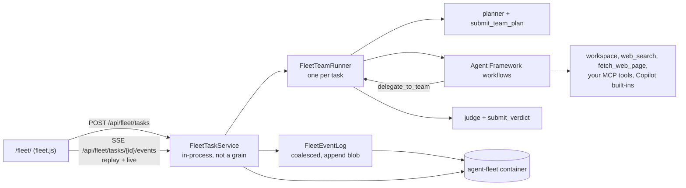

# Agent42 agent fleet

> A planner designs a team of agents for your task, the team runs, agents can hand sub-tasks to sub-teams of their
> own, and a judge reviews the result. It has its own page, `/fleet/`, linked from the sidebar as
> an icon button with the tooltip "Agent42 agent fleet". ADR 0097.

## What it is

- **A team per task.** The planner writes each agent as declarative YAML (`kind: Prompt`) and picks a pattern:
  Sequential, Concurrent, GroupChat (a model moderates), Handoff, Magentic or Staged. Invalid YAML, an unknown
  tool or model, and a hosted tool kind are sent back to the planner to fix.
- **Recursive.** Below `Fleet:MaxTeamDepth`, agents can get `delegate_to_team`, which designs and runs a new
  team for a sub-task. Sub-teams per level and the soft budget limit keep it bounded.
- **Judged.** Teams up to `Fleet:JudgeDepth` are scored 1 to 10. Below `PassingScore`, the same team fixes its
  result, then a new team builds on it. The best result is kept.
- **Your models only.** The planner, judge and moderators run on the model you pick. Agents can run on any of
  your tool-capable models. With none, the page shows the same "add a provider" gate as the chat.
- **Tools per task.** Agents get web search and your MCP tools as your chat default selects them. The composer's
  **Tools** picker overrides that for one task: it sends a selection only once you change it, and an untouched
  picker follows the default (ADR 0099). The task header shows "Tools: your defaults" or "Tools: N selected".
  Run again keeps the task's selection, and a follow-up starts from it.
- **Approval and questions.** Teams up to `Fleet:ApprovalDepth` ask you to approve their plan. Copilot
  permissions and MCP elicitations are asked the same way: a bar at the top with buttons and a text field.
- **Bounded.** Every task has a token cap (a default, and a server maximum) and an agent cap. You run one task
  at a time, and `Fleet:MaxConcurrentTasks` caps all users together.
- **Persistent.** Tasks, results, the event log and workspace files are kept in Blob. Reload the page at any
  moment and it replays the task. A done task can be followed up: a new team gets the earlier requests,
  results and workspace. A task that was running when the app restarted shows as **interrupted** and can be
  run again. **Delete task** removes a task that is not running, with its log; the workspace and its files go
  once no follow-up shares them.
- **Editable prompts.** The planner, delegation, Copilot, judge, retry, follow-up, moderator and Copilot-report
  prompts can be edited per user.

## How it works

- `FleetTaskService` (`src/Agent42.Backend/Fleet/`) runs each task on a background `Task`. Its registry of running
  tasks, open questions and live subscribers is in-process, so it relies on the single replica.
- `FleetTeamRunner` is the engine: `RunTeamAsync`, `CreateTeamAsync` (with the `PlanSubmission` tool),
  `JudgeAsync`, `DelegateToTeamAsync`, `BuildWorkflow`, `RunWorkflowAsync` and `RunStagesAsync`.
- `FleetStore` (`src/Agent42.Agents/Fleet/`) holds the layout over the narrow `IFleetBlobs` seam:
  `{userId}/tasks/`, `/events/` (append blobs), `/workspaces/{workspaceId}/` and `/prompts.json`.
- `FleetEventLog` numbers every event, fans it out live, and persists it at most once a second, merging streamed
  text. A subscriber registers before the store is read and skips what it already sent, so a reload sees each
  event exactly once.
- `FleetToolCatalog` builds the tools from the task's own selection (`FleetTaskRecord.EnabledTools`), else the
  user's DEFAULT tool selection (ADR 0099): web tools (with the chat's
  fetch allowlist) and MCP tools with the reauth and elicitation wrappers.
- Usage counts under your user and the application `Agent42 fleet` in the usage dashboard.

## Copilot agents (`model: id: copilot`)

A Copilot fleet agent runs GitHub Copilot's loop with its **built-in shell, file and URL tools**, in the task's
workspace directory inside the backend container. This is the one place ADR 0085's "no built-in tools" boundary is
set aside (ADR 0097). Every write, command and fetch is asked to you ("always for this task" is per task). Reads and
writes outside the workspace are refused, and the runtime gets a minimal environment. `Fleet:CopilotAgentsEnabled`
switches it off. The residual risks are in ADR 0097: a shell can reach the app on localhost, read the container's
files, and use its network.

## Downloads

Workspace files are listed under the task and downloaded from `/api/fleet/tasks/{id}/files/{path}`. They are
model-written, so they are always served as attachments with `nosniff` and a `text/plain` or
`application/octet-stream` type, never as a page in the app's origin.
