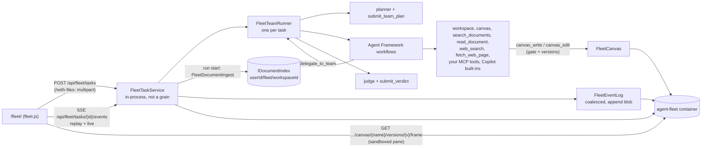

# Agent42 agent fleet

> A planner designs a team of agents for your task, the team runs, agents can hand sub-tasks to sub-teams of their
> own, and a judge reviews the result. It has its own page, `/fleet/`, linked from the sidebar as
> an icon button with the tooltip "Agent42 agent fleet". ADR 0097.

## What it is

- **A team per task.** The planner writes each agent as declarative YAML (`kind: Prompt`) and picks a pattern:
  Sequential, Concurrent, GroupChat (a model moderates), Handoff, Magentic or Staged. Invalid YAML, an unknown
  tool or model, and a hosted tool kind are sent back to the planner to fix.
- **Recursive.** Below `Fleet:MaxTeamDepth`, agents can get `delegate_to_team`, which designs and runs a new
  team for a sub-task. Sub-teams per level and the soft budget limit keep it bounded.
- **Judged.** Teams up to `Fleet:JudgeDepth` are scored 1 to 10. Below `PassingScore`, the same team fixes its
  result, then a new team builds on it. The best result is kept.
- **Your models only.** The planner, judge and moderators run on the model you pick. Agents can run on any of
  your tool-capable models. With none, the page shows the same "add a provider" gate as the chat.
- **Tools per task.** Agents get web search and your MCP tools as your chat default selects them. The composer's
  **Tools** picker overrides that for one task: it sends a selection only once you change it, and an untouched
  picker follows the default (ADR 0099). The task header shows "Tools: your defaults" or "Tools: N selected".
  Run again keeps the task's selection, and a follow-up starts from it.
- **Attached files.** **Attach files** (or drop them on the composer) to send files with a task, up to
  `Fleet:MaxInputFiles` of at most `Fleet:MaxInputFileBytes` each, within the workspace caps. They land under
  `inputs/` in the workspace, where every agent can read them. When the run starts, documents (PDF, Word,
  PowerPoint, Excel, text) are embedded into a vector store of that workspace, and a PDF or Office file also gets a
  `.txt` copy. Agents then get `search_documents` and `read_document`. Without an embedding model, the files are
  still there but nothing is searchable. A "documents.ingested" line per file shows what happened. Follow-ups share
  the files. Run again of a new task copies them into its new workspace. Deleting the workspace's last task deletes
  the indexed chunks first (ADR 0101).
- **Shared canvas.** Agents, Copilot agents included, write named, versioned pages (html, svg, markdown or code)
  with `canvas_list`, `canvas_read`, `canvas_write` and `canvas_edit`. A **Canvas** card under the task lists them,
  while the task runs too, and opens them in the same sandboxed pane as chat artifacts. A page that is open
  reloads at each new version. A write based on a stale version is refused with the current content, and an edit
  replaces one unique snippet, so concurrent sub-teams never lose each other's updates. A page keeps its latest 20
  versions. Follow-ups share the canvas, and the judge sees it (ADR 0102).
- **Approval and questions.** Teams up to `Fleet:ApprovalDepth` ask you to approve their plan. Copilot
  permissions and MCP elicitations are asked the same way: a bar at the top with buttons and a text field.
- **Started from a chat (ADR 0115).** With the `fleet` tool on, a chat agent can call `start_fleet_task`. The task is
  tied to the conversation and asks nobody: the plan and every Copilot permission are approved automatically (the
  refusals outside the workspace still apply), and MCP elicitations are declined. Each automatic answer is listed
  under **Answered automatically**. The chat gets the link `/fleet/?task=<id>`, which opens that task, and when the
  task finishes the conversation runs a background turn with the result (pushed and delivered to a chat app like an
  agent-run reply). `get_fleet_task` reads a task's status. Incognito chats and `ask_agent` can't start one.
- **Bounded.** Every task has a token cap (a default, and a server maximum) and an agent cap. You run one task
  at a time, and `Fleet:MaxConcurrentTasks` caps all users together.
- **Persistent.** Tasks, results, the event log and workspace files are kept in Blob. Reload the page at any
  moment and it replays the task. A done task can be followed up: a new team gets the earlier requests,
  results and workspace. A task that was running when the app restarted shows as **interrupted** and can be
  run again. **Delete task** removes a task that is not running, with its log; the workspace and its files go
  once no follow-up shares them.
- **Editable prompts.** The planner, delegation, Copilot, judge, retry, follow-up, moderator and Copilot-report
  prompts can be edited per user.

## How it works

- `FleetTaskService` (`src/Agent42.Backend/Fleet/`) runs each task on a background `Task`. Its registry of running
  tasks, open questions and live subscribers is in-process, so it relies on the single replica.
- `FleetTeamRunner` is the engine: `RunTeamAsync`, `CreateTeamAsync` (with the `PlanSubmission` tool),
  `JudgeAsync`, `DelegateToTeamAsync`, `BuildWorkflow`, `RunWorkflowAsync` and `RunStagesAsync`.
- `FleetStore` (`src/Agent42.Agents/Fleet/`) holds the layout over the narrow `IFleetBlobs` seam:
  `{userId}/tasks/`, `/events/` (append blobs), `/workspaces/{workspaceId}/`, `/canvas/{workspaceId}/` (outside
  the workspace prefix, which the sync prunes) and `/prompts.json`.
- `FleetCanvas` holds a task's canvas pages behind one gate and writes each version through to Blob before it
  publishes `canvas.updated` (ADR 0102).
- `FleetEventLog` numbers every event, fans it out live, and persists it at most once a second, merging streamed
  text. A subscriber registers before the store is read and skips what it already sent, so a reload sees each
  event exactly once.
- `FleetToolCatalog` builds the tools from the task's own selection (`FleetTaskRecord.EnabledTools`), else the
  user's DEFAULT tool selection (ADR 0099): web tools (with the chat's
  fetch allowlist) and MCP tools with the reauth and elicitation wrappers.
- `FleetDocumentIngest` indexes a task's inputs when its run starts, and `FleetDocumentTools` gives the agents
  `search_documents` (model-invoked, a fleet-only exception to ADR 0008) and `read_document` (the chat tool's
  `DocumentPartReader`) over the workspace's owner key `{userId}/fleet/{workspaceId}` (ADR 0101).
- Usage counts under your user and the application `Agent42 fleet` in the usage dashboard.

## Copilot agents (`model: id: copilot`)

A Copilot fleet agent runs GitHub Copilot's loop with its **built-in shell, file and URL tools**, in the task's
workspace directory inside the backend container. This set aside ADR 0085's "no built-in tools" boundary (ADR 0097),
as copilot-kind chats now do too, but auto-approved (ADR 0107). Every write, command and fetch is asked to you ("always for this task" is per task), except in a task started from a chat, which approves them all (ADR 0115). Reads and
writes outside the workspace are refused, and the runtime gets a minimal environment. `Fleet:CopilotAgentsEnabled`
switches it off. The residual risks are in ADR 0097: a shell can reach the app on localhost, read the container's
files, and use its network. Since ADR 0101 the workspace can hold your uploaded files, so its shell and file tools read
those too. Since ADR 0102 it also gets the four canvas tools as custom tools, and only those (its file access covers
the workspace tools).

Since ADR 0108 a Copilot agent can also run on your GitHub Copilot plan, as `copilot/github-copilot:<model>`, once you
have signed in with GitHub. Those models never become the task's model and never get a chat client: the planner,
judge, manager and ordinary agents stay on your own providers, and the planner sees the plan's models in a separate
"run only as a Copilot agent" list.

## Downloads

Workspace files are listed under the task and downloaded from `/api/fleet/tasks/{id}/files/{path}`. They are
model-written, so they are always served as attachments with `nosniff` and a `text/plain` or
`application/octet-stream` type, never as a page in the app's origin. Canvas pages are the rendered counterpart: they
are served only through the artifact sandbox headers (ADR 0084's CSP), read-only (ADR 0102).
