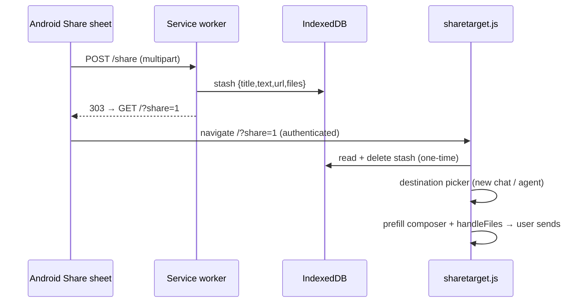

# Android Share sheet

> Share text, links, images, or documents from other Android apps straight into a new chat or
> an agent; the content is prefilled and you review and send it yourself. ADR 0023. Installed
> Android/Chromium PWA only.

## What it is

An installed PWA appears in Android's system **Share sheet** and receives shared text, URL,
images, or documents. You pick a destination (new chat, or an agent), the content is prefilled,
and **you** send it yourself — it's never auto-sent. iOS PWAs can't register as share targets, so this
is Android/Chromium only.

## How it works

The manifest declares a `share_target`, but there is **no server `/share` route** — the
deliberate contrast with the external agent-run endpoint. The **service worker intercepts
`POST /share` client-side**, stashes the payload in IndexedDB, and 303-redirects to a GET
landing. The POST never hits the network, so Easy Auth never sees it and can't drop the body on
a login redirect.



### The manifest declaration

```json
"share_target": {
  "action": "/share",
  "method": "POST",
  "enctype": "multipart/form-data",
  "params": {
    "title": "title", "text": "text", "url": "url",
    "files": [ { "name": "file", "accept": ["image/*", "application/pdf", ".pdf", ".docx", ".pptx", ".xlsx", ".txt", ".md", "text/plain", "text/markdown"] } ]
  }
}
```

### The SW intercepts, stashes, and redirects

```javascript
async function handleShare(request) {
  const form = await request.formData();
  const files = form.getAll("file")
    .filter((f) => f instanceof Blob && f.name)
    .map((f) => ({ name: f.name, type: f.type, blob: f }));
  await sharePut({ title: form.get("title") || "", text: form.get("text") || "", url: form.get("url") || "", files });
  return Response.redirect("/?share=1", 303);
}
```

The ordering invariant in the fetch handler — the share branch sits **after** the `/api` guard
and **before** the non-GET early-return (a share is a POST):

```javascript
if (url.pathname.startsWith("/api")) return;      // ADR 0002: never intercept /api — must precede any respondWith
// Share branch AFTER the /api guard, BEFORE the non-GET early-return (a share is a POST):
if (req.method === "POST" && url.pathname === "/share") { event.respondWith(handleShare(req)); return; }
if (req.method !== "GET") return;
```

### sharetarget.js reads the stash and opens the picker

```javascript
async function initShare() {
  if (!new URLSearchParams(location.search).has("share")) return;
  history.replaceState(null, "", location.pathname); // drop ?share=1 so a reload isn't a re-share
  const record = await readSharePayload();
  if (!record) return;
  await loadAgents();
  renderShareAgents((agent) => { shareDialog.close(); startAgentChat(agent); applyShare(record); });
  shareNewChatBtn.onclick = () => { shareDialog.close(); startNewConversation(); applyShare(record); };
  shareCancelBtn.onclick = () => shareDialog.close();
  shareDialog.showModal();
}
```

Prefill only — reuses the existing `handleFiles` upload path, never auto-sends:

```javascript
function applyShare(record) {
  input.value = sharePrefillText(record);
  autosize();
  const files = filesFromShare(record);
  if (files.length) handleFiles(files);   // images → attachments, documents → RAG
  input.focus();                          // user reviews it and sends it themselves
}
```

The stash is read **once** (get-then-delete) so a reload isn't a re-share.

## How the Agent Framework fits

- None directly — this is a front-of-house inbound path onto the existing composer/upload
  pipeline. A subsequent Send runs the normal Agent-Framework turn.

## How Orleans fits

- None directly. The chosen destination becomes a normal `AgentGrain` conversation only once
  the user sends. ADR 0023 explicitly required **no backend/Orleans change** — the whole
  mechanism is the SW-stash design.
- **Caveat:** the SW must be **active** for the share to work; if it isn't, the POST reaches the
  server and fails (accepted degradation, no server fallback).
- **Headline consequence:** sharing a large file into a *continuous* agent is a new
  low-friction path to the 2 MB grain brick (see [Custom agents](custom-agents.md)).

## Key files

| Concern | File |
|---------|------|
| Manifest | `src/Agent42.Backend/wwwroot/manifest.webmanifest` |
| SW interception | `src/Agent42.Backend/wwwroot/sw.js` |
| App handling | `src/Agent42.Backend/wwwroot/js/sharetarget.js` (`initShare`, `applyShare`) |
