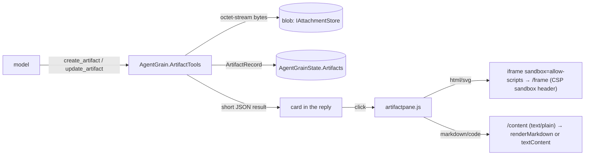

# Artifacts

> The model can create and revise standalone pages, apps, SVG diagrams, documents and code files. Each one shows
> as a card in the reply and opens in a side pane, with versions, copy and download. Share links show them too.
> ADR 0084.

## What it is

| Kind | Opens as |
|---|---|
| `html` | a live page in a sandboxed iframe (script runs, network does not) |
| `svg` | the drawing, in the same sandbox |
| `markdown` | a rendered document (with diagrams, code, math and charts, as in a reply) |
| `code` | highlighted source, with a language |

Every change is a new version, and the pane's version picker steps through them. The **☰** button lists every
artifact in the chat, including ones whose card is no longer in the history. The tools are behind the
**Artifacts** tool key, which is off for anyone who has saved a tool selection before. Incognito chats refuse
them.

## How it works



- **Tools.** `create_artifact(kind, title, content, language?)`, `update_artifact(artifactId, content, title?)`
  and `read_artifact(artifactId, version?)` are in `src/Agent42.Agents/Artifacts/AgentGrain.ArtifactTools.cs`.
  `ArtifactLimits` caps a version at 64 KB, an artifact at 20 versions and a chat at 20 artifacts. Over-cap content
  is refused, never truncated.
- **The session stays small.** After the turn, `CompactArtifactCalls` replaces the `content` argument of every
  create/update call, and every `read_artifact` result, with a stub. On a later turn the model calls
  `read_artifact` to see the source again.
- **Two layers keep model HTML off the app origin.** Every artifact route sends `AgentApi.ArtifactCsp`, whose
  `sandbox allow-scripts` gives the page an opaque origin even when `/frame` is opened directly in a tab. The iframe
  also carries `sandbox="allow-scripts"`. A page can load libraries from cdnjs and nothing else. Self-navigation is
  an accepted residual (ADR 0084).
- **One pane script for both pages.** `wwwroot/shared/lib/artifactpane.js` is a classic script
  (`window.Agent42ArtifactPane`). The app's `js/artifacts.js` injects the owner routes and `renderMarkdown`, and the
  share viewer injects the `/api/share/{token}/artifacts` routes.
- **Cards** come from `ChatTurn.Artifacts`, which `GetHistoryAsync` projects from the turn's tool calls, and from
  the live `toolCallEnd` event. The public share response keeps them while it strips the tool calls.

```csharp
// AgentApi.Artifacts.cs — the header on every artifact response, failures included
response.Headers.ContentSecurityPolicy = ArtifactCsp;   // "sandbox allow-scripts; … connect-src 'none'; form-action 'none'; …"
response.Headers.XContentTypeOptions = "nosniff";
```

## Try it offline

Run `dotnet run --project tools/Agent42.DevHost` and send **make an artifact**. It creates a page that draws on
a canvas and prints what the sandbox blocked. Then send **update the artifact** for v2. **make a markdown
artifact** and **make a code artifact** show the other kinds. The code one contains a triple-backtick run on
purpose.
