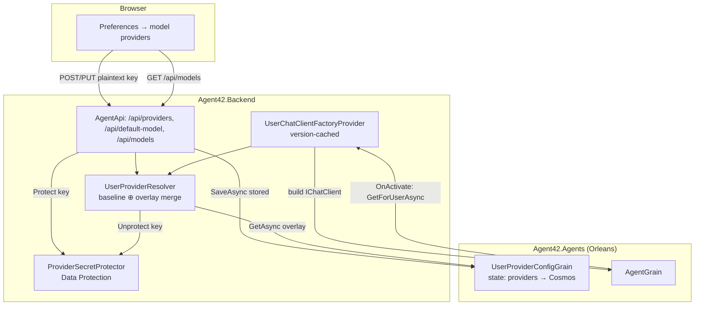

# Bring your own models

> User-configurable model providers, encrypted keys, and a user-settable default model.
> ADRs 0013 · 0017 · 0018 · 0019 · 0020.

## What it is

Agent42 ships with **no built-in chat model**. A signed-in user adds their own model
providers from **Preferences → model providers** — Azure AI Foundry, any
OpenAI-compatible endpoint, GitHub Models, or a local runtime like Ollama / vLLM. Keys are
stored **encrypted** (never echoed back), changes take effect **without a restart**, and the
user picks the **default model** new chats start on. Until at least one provider is added,
the composer stays gated and the model picker is empty.

> **Embedding models (ADR 0030):** a model can also be marked **embeddings** — document Q&A (RAG)
> uses whichever embedding model you pick as the **default embedding model** (a second selector on
> this tab, `PUT /api/default-embedding-model`). It's the same per-user overlay machinery as the chat
> default; without one, attaching documents is blocked. See [Document Q&A](document-qa.md).

> **Egress note:** picking a third-party model sends that conversation's content (messages,
> document excerpts, image links, location) to that provider — outside the sign-in tenant.
> That is why the pick is always explicit and the default stays Foundry.

## How it works

The system is layered so the grain layer (`Agent42.Agents`) has **no upward dependency** on
the backend: the grain *persists* a provider overlay, and the backend *resolves* it into
runnable chat clients. That split is why there are two parallel provider shapes —
`StoredProvider` (Orleans-serializable, holds ciphertext) and `ProviderOptions` (decrypted,
used to build clients).

The effective catalog is **baseline ⊕ per-user overlay**. As of ADR 0019 the baseline chat
set ships empty, so in practice the catalog *is* the user's overlay.



### Write path — adding or editing a provider

1. The browser `POST`/`PUT`s `/api/providers` with a `ProviderUpsertRequest` (key, kind,
   endpoint, plaintext API key, models).
2. `AgentApi.ValidateProvider` checks the key is non-empty and contains no `:`, the kind
   parses to a `ProviderKind`, the endpoint is absolute http/https, and there is ≥1 model.
3. `ToStored` **encrypts** the key before it ever reaches the grain — a blank key stores a
   `null` ciphertext:

```csharp
ApiKeyCiphertext: string.IsNullOrWhiteSpace(request.ApiKey) ? null : protector.Protect(request.ApiKey),
```

4. `IUserProviderConfigGrain.SaveAsync` upserts by key and bumps a monotonic version. A
   **blank incoming ciphertext means "keep the stored key"** — that is how an edit that
   doesn't re-enter the key preserves it:

```csharp
// A blank incoming ciphertext means "keep the stored key" ...
var key = string.IsNullOrEmpty(provider.ApiKeyCiphertext)
    ? providers[existing].ApiKeyCiphertext
    : provider.ApiKeyCiphertext;
stored = provider with { ApiKeyCiphertext = key };
providers[existing] = stored;
...
await BumpAsync(_state.State.Config with { Providers = providers });
```

```csharp
private async Task BumpAsync(UserProviderConfig next)
{
    _state.State.Config = next with { Version = next.Version + 1 };
    await _state.WriteStateAsync();
}
```

5. The API returns `Mask(stored)` — it exposes only whether a key exists, **never the
   ciphertext**:

```csharp
private static ProviderResponse Mask(StoredProvider p) =>
    new(
        p.Key, p.Kind, p.DisplayName, p.Endpoint,
        HasKey: !string.IsNullOrEmpty(p.ApiKeyCiphertext),   // never the key, only whether one exists
        Models: [.. p.Models.Select(...)],
        p.UseResponsesApi);
```

6. `PUT /api/default-model` calls `SetDefaultAsync`, which sets the overlay `Default` and
   bumps the version.

### Resolve / merge path (shared by the catalog and the client factory)

`UserProviderResolver.Merge` seeds a dictionary from the baseline, then for each overlay
provider decrypts the key and builds it. A provider that fails to build **never throws** —
it keeps the baseline entry if one exists, else is skipped. Overlays are best-effort:

```csharp
var result = ModelProviderBuilder.TryBuildProvider(stored.Key, ToOptions(stored, kind), NoInheritance);
if (result.Status != ProviderBuildStatus.Built)
{
    // Skipped (OpenAI-compatible with no key) or Invalid (e.g. a Foundry override with a
    // blank key) → keep the baseline-built entry if one exists, else skip. Availability floor.
    continue;
}
providers[stored.Key] = result.Provider!;
```

The key is **decrypted only when a client is actually built** — never on the read/masking
path:

```csharp
private ProviderOptions ToOptions(StoredProvider stored, ProviderKind kind) => new()
{
    Kind = kind,
    DisplayName = stored.DisplayName,
    Endpoint = stored.Endpoint,
    ApiKey = _protector.Unprotect(stored.ApiKeyCiphertext),
    Discover = false,
    ...
```

A model is named by a **qualified `provider:model` id split on the FIRST colon** (GitHub's
own ids contain a `/`, and some model ids contain `:`), which is why this needed no state
migration when the multi-provider scheme landed:

```csharp
public static (string Provider, string Model) Parse(string id, string defaultProvider)
{
    var separator = id.IndexOf(':');
    // separator == 0 means the id has no provider part (":gpt-4o"); treat it as legacy too,
    return separator <= 0
        ? (defaultProvider, id)
        : (id[..separator], id[(separator + 1)..]);
}

public static string Qualify(string provider, string model) => $"{provider}:{model}";
```

### Inference path (a chat turn)

On activation, `AgentGrain` resolves the per-user factory once. The factory is cached by the
overlay's **monotonic version**, so a save is picked up on the next activation with no
restart — a stale factory is never served:

```csharp
var resolved = await _resolver.ResolveAsync(userId, cancellationToken);

// A cache hit is same-version only: a save bumps the version, so a stale factory is never served.
if (_cache.TryGetValue(userId, out var cached) && cached.Version == resolved.Version)
{
    return cached.Factory;
}

var factory = new MultiProviderChatClientFactory(
    resolved.Providers, resolved.DefaultModelId, _otelSourceName, _logger);
_cache[userId] = new CachedFactory(resolved.Version, factory);
return factory;
```

With no providers configured the factory hands out a no-op client, and the grain guards on
the empty default so it emits an "add one in Preferences" notice rather than running it:

```csharp
public IChatClient GetClient(string? modelId) =>
    _providers.Count == 0 ? NoModelChatClient.Instance : _clients.GetOrAdd(Resolve(modelId).QualifiedId, Build);
```

The two provider kinds construct different SDK clients. A Foundry provider reaches both chat wire
paths over the GA `/openai/v1` surface (no `api-version`) with an `api-key`-header policy — the Chat
path used to go through `AzureOpenAIClient`'s classic `api-version` data plane, but the stable SDK
caps that at `2024-10-21`, which newer deployments reject (ADR 0033). OpenAI-compatible carries the
key credential and can also expose an image generator:

```csharp
// AzureOpenAI (Foundry) — Chat Completions over the /openai/v1 GA surface (ADR 0033)
var v1 = new Uri(endpoint.AbsoluteUri.TrimEnd('/') + "/openai/v1");
var client = new OpenAIClient(new ApiKeyHeaderPolicy(apiKey), new OpenAIClientOptions { Endpoint = v1 });
return new Provider(options, model => client.GetChatClient(model).AsIChatClient());
```

```csharp
public static Provider OpenAICompatible(ProviderOptions options, Uri endpoint, string apiKey)
{
    var client = new OpenAIClient(
        new ApiKeyCredential(apiKey), new OpenAIClientOptions { Endpoint = endpoint });
    return new Provider(
        options,
        model => client.GetChatClient(model).AsIChatClient(),
        model => new OpenAIImageGenerator(client.GetImageClient(model)));
```

## How the Agent Framework fits

- The backend produces `Microsoft.Extensions.AI.IChatClient` instances by wrapping the
  Azure/OpenAI SDK clients (`.AsIChatClient()` / `.AsIChatClientWithStoredOutputDisabled(...)`)
  and layering `.UseOpenTelemetry(...)`.
- `AgentGrain` wraps whichever `IChatClient` it resolves in a Microsoft Agent Framework
  **`ChatClientAgent`** with `ChatClientAgentOptions` (name, instructions, tools). This is the
  seam where "bring your own model" plugs in: the same `AIAgent` / session machinery runs
  regardless of which provider backs the `IChatClient`.
- `NoModelChatClient` is an `IChatClient` that only *wraps* — never invokes — so
  `ChatClientAgent` construction and session serialize/deserialize keep working with zero
  configured models. Inference is guarded upstream.

## How Orleans fits

- **Persistence is a grain.** `UserProviderConfigGrain : Grain, IUserProviderConfigGrain` is
  string-keyed by user id — one overlay per user. Its state rides
  `[PersistentState("providers", ...)]`, a **distinct Cosmos item** from the 2 MB session
  (ADR 0004), so a secret never lands in the session. All record types are
  `[GenerateSerializer]` with explicit `[Id(n)]` ordering and trailing defaults for
  forward-compatible deserialization.
- **Version-cached activation** gives the no-restart behaviour: `AgentGrain.OnActivateAsync`
  resolves the factory once; a save bumps the overlay version so the next activation of any of
  that user's conversation grains rebuilds it.
- **Grain-to-grain calls:** the backend resolver reaches the overlay via
  `IGrainFactory.GetGrain<IUserProviderConfigGrain>(userId).GetAsync()`; the API writes
  through `SaveAsync` / `SetDefaultAsync` / `DeleteAsync`.
- **Test/DevHost substitution:** `SingleUserChatClientFactoryProvider` and
  `SingleUserModelCatalogProvider` return one factory/catalog for every user, so hosts with no
  overlay store swap in a fake in one line.

## Key files

| Concern | File |
|---------|------|
| Stored overlay shapes | `src/Agent42.Agents/UserProviderConfig.cs` |
| Overlay grain | `src/Agent42.Agents/UserProviderConfigGrain.cs` |
| Baseline ⊕ overlay merge | `src/Agent42.Backend/UserProviderResolver.cs` |
| Per-provider build rules | `src/Agent42.Backend/ModelProviderBuilder.cs` |
| Provider/model options + id parsing | `src/Agent42.Backend/ModelProviderOptions.cs` |
| Version-cached factory | `src/Agent42.Backend/UserChatClientFactoryProvider.cs` |
| Client construction | `src/Agent42.Backend/ChatClientFactory.cs` |
| No-op client | `src/Agent42.Backend/NoModelChatClient.cs` |
| Encryption seam | `src/Agent42.Backend/ProviderSecretProtector.cs` |
| HTTP API | `src/Agent42.Backend/AgentApi.cs` |
| Frontend UI | `src/Agent42.Backend/wwwroot/app.js` |
