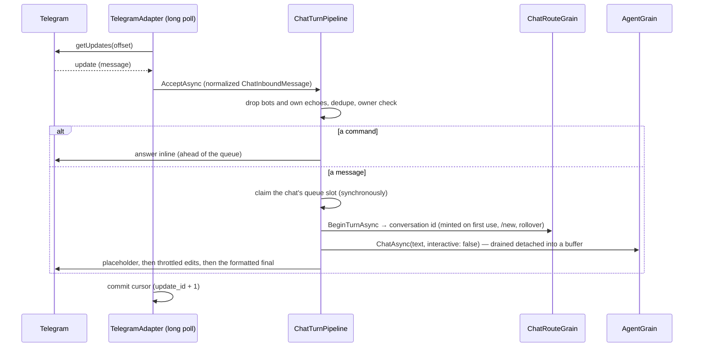

# Chat apps

> Talk to Agent 42 from your own bot on a chat app. Telegram, Slack and Discord today; WhatsApp and Signal are planned
> (ADR 0111).

## What it is

Each user connects their **own** bot in Preferences → Chat apps: paste the bot's token, then send the bot the pairing
code Agent42 shows. From then on, DMs to the bot are conversations with Agent 42, listed in the sidebar like any other
chat. Replies stream into the chat by editing one message in place. `/new`, `/stop`, `/model`, `/agent`, `/sethome`,
`/status` and `/help` work in the chat (on Slack they start with `!`, because Slack keeps a leading `/` for its own
commands).

Only the paired owner can talk to the bot. Everyone else, other bots included, is ignored without a reply.

## How it works

- **One gateway per process.** `ChatGatewayService` holds a Blob lease, then runs one supervised session per runnable
  connection, reconnecting with backoff. An auth failure (a dead token, another program polling the same bot) faults
  the connection with a reason the panel shows. Saving the connection again retries.
- **Adapters own transport and formatting only.** `IChatPlatformAdapter` is the per-platform seam. Who may talk and
  which conversation a message lands in belong to `ChatTurnPipeline`.
- **No public endpoint.** The gateway connects out (Telegram long polling, Slack Socket Mode, the Discord gateway
  websocket), so nothing is added to Easy Auth's `excludedPaths`.
- **Slack** acks every Socket Mode envelope before reading it, and reconnects inside the session when Slack recycles
  the socket. **Discord** uses `Discord.Net.WebSocket` for the gateway only; replies go through a hand-rolled REST
  client that sends every message with mentions switched off.

## Key files

| What | Where |
|---|---|
| Connection state, pairing, routes | `src/Agent42.Agents/ChatGateway/` (`UserChatConnectionsGrain`, `ChatConnectionDirectoryGrain`, `ChatRouteGrain`) |
| Supervisor and lease | `src/Agent42.Backend/ChatGateway/ChatGatewayService.cs`, `ChatGatewayLease.cs` |
| Turn pipeline and commands | `src/Agent42.Backend/ChatGateway/ChatTurnPipeline*.cs` |
| Streaming replies and splitting | `src/Agent42.Backend/ChatGateway/ChatReplyStreamer.cs`, `ChatMessageChunker.cs` |
| Telegram | `src/Agent42.Backend/ChatGateway/Telegram/` |
| Slack (Socket Mode, Web API, mrkdwn, the app manifest) | `src/Agent42.Backend/ChatGateway/Slack/` |
| Discord (gateway via Discord.Net, REST, table conversion) | `src/Agent42.Backend/ChatGateway/Discord/` |
| Management API | `src/Agent42.Backend/ChatGateway/AgentApi.ChatGateway.cs` |
| Preferences panel | `src/Agent42.Backend/wwwroot/js/chatgateway.js` |

## Trying it offline

DevHost runs the real adapters against local stand-ins for the platforms, and without them a real token connects to
the real platform, outbound only, with no tunnel needed:

| Platform | Setting (base URLs end in `/`) |
|---|---|
| Telegram | `ChatGateway__TelegramApiBaseUrl`: a server that speaks the Bot API |
| Slack | `ChatGateway__SlackApiBaseUrl`: the Web API. Its `apps.connections.open` answer names the Socket Mode URL |
| Discord | `ChatGateway__DiscordApiBaseUrl` (REST) and `ChatGateway__DiscordGatewayUrl` (a `ws://` gateway; with it set, Discord.Net makes no REST call to connect) |

## Setup

See [`docs/integrations/chat-apps/`](../integrations/chat-apps/README.md).
