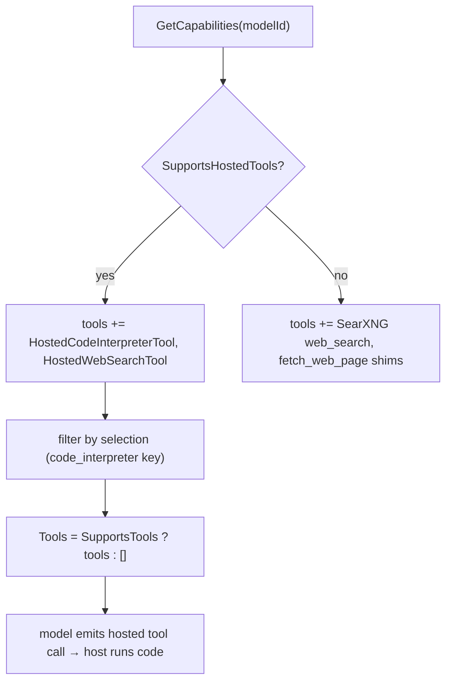

# Code interpreter

> Runs code to compute, analyze, and produce results — on models that support it. ADR 0015.

## What it is

On a hosted-tool-capable model, the agent can run code server-side (via the model host's own
sandbox) to compute and analyze. Agent42 never executes code locally — this is a **hosted
tool**, executed by OpenAI / Foundry on the Responses API.

## How it works

A per-model capability bit, `SupportsHostedTools`, is true only when the provider runs the
Responses API (a Foundry provider with `UseResponsesApi`). When set, `BuildAgent` swaps the
SearXNG web-search shims out and adds the framework's native `HostedCodeInterpreterTool` and
`HostedWebSearchTool`.



### The capability record

```csharp
public record ModelCapabilities(
    bool SupportsTools, bool SupportsVision, bool SupportsHostedTools = false, bool SupportsImageGeneration = false)
{
    public static ModelCapabilities Full => new(SupportsTools: true, SupportsVision: true);
}
```

### The swap — hosted tools replace the shims

```csharp
List<AITool> tools =
[
    schedulePrompt, cancelScheduledPrompt, cancelAllScheduledPrompts, getDateTime, getCurrentLocation,
];
if (capabilities.SupportsHostedTools)
{
    tools.Add(new HostedWebSearchTool());
    tools.Add(new HostedCodeInterpreterTool());
}
else
{
    tools.Add(webSearch);
    tools.Add(fetchWebPage);
}
```

The hosted code-interpreter tool is named `code_interpreter`, so it filters by the same
catalog key, and a no-tools model gets `[]` even if it reported hosted support:

```csharp
var enabled = EffectiveEnabledTools().ToHashSet(StringComparer.Ordinal);
tools = [.. tools.Where(t => ToolCatalog.IsToolEnabled(t.Name, enabled))];
...
Tools = capabilities.SupportsTools ? tools : [],
```

The catalog descriptor flags the UI to grey it out on non-hosted models:

```csharp
new(CodeInterpreter, "Code interpreter", RequiresHostedTools: true),
```

## How the Agent Framework fits

- `HostedCodeInterpreterTool` (and `HostedWebSearchTool`) are `Microsoft.Extensions.AI`
  hosted-tool markers. Placed in `ChatOptions.Tools`, the framework's `ChatClientAgent` forwards
  them to the provider's Responses API where execution happens server-side.
- There is **no local `AIFunctionFactory` delegate** — unlike the SearXNG shims, these are pure
  server-side tools. The swap (not an add) avoids two overlapping web-search tools, since
  `HostedWebSearchTool.Name` is literally `web_search`.

## How Orleans fits

- Minimal — the tool is added inside `BuildAgent` per activation and re-evaluated on model
  switch. Because the grain is non-reentrant, a hosted tool run serializes the conversation's
  turn.
- Grain state stores only `DeploymentName` (the selected model), which drives the capability
  lookup on the next activation.

## Key files

| Concern | File |
|---------|------|
| Capability record | `src/Agent42.Agents/Models/IChatClientFactory.cs` |
| Swap + gate | `src/Agent42.Agents/Tools/AgentGrain.BuildAgent.cs` (`BuildAgent`) |
| Catalog descriptor | `src/Agent42.Agents/Tools/ToolCatalog.cs` |
| Capability source | `src/Agent42.Backend/ChatClientFactory.cs` |
