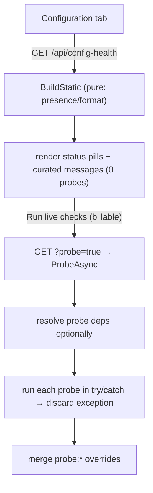

# Configuration health

> A read-only **Preferences → Configuration** tab that shows which features are fully
> configured, degraded, or off, so nothing fails silently. ADR 0029.

## What it is

A read-only tab, backed by `GET /api/config-health`, that reports which config inputs are
present / malformed / (opt-in) unreachable — so a silently degraded feature (geocoding off,
context.dev 401, Web Push off) is visible instead of mysterious.

> **The load-bearing invariant: the report never contains a secret value** — only a status
> (`ok`/`warning`/`error`/`skipped`/`na`) plus a curated message per check.

## How it works

`ConfigHealth.BuildStatic` is a **pure function** of `IConfiguration` + `IHostEnvironment` +
`PushConfig` — no HTTP, no DI. Live probes are a separate **opt-in** `ProbeAsync` path (a "Run
live checks" button; geocoding/context.dev probes are billable), so a static call runs **zero**
probes.



### The endpoint — static by default, opt-in probe

```csharp
app.MapGet("/api/config-health", async (
    bool? probe, IConfiguration configuration, IHostEnvironment environment, PushConfig push,
    IServiceProvider services, CancellationToken cancellationToken) =>
{
    var report = ConfigHealth.BuildStatic(configuration, environment, push);
    if (probe == true)
        report = await ConfigHealth.ProbeAsync(report, services, configuration, cancellationToken);
    return Results.Json(report);
});
```

### Static checks report presence/format only, never a secret

```csharp
checks.Add(PresenceCheck(GroupOptional, "Geocoding:GoogleApiKey", config["Geocoding:GoogleApiKey"],
    present: "reverse geocoding enabled",
    missing: "not set — get_current_location reports coordinates without a street address",
    missingStatus: Warning));
```

Web Push is derived from the single `PushConfig.Enabled` fact:

```csharp
checks.Add(new ConfigCheck(GroupOptional, "Push:Vapid", push.Enabled ? Ok : Warning,
    push.Enabled ? "Web Push enabled."
                 : "off — Web Push needs both a VAPID private key (secret) and public key.",
    Billable: false));
```

### The probe path is the real leak channel — so the catch discards the exception

The geocoding key rides in the request query string, so a leaked exception could carry it. The
probe returns a curated constant, never the exception, a body, or a target URL:

```csharp
try { result = await probe(cancellationToken); }
catch
{
    // NEVER surface the exception: on the geocoding path it can carry the key-bearing URL.
    result = new ProbeResult(Error, "unreachable");
}
overrides[key] = original with { Status = result.Status, Message = result.Message };
```

Probe clients are resolved **optionally** — the geocoding probe is built only when its key is
present (else `CreateClient` would return a retry-pipeline-inheriting client):

```csharp
return new ConfigHealthProbeSet(
    SearXng: httpFactory is null ? null : ct => ProbeSearxngAsync(httpFactory, ct),
    Geocoding: httpFactory is null || string.IsNullOrWhiteSpace(googleKey)
        ? null : ct => ProbeGeocodingAsync(httpFactory, googleKey, ct),
    ContextScrape: httpFactory is null ? null : ct => ProbeContextAsync(httpFactory, ct));
```

> There is **no embeddings check** here (ADR 0030): embeddings are a **per-user** model now, not
> operator config, and `BuildStatic` is pure (no grain I/O) so it can't see a user's pick. Whether an
> embedding model is configured is surfaced by the Model providers tab's embedding selector instead.

The geocoding probe classifies by marker and never echoes the body; a **SearXNG 403 is a
healthy sidecar** (JSON API off), not an auth failure.

> The endpoint injects `IServiceProvider`, **deliberately not `IHttpClientFactory`** (which is
> unregistered in DevHost — a minimal-API param it can't resolve would break routing for the
> whole host), and resolves probe deps optionally.

## How the Agent Framework fits

- None directly — the endpoint inspects config, env, and DI-registered clients only.

## How Orleans fits

- None — the endpoint is pure config / env / DI-service inspection; no grain is involved. It
  stays behind Easy Auth like every `/api/*` read; all allowlisted users may view it (no role
  system).

## Key files

| Concern | File |
|---------|------|
| Report + probes | `src/Agent42.Backend/ConfigHealth.cs` |
| Endpoint | `src/Agent42.Backend/AgentApi.cs` (`/api/config-health`) |
| Frontend | `src/Agent42.Backend/wwwroot/app.js` (`loadConfigHealth`, `renderConfigHealth`) |
