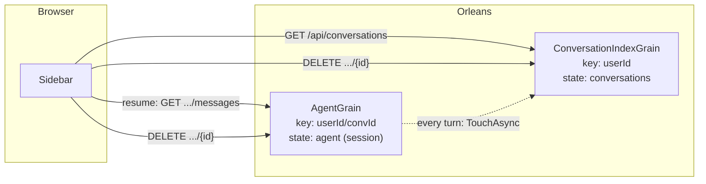

# Conversation history

> Every chat is saved and listed in the sidebar (most recent first, grouped by agent), so you
> can leave and resume any conversation later, or delete one.

## What it is

Each conversation shows up in the sidebar, ordered by most-recent activity, with per-agent
chats collapsed into groups. Click one to resume it — the full transcript, model, agent, and
tool selection are restored. Delete one and it's gone, along with its reminders and any
indexed document chunks.

## How it works

Two grains cooperate: a per-user **index grain** holds the lightweight sidebar list, and each
conversation's **`AgentGrain`** holds the actual transcript (inside its Agent Framework
session). The transcript is never stored separately — it *is* the serialized session.



### Recording and listing

Every chat turn calls `TouchAsync` before running — inserting on first touch (title from the
first prompt, agent identity snapshotted) or bumping `UpdatedAt`. Listing returns the entries
newest-first:

```csharp
public async Task TouchAsync(string conversationId, string firstPrompt, string? agentId = null, string? agentName = null)
{
    var conversations = _state.State.Conversations;
    var existing = conversations.FindIndex(c => c.Id == conversationId);
    if (existing >= 0)
        conversations[existing] = conversations[existing] with { UpdatedAt = DateTimeOffset.UtcNow };
    else { /* title trimmed to 60 chars */ conversations.Add(new ConversationInfo(...)); }
    await _state.WriteStateAsync();
}

public Task<IReadOnlyList<ConversationInfo>> GetConversationsAsync()
    => Task.FromResult<IReadOnlyList<ConversationInfo>>(
        [.. _state.State.Conversations.OrderByDescending(c => c.UpdatedAt)]);
```

The three history endpoints are thin grain calls:

```csharp
app.MapGet("/api/conversations", (IGrainFactory grains, HttpContext http) =>
    grains.GetGrain<IConversationIndexGrain>(http.GetUserId()).GetConversationsAsync());

app.MapGet("/api/conversations/{conversationId}/messages", (string conversationId, IGrainFactory grains, HttpContext http) =>
    grains.GetGrain<IAgentGrain>(AgentKey(http.GetUserId(), conversationId)).GetHistoryAsync());

app.MapDelete("/api/conversations/{conversationId}", async (string conversationId, IGrainFactory grains, HttpContext http) =>
{
    var userId = http.GetUserId();
    await grains.GetGrain<IAgentGrain>(AgentKey(userId, conversationId)).PurgeAsync();
    await grains.GetGrain<IConversationIndexGrain>(userId).RemoveAsync(conversationId);
    return Results.NoContent();
});
```

### Resuming — the transcript comes from the session

`GetHistoryAsync` reconstructs visible turns from the in-memory Agent Framework session,
joining user turns back to their attachments by index:

```csharp
if (!_session.TryGetInMemoryChatHistory(out List<ChatMessage>? messages) || messages is null)
    return Task.FromResult<IReadOnlyList<ChatTurn>>([]);
var turns = new List<ChatTurn>();
var userTurnIndex = 0;
foreach (var message in messages)
{
    if (message.Role == ChatRole.User)
    {
        var refs = userTurnIndex < _state.State.TurnAttachments.Count ? _state.State.TurnAttachments[userTurnIndex] : null;
        userTurnIndex++;
        turns.Add(new ChatTurn(message.Role.Value, message.Text ?? "", hasAttachments ? refs : null));
    }
    ...
}
```

The browser fetches messages, model, agent, and tools in parallel and replays them:

```javascript
const [msgRes, modelRes, agentRes, toolsRes] = await Promise.all([
  fetch(`/api/conversations/${encodeURIComponent(id)}/messages`),
  fetch(`/api/conversations/${encodeURIComponent(id)}/model`),
  fetch(`/api/conversations/${encodeURIComponent(id)}/agent`),
  fetch(`/api/conversations/${encodeURIComponent(id)}/tools`),
]);
const turns = await msgRes.json();
for (const turn of turns) { /* addMessage + fillUserBubble / setAgentMarkdown */ }
if (modelRes.ok) setModel(await modelRes.json());
```

### Deleting — purge is more than clearing state

`PurgeAsync` must **explicitly unregister durable reminders** (clearing state alone leaves
them ticking) and delete indexed document chunks:

```csharp
foreach (var reminder in await this.GetReminders())
    await this.UnregisterReminder(reminder);
await _documentIndex.DeleteAsync(this.GetPrimaryKeyString());
_state.State.ScheduledPrompts.Clear();
_state.State.DocumentNames.Clear();
_state.State.SerializedSession = null;
_state.State.DeploymentName = null;
await _state.ClearStateAsync();
...
this.DeactivateOnIdle();
```

The sidebar interleaves per-agent collapsible groups at their most-recent member:

```javascript
const groups = new Map();
for (const conv of conversations) {
  if (!conv.agentId) { conversationList.appendChild(buildConvRow(conv)); continue; }
  let group = groups.get(conv.agentId);
  if (!group) { const placeholder = document.createElement("li"); conversationList.appendChild(placeholder);
    group = { name: conv.agentName, convs: [], placeholder }; groups.set(conv.agentId, group); }
  group.convs.push(conv);
}
for (const [agentId, group] of groups) group.placeholder.replaceWith(buildAgentGroup(agentId, group.name, group.convs));
```

## How the Agent Framework fits

- History is **not** stored separately — it lives inside the Agent Framework `AgentSession`.
  `GetHistoryAsync` reads it via `_session.TryGetInMemoryChatHistory(...)` and maps
  `ChatMessage`s to `ChatTurn` DTOs.
- The session is serialized via `AIAgent.SerializeSessionAsync` and rehydrated via
  `DeserializeSessionAsync` on activation — that round-trip is what makes a conversation
  resumable after the grain deactivates.

## How Orleans fits

- **Two grains, two Cosmos items.** `ConversationIndexGrain` (keyed by `userId`, state
  `"conversations"`) is the sidebar; `AgentGrain` (keyed by `{userId}/{conversationId}`, state
  `"agent"`) is the transcript. Both ride the shared `agent-state` Cosmos storage provider.
- Persistence is `IPersistentState<T>.WriteStateAsync()` / `ClearStateAsync()`. `PurgeAsync`
  additionally uses the Orleans **reminder API** (`GetReminders` / `UnregisterReminder`)
  because reminders are durable and independent of grain state.
- The grain key isolates conversations per user — one user's conversation id can never resolve
  to another user's chat.

## Key files

| Concern | File |
|---------|------|
| Index grain | `src/Agent42.Agents/Conversations/ConversationIndexGrain.cs` |
| Index contract | `src/Agent42.Agents/Conversations/IConversationIndexGrain.cs` |
| History / purge | `src/Agent42.Agents/Conversations/AgentGrain.cs` (`GetHistoryAsync`, `PurgeAsync`) |
| Endpoints | `src/Agent42.Backend/AgentApi.cs` |
| Cosmos wiring | `src/Agent42.Backend/Program.cs` |
| Frontend | `src/Agent42.Backend/wwwroot/app.js` |
