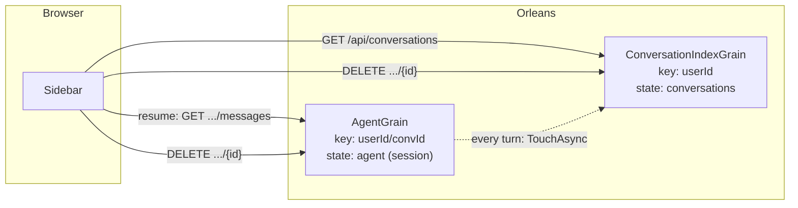

# Conversation history

> Every chat is saved and listed in the sidebar (most recent first, grouped by agent), so you
> can leave and resume any conversation later, delete one, or **search inside the messages
> themselves** — not just their titles.

## What it is

Each conversation shows up in the sidebar, ordered by most-recent activity, with per-agent
chats collapsed into groups. Click one to resume it — the full transcript, model, agent, and
tool selection are restored. Delete one and it's gone, along with its reminders and any
indexed document chunks.

A search box above the list filters it by **message text** — both what you asked and what the
agent answered. Typing replaces the list with matching messages (conversation title plus a
snippet around the match); clicking one opens that conversation; clearing the box brings the
list back, pins and agent groups intact.

## How it works

Two grains cooperate: a per-user **index grain** holds the lightweight sidebar list, and each
conversation's **`AgentGrain`** holds the actual transcript (inside its Agent Framework
session). The transcript is never stored separately — it *is* the serialized session.



### Recording and listing

Every chat turn calls `TouchAsync` before running — inserting on first touch (title from the
first prompt, agent identity snapshotted) or bumping `UpdatedAt`. Listing returns the entries
newest-first:

```csharp
public async Task TouchAsync(string conversationId, string firstPrompt, string? agentId = null, string? agentName = null)
{
    var conversations = _state.State.Conversations;
    var existing = conversations.FindIndex(c => c.Id == conversationId);
    if (existing >= 0)
        conversations[existing] = conversations[existing] with { UpdatedAt = DateTimeOffset.UtcNow };
    else { /* title trimmed to 60 chars */ conversations.Add(new ConversationInfo(...)); }
    await _state.WriteStateAsync();
}

public Task<IReadOnlyList<ConversationInfo>> GetConversationsAsync()
    => Task.FromResult<IReadOnlyList<ConversationInfo>>(
        [.. _state.State.Conversations
            .OrderByDescending(c => c.Pinned)                 // pins first (ADR 0045)
            .ThenByDescending(c => c.UpdatedAt)]);
```

The three history endpoints are thin grain calls:

```csharp
app.MapGet("/api/conversations", (IGrainFactory grains, HttpContext http) =>
    grains.GetGrain<IConversationIndexGrain>(http.GetUserId()).GetConversationsAsync());

app.MapGet("/api/conversations/{conversationId}/messages", (string conversationId, IGrainFactory grains, HttpContext http) =>
    grains.GetGrain<IAgentGrain>(AgentKey(http.GetUserId(), conversationId)).GetHistoryAsync());

app.MapDelete("/api/conversations/{conversationId}", async (string conversationId, IGrainFactory grains, HttpContext http) =>
{
    var userId = http.GetUserId();
    await grains.GetGrain<IAgentGrain>(AgentKey(userId, conversationId)).PurgeAsync();
    await grains.GetGrain<IConversationIndexGrain>(userId).RemoveAsync(conversationId);
    return Results.NoContent();
});
```

### Resuming — the transcript comes from the session

`GetHistoryAsync` reconstructs visible turns from the in-memory Agent Framework session,
joining user turns back to their attachments by index:

```csharp
if (!_session.TryGetInMemoryChatHistory(out List<ChatMessage>? messages) || messages is null)
    return Task.FromResult<IReadOnlyList<ChatTurn>>([]);
var turns = new List<ChatTurn>();
var userTurnIndex = 0;
foreach (var message in messages)
{
    if (message.Role == ChatRole.User)
    {
        var refs = userTurnIndex < _state.State.TurnAttachments.Count ? _state.State.TurnAttachments[userTurnIndex] : null;
        userTurnIndex++;
        turns.Add(new ChatTurn(message.Role.Value, message.Text ?? "", hasAttachments ? refs : null));
    }
    ...
}
```

The browser fetches messages, model, agent, and tools in parallel and replays them:

```javascript
const [msgRes, modelRes, agentRes, toolsRes] = await Promise.all([
  fetch(`/api/conversations/${encodeURIComponent(id)}/messages`),
  fetch(`/api/conversations/${encodeURIComponent(id)}/model`),
  fetch(`/api/conversations/${encodeURIComponent(id)}/agent`),
  fetch(`/api/conversations/${encodeURIComponent(id)}/tools`),
]);
const turns = await msgRes.json();
for (const turn of turns) { /* addMessage + fillUserBubble / setAgentMarkdown */ }
if (modelRes.ok) setModel(await modelRes.json());
```

### Deleting — purge is more than clearing state

`PurgeAsync` must **explicitly unregister durable reminders** (clearing state alone leaves
them ticking) and delete indexed document chunks:

```csharp
foreach (var reminder in await this.GetReminders())
    await this.UnregisterReminder(reminder);
await _documentIndex.DeleteAsync(this.GetPrimaryKeyString());
_state.State.ScheduledPrompts.Clear();
_state.State.DocumentNames.Clear();
_state.State.SerializedSession = null;
_state.State.DeploymentName = null;
await _state.ClearStateAsync();
...
this.DeactivateOnIdle();
```

The sidebar interleaves per-agent collapsible groups at their most-recent member:

```javascript
const groups = new Map();
for (const conv of conversations) {
  if (!conv.agentId) { conversationList.appendChild(buildConvRow(conv)); continue; }
  let group = groups.get(conv.agentId);
  if (!group) { const placeholder = document.createElement("li"); conversationList.appendChild(placeholder);
    group = { name: conv.agentName, convs: [], placeholder }; groups.set(conv.agentId, group); }
  group.convs.push(conv);
}
for (const [agentId, group] of groups) group.placeholder.replaceWith(buildAgentGroup(agentId, group.name, group.convs));
```

### Searching — a separate projection, because the session is one opaque blob

The transcript *is* the serialized session, which is exactly why it cannot be searched in
place: Cosmos full-text search indexes a **named string path**, and `SerializedSession` is one
JSON string per conversation. Indexing it would tokenize JSON keys (`messages`, `role`,
`assistant`) alongside the content, and "document" would mean *whole conversation* rather than
*message* — the unit a person actually searches for.

So messages are projected into a second container, `chat-messages`, one item per message,
partitioned by **`/userId`**. That partition choice is the security property: a query is
single-partition *and* owner-scoped by construction, not by a `WHERE` clause a later edit could
drop (ADR 0061).

```csharp
// One projection, used by BOTH the live write and the backfill - so their ordinals cannot
// disagree, which is what makes re-indexing overwrite instead of duplicate.
private static List<ChatSearchTurn> ProjectForSearch(IReadOnlyList<ChatTurn> turns, int fromOrdinal)
{
    var projected = new List<ChatSearchTurn>();
    for (var ordinal = Math.Max(fromOrdinal, 0); ordinal < turns.Count; ordinal++)
        if (!string.IsNullOrWhiteSpace(turns[ordinal].Text))
            projected.Add(new ChatSearchTurn(ordinal, turns[ordinal].Role, turns[ordinal].Text));
    return projected;
}
```

Three properties are worth knowing, because each is easy to get wrong:

- **The write is best-effort** — its own `try`/`catch`, logged, never rethrown. The index is a
  projection, so losing a write costs search results and never conversation content; nothing
  about search may be able to fail a turn. The gap that leaves is repairable, because
  `POST /api/search/reindex` is user-invocable and **idempotent** — drive it with
  `scripts/reindex-chat-search.sh`, which pages the batches and resumes with `--skip`. Nothing
  backfills on deploy, so history predating the feature is indexed only once that has been run.
- **Incognito chats produce zero index documents**, and skipping the ephemeral write is not
  enough on its own: an incognito turn stays in the in-memory session, so the next normal turn
  would re-project it. The cursor is advanced past it instead.
- **Deleting a conversation deletes its messages with a filtered delete**, never a partition
  drop — the partition here is the *user*, so dropping it would take every other chat with it.

v1 queries with `CONTAINS` (case-insensitively — the third argument is required, and the
default is case-sensitive). The container is nonetheless created **with** an `en-US` full-text
policy, because that policy cannot be added afterwards: switching to BM25 ranking later is then
a query change rather than a second backfill.

**The model searches it too (ADR 0112).** `search_past_chats` and `read_past_chat` (the `past_chats` tool key)
read this same projection: a ranked any-term query (`SearchRankedAsync`, BM25 on Cosmos) and an ordinal-window read
(`GetTurnsAsync`). The sidebar keeps `CONTAINS`, because people type substrings and models type keywords. The tool
reads the index, never another conversation's grain, so incognito turns can never surface, and a dropped write shows up
as "some turns are missing" rather than a silently short window.

On the client the one rule that matters is that the search render lives **inside**
`renderSidebar`, as an early return — not as a second render path beside it. Nine call sites
re-render this list independently of the search box (a background refresh, cache hydration, an
agent save, a completed send), and any of them would otherwise wipe an active result list while
it was being read.

### Pins and custom groups (ADR 0045/0073)

`PUT /api/conversations/{id}/pin` sets `ConversationInfo.Pinned`, and the index sorts pinned
chats first. Custom groups are first-class entities: `ChatGroup(Id, Name, Order)` in
`ConversationIndexState`, with a nullable `GroupId` on each conversation. A custom group wins over
the agent group, so a filed agent chat shows in its custom group. The routes are in
`AgentApi.ChatGroups.cs` (`/api/conversation-groups`, `/api/conversation-group-order`,
`PUT /api/conversations/{id}/group`), and `wwwroot/js/groups.js` owns the dialogs and the
drag-and-drop.

### Incognito chats (ADR 0034)

`ChatRequest.Ephemeral` makes a turn that skips `TouchAsync` (so the chat never enters the sidebar)
and skips the session write in the grain. Incognito is the run's own `TurnContext.Ephemeral` (ADR 0106),
so no later turn or interleaved reminder can inherit or clear it. Documents are blocked at the
composer in an incognito chat, because RAG ingestion writes durable chunks.
A copilot agent's chat refuses incognito turns altogether (ADR 0085): the Copilot runtime writes its
transcript to Blob during the turn, so the grain answers an ephemeral turn there with a refusal before
anything runs, and the client locks the toggle off.

### Read-only share links (ADR 0035)

`POST / GET / DELETE /api/conversations/{id}/share` mint, show and revoke a `shr_` token.
`UserShareLinksGrain` is the owner's list, and the global `ShareLinkDirectoryGrain` maps the token
hash to `(userId, conversationId)`. The public side (`GET /api/share/{token}`, its attachment
proxy, and the `/shared` viewer page) is on Easy Auth's `excludedPaths` and self-enforces the
token; it never calls `GetUserId()`. Deleting a conversation also revokes its link.

### Follow-up suggestions (ADR 0036)

After an interactive reply, the grain makes one extra call on the conversation's model and streams
up to three follow-up prompts as a `Suggestions` event. Clicking a chip sends it. Suggestions are
never persisted, and the agent-run and reminder paths skip them.

## How the Agent Framework fits

- History is **not** stored separately — it lives inside the Agent Framework `AgentSession`.
  `GetHistoryAsync` reads it via `_session.TryGetInMemoryChatHistory(...)` and maps
  `ChatMessage`s to `ChatTurn` DTOs.
- The session is serialized via `AIAgent.SerializeSessionAsync` and rehydrated via
  `DeserializeSessionAsync` on activation — that round-trip is what makes a conversation
  resumable after the grain deactivates.

## How Orleans fits

- **Two grains, two Cosmos items.** `ConversationIndexGrain` (keyed by `userId`, state
  `"conversations"`) is the sidebar; `AgentGrain` (keyed by `{userId}/{conversationId}`, state
  `"agent"`) is the transcript. Both ride the shared `agent-state` Cosmos storage provider.
- Persistence is `IPersistentState<T>.WriteStateAsync()` / `ClearStateAsync()`. `PurgeAsync`
  additionally uses the Orleans **reminder API** (`GetReminders` / `UnregisterReminder`)
  because reminders are durable and independent of grain state.
- The grain key isolates conversations per user — one user's conversation id can never resolve
  to another user's chat.

## Key files

| Concern | File |
|---------|------|
| Index grain | `src/Agent42.Agents/Conversations/ConversationIndexGrain.cs` |
| Index contract | `src/Agent42.Agents/Conversations/IConversationIndexGrain.cs` |
| History / purge | `src/Agent42.Agents/Conversations/AgentGrain.cs` (`GetHistoryAsync`, `PurgeAsync`) |
| Endpoints | `src/Agent42.Backend/Conversations/AgentApi.Conversations.cs` |
| Cosmos wiring | `src/Agent42.Backend/Program.cs` |
| Search port + in-memory twin | `src/Agent42.Agents/Search/IChatSearchIndex.cs`, `src/Agent42.Agents/Search/InMemoryChatSearchIndex.cs` |
| Search projection + backfill | `src/Agent42.Agents/Search/ChatSearchProjection.cs` (grain side: `src/Agent42.Agents/Search/AgentGrain.Search.cs`) |
| Search Cosmos adapter | `src/Agent42.Backend/Search/CosmosChatSearchIndex.cs` |
| Custom groups | `src/Agent42.Backend/Conversations/AgentApi.ChatGroups.cs`, `wwwroot/js/groups.js` |
| Share links | `src/Agent42.Agents/Sharing/`, `wwwroot/shared/`, `wwwroot/js/sharelinks.js` |
| Search endpoints | `src/Agent42.Backend/Search/AgentApi.Search.cs` |
| Frontend | `src/Agent42.Backend/wwwroot/js/sidebar.js`, `src/Agent42.Backend/wwwroot/js/search.js` |
