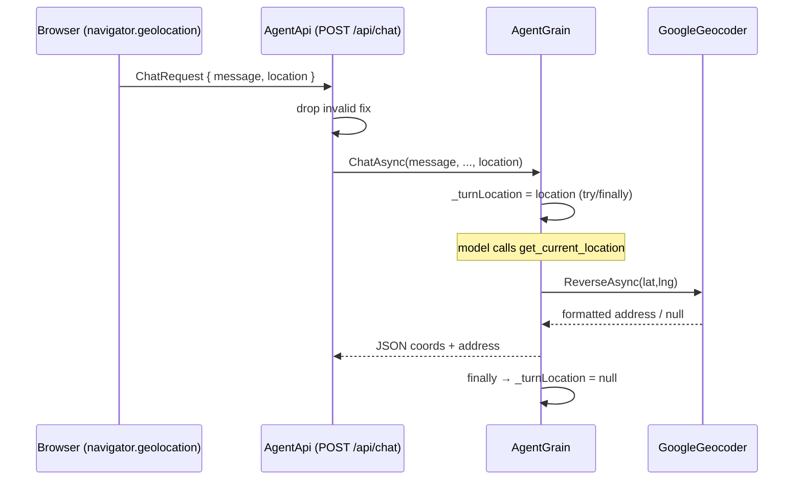

# Current location

> A `get_current_location` tool that returns the user's coordinates and a reverse-geocoded
> street address — for local weather, what's nearby, travel times, and "where am I". ADR 0012.

## What it is

With the user's browser permission, the agent can answer location-aware questions. The tool
returns coordinates plus, when it can be resolved, a street address via the Google Geocoding
API. If no key is configured the app still works — the tool reports coordinates without an
address.

> **Two subtle properties keep this safe:** the tool takes **zero parameters** (the model
> can't inject a location or a URL — it is *not* an SSRF sink), and the position is
> **turn-scoped** and never persisted (a stored fix would outlive its turn).

## How it works

`navigator.geolocation` is a *browser* API and tools run *server-side*, and the chat path is a
one-way NDJSON stream — so a tool cannot ask the browser for a fix mid-turn. Instead the
position **rides the chat request** into a turn-scoped grain field that is cleared explicitly.



### The tool — zero parameters, reads the turn field

```csharp
var getCurrentLocation = AIFunctionFactory.Create(
    GetCurrentLocationAsync,
    name: "get_current_location",
    description: "Get the user's current location: their coordinates and, when it can be resolved, their street address. ...");
```

```csharp
private async Task<string> GetCurrentLocationAsync(CancellationToken cancellationToken)
{
    if (_turnLocation is not { } location)
        return "The user has not shared their location with this conversation ...";
    var place = await _geocoder.ReverseAsync(location, cancellationToken);
    var result = new { latitude = location.Latitude, longitude = location.Longitude,
        accuracyMetres = location.AccuracyMetres, address = place?.FormattedAddress,
        locality = place?.Locality, country = place?.Country,
        capturedAt = location.CapturedAt?.ToString("o", CultureInfo.InvariantCulture), note = ... };
    return JsonSerializer.Serialize(result);
}
```

### The turn-scoped field, cleared in a `finally`

```csharp
_turnLocation = location is { IsValid: true } ? location : null;
try { await foreach (var evt in ChatCoreAsync(message, model, attachments)) yield return evt; }
finally { _turnLocation = null; }
```

The position rides `ChatRequest` into the grain; an invalid fix is dropped at the boundary:

```csharp
var location = request.Location is { IsValid: true } fix ? fix : null;
http.Response.ContentType = "application/x-ndjson";
await foreach (var evt in agent.ChatAsync(request.Message, model, attachmentRefs, location)) { ... }
```

`UserLocation` is Orleans-serializable and range-validated:

```csharp
[GenerateSerializer] [Alias("Agent42.Agents.UserLocation")]
public sealed record UserLocation([property: Id(0)] double Latitude, [property: Id(1)] double Longitude,
    [property: Id(2)] double? AccuracyMetres = null, [property: Id(3)] DateTimeOffset? CapturedAt = null)
{
    public bool IsValid => double.IsFinite(Latitude) && double.IsFinite(Longitude)
        && Latitude is >= -90 and <= 90 && Longitude is >= -180 and <= 180;
}
```

The geocoder degrades to `null` (never throws) when the key is missing or the call fails; DI
picks `GoogleGeocoder` when a key is present, else `CoordinatesOnlyGeocoder`:

```csharp
builder.Services.AddSingleton<IGeocoder>(sp => new GoogleGeocoder(..., googleApiKey, ...));
// else
builder.Services.AddSingleton<IGeocoder, CoordinatesOnlyGeocoder>();
```

## How the Agent Framework fits

- `get_current_location` is an `AIFunction` with **no JSON-schema parameters** — the
  `CancellationToken` is supplied by the framework's invocation context and kept out of the
  schema, so the model cannot inject coordinates or an address. That zero-param property is the
  SSRF defence, pinned by a test.
- It rides the same `ChatClientAgent` tool-call loop as the web tools and is gated by the
  `location` catalog key.

## How Orleans fits

- `_turnLocation` is a **per-activation grain field, deliberately not in `AgentGrainState`** —
  never persisted. Because the activation outlives a single call and `ChatAsync` is an
  `IAsyncEnumerable` that suspends between `yield return`s, the field is cleared explicitly in
  three places (the live `finally`, `EnqueuePromptAsync`, and `ReceiveReminder`) so a later
  async turn never inherits a stale fix.
- `UserLocation` crosses the grain boundary, so it carries `[GenerateSerializer]` / `[Id]`.
- `IGeocoder` is a grain-injected singleton.

## Key files

| Concern | File |
|---------|------|
| Tool + turn field | `src/Agent42.Agents/AgentGrain.cs` (`GetCurrentLocationAsync`, `_turnLocation`) |
| Location type | `src/Agent42.Agents/UserLocation.cs` |
| Geocoder | `src/Agent42.Backend/GoogleGeocoder.cs`, `src/Agent42.Agents/CoordinatesOnlyGeocoder.cs` |
| Request DTO / endpoint | `src/Agent42.Backend/AgentApi.cs` (`ChatRequest.Location`) |
| DI | `src/Agent42.Backend/Program.cs` |
