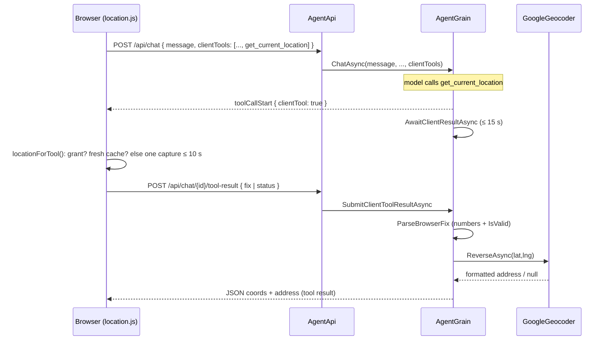

# Current location

> A `get_current_location` tool that returns the user's coordinates and a reverse-geocoded
> street address — for local weather, what's nearby, travel times, and "where am I". ADR 0012;
> a client tool since ADR 0093.

## What it is

With the user's browser permission, the agent can answer location-aware questions. The tool
returns coordinates plus, when it can be resolved, a street address via the Google Geocoding
API. If no key is configured the app still works — the tool reports coordinates without an
address.

> **Two subtle properties keep this safe:** the tool takes **zero parameters** (the model
> can't inject a location or a URL — it is *not* an SSRF sink), and the position is
> **never persisted as state** and never sent unless the model asks for it.

## How it works

`navigator.geolocation` is a *browser* API and tools run *server-side*. Since ADR 0093 the tool is a
**client tool** (ADR 0089): the call streams to the browser, the turn waits, the browser posts its fix,
and the grain validates and geocodes it. Nothing location-related rides the chat request.



### The tool — zero parameters, waits on the browser

```csharp
var getCurrentLocation = AIFunctionFactory.Create(
    GetCurrentLocationAsync,
    name: ClientToolLimits.GetCurrentLocation,
    description: "Get the user's current location from their device: ...");
```

```csharp
private async Task<string> GetCurrentLocationAsync(CancellationToken cancellationToken)
{
    var answer = await AwaitClientResultAsync(ClientToolLimits.GetCurrentLocation, cancellationToken);
    var (location, status) = ParseBrowserFix(answer);
    if (location is null)
        return status switch { "not_shared" => NotSharedText, "unavailable" => UnavailableText, _ => NoFixText };
    var place = await _geocoder.ReverseAsync(location, cancellationToken);
    // ... compact record: coordinates, address, locality, country, capturedAt (absolute), note
}
```

The browser's answer is `{latitude, longitude, accuracyMetres, capturedAt}` or a status:
`not_shared` (not authorized, or denied), `no_fix` (authorized, no fresh fix). The broker adds
`unavailable` (no browser: a reminder, a background run, `ask_agent`, MCP, an old cached client) and
`timeout`. Each becomes plain language telling the model not to guess; the raw status is never the
result. Anything that is not two in-range numbers is "no usable fix" and never reaches the geocoder.

### The browser side

```js
export async function locationForTool() {
  if (!(await isCaptureAuthorized())) return { status: "not_shared" };
  if (isFresh(lastFix)) return lastFix;                 // ≤ 30 min old
  try {
    lastFix = toFix(await readPosition(LOCATION_TOOL_TIMEOUT_MS));   // 10 s, below the server's 15 s
    return lastFix;
  } catch (error) {
    handlePositionError(error);
    return error?.code === 1 ? { status: "not_shared" } : { status: "no_fix" };
  }
}
```

The send path never touches geolocation. The background refresh (on grant, on visibility, every
5 minutes while visible) keeps the cache warm, so most calls are answered at once. The grant is
two-legged (Permissions API, or a stored flag on WebKit); on WebKit a site permission reset to
"ask" can still prompt during the tool's capture.

The geocoder degrades to `null` (never throws) when the key is missing or the call fails; DI
picks `GoogleGeocoder` when a key is present, else `CoordinatesOnlyGeocoder`:

```csharp
builder.Services.AddSingleton<IGeocoder>(sp => new GoogleGeocoder(..., googleApiKey, ...));
// else
builder.Services.AddSingleton<IGeocoder, CoordinatesOnlyGeocoder>();
```

## How the Agent Framework fits

- `get_current_location` is an `AIFunction` with **no JSON-schema parameters** — the
  `CancellationToken` is supplied by the framework's invocation context and kept out of the
  schema, so the model cannot inject coordinates or an address. That zero-param property is the
  SSRF defence, pinned by a test.
- It rides the same `ChatClientAgent` tool-call loop as every tool and is gated by the
  `location` catalog key — not `browser_tools`, even though it is a client tool, so older saved
  selections keep it (ADR 0021).
- Copilot chats never get it: client tools are excluded there (ADR 0089).

## How Orleans fits

- No location state exists on the grain. The fix lives only in one tool call's locals, and
  `AgentGrainState` has no location field.
- The wait goes through the per-run client-tool broker (an async local), so a reminder or a
  background run in a gap of the streaming turn answers `unavailable` instead of reaching the
  user's browser.
- `IGeocoder` is a grain-injected singleton.

## Key files

| Concern | File |
|---------|------|
| Tool | `src/Agent42.Agents/Location/AgentGrain.LocationTool.cs` (`GetCurrentLocationAsync`, `ParseBrowserFix`) |
| Client-tool name and wait | `src/Agent42.Agents/ClientTools/ClientToolLimits.cs`, `src/Agent42.Agents/ClientTools/AgentGrain.ClientTools.cs` |
| Location type | `src/Agent42.Agents/Location/UserLocation.cs` |
| Geocoder | `src/Agent42.Backend/Location/GoogleGeocoder.cs`, `src/Agent42.Agents/Location/CoordinatesOnlyGeocoder.cs` |
| Browser | `src/Agent42.Backend/wwwroot/js/location.js` (`locationForTool`), `src/Agent42.Backend/wwwroot/js/clienttools.js` |
| DI | `src/Agent42.Backend/Program.cs` |
