# Custom agents

> Build named agents with their own persona and tool set; run them per-chat or in continuous
> memory; and drive them from outside the browser with a per-agent API key, or call them as an MCP
> tool. Every user also gets a seeded Research agent. ADRs 0003 · 0016 · 0022 · 0068 · 0070 · 0082.

## What it is

- **Build your own agents** — named agents with their own persona/instructions and enabled tool
  set.
- **Continuous or per-chat memory** — an agent can start a fresh thread each time, or run in
  *continuous* mode where every start resumes one ongoing conversation.
- **Run from outside the browser** — each agent gets its own API key (shown once) and a
  fire-and-forget endpoint, so a webhook / cron / n8n can hand it a prompt and files with no
  browser session. The result shows up as a new conversation you open later.
- **Call it from another MCP host** — an agent can be exposed over `/api/agent-mcp` (ADR 0070), so
  Claude Desktop, Copilot or any MCP client holding its API key calls it as an `ask_agent` tool and
  gets the reply back.
- **A built-in Research agent** — seeded per user (ADR 0082); it plans a question into steps,
  searches, and checks its own answer, with a live checklist in the chat. See
  [Research agent](research-agent.md).

## How it works

A custom agent is an `AgentDefinition` in a per-user registry grain. Starting a chat
**snapshots** the persona into the conversation (ADR 0003 — the conversation is immune to later
edits). Continuous mode derives a deterministic conversation id. External runs authenticate by
a hashed API key resolved through a global directory grain, then run in the background.

```mermaid
flowchart TD
    subgraph CRUD
      REG["AgentRegistryGrain (per user)<br/>AgentDefinition + ApiKeyHash"]
      DIR["AgentKeyDirectoryGrain (global)<br/>key = SHA-256(apiKey) → (userId, agentId)"]
      REG -->|"register / deregister hash"| DIR
    end
    subgraph Interactive
      START["start chat: convId = continuous ? agent-{id} : uuid"]
      START --> BIND["BindAgentAsync — snapshot persona+model+tools (idempotent)"]
    end
    subgraph External["POST /api/agent-run (X-Api-Key)"]
      KEY["hash key → DIR.ResolveAsync → owner"] --> BIND2["BindAgentAsync + RegisterDocument"]
      BIND2 --> ENQ["EnqueuePromptAsync [OneWay] → 202"]
      ENQ --> DRAIN["background: drain ChatCoreAsync → persist turn → push"]
    end
```



### The definition

```csharp
public sealed record AgentDefinition(
    [property: Id(0)] string Id, [property: Id(1)] string Name, [property: Id(2)] string Description,
    [property: Id(3)] string Model, [property: Id(4)] string SystemPrompt,
    [property: Id(5)] DateTimeOffset CreatedAt, [property: Id(6)] DateTimeOffset UpdatedAt,
    [property: Id(7)] bool Continuous = false, [property: Id(8)] IReadOnlyList<string>? EnabledTools = null,
    [property: Id(9)] string ApiKeyHash = "");
```

### The API key — shown once, only the hash stored

```csharp
public static (string Raw, string Hash) Generate()
{
    var raw = Prefix + Base64Url(RandomNumberGenerator.GetBytes(32));   // "sk_agent_" + 256-bit
    return (raw, Hash(raw));
}
public static string Hash(string raw)
    => Convert.ToHexStringLower(SHA256.HashData(Encoding.UTF8.GetBytes(raw)));
```

Create mints the key, writes state **first**, then registers the directory — a crash leaves no
live orphan key:

```csharp
var (raw, hash) = ApiKey.Generate();
var inserted = agent with { Id = Guid.NewGuid().ToString(), CreatedAt = now, UpdatedAt = now, ApiKeyHash = hash };
agents.Add(inserted);
await _state.WriteStateAsync();
await Directory(hash).RegisterAsync(userId, inserted.Id);
return new AgentSaveResult(inserted, raw);   // raw returned ONCE
```

### The directory grain — the key *is* the grain key

```csharp
public Task<AgentKeyOwner?> ResolveAsync()
    => Task.FromResult(
        _state.State is { UserId: { Length: > 0 } userId, AgentId: { Length: > 0 } agentId }
            ? new AgentKeyOwner(userId, agentId) : null);
```

### Continuous mode — one deterministic conversation

```javascript
const convId = agent.continuous ? `agent-${agent.id}` : crypto.randomUUID();
if (agent.continuous && conversations.some((c) => c.id === convId)) { selectConversation(convId); return; }
```

> **Headline consequence:** continuous funnels every chat into one unbounded grain, so it will
> eventually hit the 2 MB session cap and brick the conversation.
> `DELETE /api/conversations/agent-{agentId}` (delete-to-reset) is the escape hatch.

### External run — resolve by key, fail closed, run in background

```csharp
var owner = await grains.GetGrain<IAgentKeyDirectoryGrain>(ApiKey.Hash(key)).ResolveAsync();
if (owner is null) return Results.Text("Unknown API key.", "text/plain", 401);
var definition = await grains.GetGrain<IAgentRegistryGrain>(owner.UserId).GetAsync(owner.AgentId);
if (definition is null) return Results.Text("Unknown API key.", "text/plain", 401);  // deletion race
```

```csharp
var agentGrain = grains.GetGrain<IAgentGrain>(ownerKey);
await agentGrain.BindAgentAsync(new AgentBinding(
    definition.Id, definition.Name, definition.SystemPrompt, definition.Model, definition.EnabledTools));
foreach (var name in documentNames) await agentGrain.RegisterDocumentAsync(name);
await agentGrain.EnqueuePromptAsync(prompt, imageRefs.Count > 0 ? imageRefs : null);
return Results.Accepted($"/api/conversations/{conversationId}/messages", new { conversationId });
```

The background run drains the **shared** chat core, so images / image-gen / RAG all work — it's
not the attachment-blind reminder path:

```csharp
await foreach (var _ in ChatCoreAsync(message, model: null, attachments)) { }   // discard events; side-effect = persisted turn
if (!string.IsNullOrEmpty(_modelId)) await SendAwayReplyPushAsync();
```

Binding snapshots the persona and materializes the tool set into a concrete list; it is
idempotent (immutable once bound):

```csharp
if (!string.IsNullOrEmpty(_state.State.AgentId)) return;   // immutable once bound
_state.State.AgentId = binding.AgentId; _state.State.AgentName = binding.Name;
_state.State.SystemPrompt = binding.SystemPrompt; _state.State.DeploymentName = binding.Model;
_state.State.EnabledTools =
    [.. ToolCatalog.Sanitize(binding.EnabledTools ?? ToolCatalog.AllSelectableToolKeys)!];
```

### Continuous history is pruned to 24 hours (ADR 0068)

A continuous chat is one grain that re-serializes its whole session into one Cosmos item (2 MB cap,
ADR 0004). So on **every persisted turn**, `ApplyRetentionAsync` hard-deletes messages older than a
fixed 24-hour window (`RetentionLimits`) from a continuous agent chat. Per-chat agents are not pruned.
Deleting the conversation is still the full reset.

### Exposed as an MCP server (ADR 0070)

`AgentDefinition.McpExposed` opts an agent into `/api/agent-mcp`, an Easy-Auth-excluded endpoint that
self-enforces the agent's API key. The MCP surface is one tool, `ask_agent` (`AgentMcpTools`). Unlike
`/api/agent-run`, the call waits and returns the reply plus a conversation id the caller can continue.
`AgentMcpRunner` binds the persona with **memory and push notifications removed** from the tool
selection (`WithoutMemoryOrPush`): a memory bank spans all the owner's conversations, so a key holder
must not read or write it. The turn lands silently in the owner's sidebar. Turning exposure on upgrades
an already-distributed key from "can send" to "can read replies", so the editor offers a key
regeneration next to the toggle.

### The seeded Research agent (ADR 0082)

Every user also gets a seeded "Research" agent: an ordinary `AgentDefinition` with `Kind = "research"`,
which only seeding can set and which forces per-chat mode. Its plan/search/reflect loop, live checklist
and one-turn fold are covered in [Research agent](research-agent.md).

## How the Agent Framework fits

- `BindAgentAsync` drives the framework `ChatClientAgent`'s `Name` and `Instructions` from the
  snapshot in grain state (`Name = _state.State.AgentName ?? "Agent42"`,
  `Instructions = WithDocumentAwareness(_state.State.SystemPrompt ...)`).
- The agent's `EnabledTools` set is intersected with model capability in `BuildAgent` (see
  [Tool selection](tool-selection.md)) — except `memory` (ADR 0057), which gates a context provider
  rather than a tool and so is never capability-filtered.
- **A bound conversation cannot change its tool set, and since ADR 0057 that has a consequence worth
  knowing.** The bind snapshot is immutable (ADR 0003): `BindAgentAsync` always materialises a concrete
  list and a re-bind returns early, while the composer's Tools popover is hidden on agent chats. So every
  conversation bound **before** a new catalog key shipped holds a selection that cannot contain it, with
  **no in-UI remedy**. For `memory` that means long-term memory is **off** on those chats — deliberately,
  and it fails safe, since memory is the widest egress in the app. New agent chats re-materialise the
  current key list at bind time and are unaffected. The stuck case is a **continuous** agent (ADR 0016):
  one permanent grain, so the only reset is `DELETE /api/conversations/agent-{agentId}`.
- The external run reuses the identical framework turn path (`ChatCoreAsync` →
  `RunStreamingAsync`), so an agent-run image rides the same `UriContent` / vision-gate
  machinery as a browser turn.

## How Orleans fits

- **Three grain types:** `AgentGrain` (per conversation), `AgentRegistryGrain` (per user), and
  `AgentKeyDirectoryGrain` — **global, keyed by the key-hash** — the one deliberately cross-user
  structure, giving O(1) `GetGrain<IAgentKeyDirectoryGrain>(hash)` resolution. All ride the
  shared `agent-state` provider; no dedicated Cosmos containers.
- `EnqueuePromptAsync` is `[OneWay]` — returns immediately so the HTTP handler answers 202
  without holding the connection; the non-reentrant grain processes the turn on its own, and
  errors are logged/swallowed (no caller).
- Registry ↔ directory consistency is kept by deliberate write ordering across grains (create:
  state then register; regenerate: deregister-old then register-new; delete: state then
  deregister) so a mid-failure never leaves a live orphaned key.
- The `Continuous` flag is read **client-side** and never snapshotted into `AgentBinding` — it's
  routing, not persona — so a user can flip it for future starts without disturbing existing
  chats.

## Key files

| Concern | File |
|---------|------|
| Definition / binding | `src/Agent42.Agents/StoredAgents/AgentDefinition.cs`, `AgentBinding.cs` |
| Key gen/hash | `src/Agent42.Agents/StoredAgents/ApiKey.cs` |
| Registry / directory grains | `src/Agent42.Agents/StoredAgents/AgentRegistryGrain.cs`, `AgentKeyDirectoryGrain.cs` |
| Endpoints | `src/Agent42.Backend/StoredAgents/AgentApi.StoredAgents.cs` (`/api/agents`, `/api/agent-run`) |
| Background run / bind | `src/Agent42.Agents/Conversations/AgentGrain.cs` (`EnqueuePromptAsync`, `BindAgentAsync`) |
| MCP exposure | `src/Agent42.Backend/Mcp/AgentMcpTools.cs`, `AgentMcpRunner.cs`, `AgentMcpServerRegistration.cs` |
| Research agent seeding | `src/Agent42.Agents/StoredAgents/AgentRegistryGrain.cs` (`EnsureResearchAgentAsync`); the loop is in [research-agent.md](research-agent.md) |
