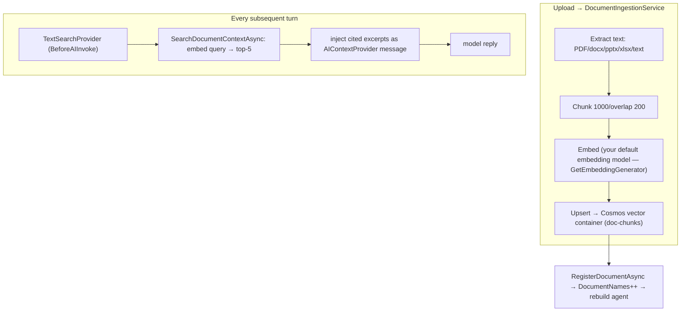

# Document Q&A (RAG)

> Drop in PDFs, Office files, or text; the agent automatically pulls the most relevant excerpts
> into its answers (retrieval-augmented), so you can ask questions about your own documents.
> ADRs 0007 · 0008 · 0066 · 0098 · 0101 (agent fleet task files).

## What it is

Upload a document to a conversation and it is extracted, chunked, embedded, and stored. From
then on, every reply is preceded by an automatic retrieval step that injects the most relevant
excerpts (with citations) — you never call a "search my docs" tool; it's **always-on** for any
conversation that has an ingested document.

Uploaded documents are **ingest-only** — they never become chat attachments (they're off the
image `UriContent` path).

The model can also pull a document from the web into the same index (ADR 0066): the
`read_web_document` tool downloads a PDF, Office or text file **from our own container**, ingests
it into this conversation's index, and returns excerpts that answer the model's `question`. It
only accepts URLs on the same fetch allowlist (URLs the user typed or a search surfaced, see
[Web search](web-search.md), plus opted-in MCP results, ADR 0067), rejects
`text/html` (web pages can't be read in full, ADR 0125), and dials through `PrivateAddressGuard`, which
checks every resolved IP and every redirect hop against private ranges. Limits are in
`WebDocumentLimits` (10 MB download, 30 s deadline, 10 web documents per conversation). A web
document counts toward the RAG gate exactly like an uploaded one
(`DocumentNames.Count + WebDocumentNames.Count > 0`).

For whole-document work ("summarise all of it", "list every requirement") the selectable
`read_document` tool (ADR 0098) reads a document **in chunk order**, ten chunks per part, with the
overlap between chunks stitched out (`DocumentStitcher`). Excerpts answer targeted questions; this reads
end to end. At most 20 parts per turn, and each part is stubbed out of the session after its turn, so the
model takes notes as it reads. A web document's parts are labelled UNTRUSTED. Uploading a file name the
conversation already holds **replaces** its chunks (on every ingest path), so a re-upload never duplicates
excerpts.

### Prerequisite: a default embedding model (ADR 0030)

RAG needs an **embedding model**, and it is **per-user** — not an operator prerequisite. Add a model
to a provider, tick **embeddings** on it, then pick it as your **default embedding model** in
Preferences → Model providers. Until you do, the composer **blocks attaching documents** (images are
unaffected). If you clear the embedding model on a conversation that already has documents, replies
still work — retrieval just **degrades to empty context, never errors**. The model must produce
**3072-dimension** vectors (the fixed `doc-chunks` container — ingest rejects a mismatch with a clear
message); switching embedding models means **re-uploading** existing documents (a re-upload of a name replaces its
chunks, ADR 0098).

## How it works

Ingestion (extract → chunk → embed → upsert) happens in the backend when you upload.
Retrieval is a **Microsoft Agent Framework `TextSearchProvider`** that runs `BeforeAIInvoke`
and injects excerpts as a context message the model sees but that is kept out of the persisted
session.



### Ingestion pipeline

```csharp
public async Task<int> IngestAsync(
    string ownerKey, string fileName, string mediaType, byte[] content, CancellationToken cancellationToken = default)
{
    var segments = extractor.Extract(fileName, mediaType, content);
    var chunks = chunker.Chunk(fileName, segments);
    if (chunks.Count == 0) { return 0; }

    // The OWNER's default embedding model (ADR 0030): userId from the ownerKey grain key, never GetUserId
    // (the /api/agent-run path has no principal). No model → EmbeddingModelNotConfiguredException → 4xx.
    var userId = UserIdFromOwnerKey(ownerKey);
    var factory = await chatClientFactoryProvider.GetForUserAsync(userId, cancellationToken);
    if (string.IsNullOrEmpty(factory.DefaultEmbeddingModelId)) { throw new EmbeddingModelNotConfiguredException(); }

    var generated = await factory.GetEmbeddingGenerator().GenerateAsync(
        chunks.Select(c => c.Text), cancellationToken: cancellationToken);

    // The prod container is fixed-dimension (3072) — reject a mismatch before any upsert (ADR 0007/0030).
    if (index.ExpectedDimensions is int expected && generated.Count > 0 && generated[0].Vector.Length != expected)
    { throw new EmbeddingDimensionMismatchException(expected, generated[0].Vector.Length); }

    var embedded = chunks
        .Zip(generated, (chunk, embedding) => new EmbeddedChunk(chunk, embedding.Vector)).ToList();

    await index.DeleteFileAsync(ownerKey, fileName, cancellationToken); // re-ingest replaces (ADR 0098)
    await index.UpsertChunksAsync(ownerKey, embedded, cancellationToken);
    return chunks.Count;
}
```

### The always-on retrieval provider

Built only when the conversation has documents; runs before every model call:

```csharp
private TextSearchProvider BuildDocumentSearchProvider() =>
    new(
        SearchDocumentContextAsync,
        new TextSearchProviderOptions
        {
            SearchTime = TextSearchProviderOptions.TextSearchBehavior.BeforeAIInvoke,
            RecentMessageMemoryLimit = 5,
            CitationsPrompt = "When you use an excerpt, cite the source file and the page or chunk shown with it.",
        },
        loggerFactory: null);
```

The search callback degrades to empty when no embedding model is configured (never throws), else
embeds the query, retrieves top-5, and maps to cited results:

```csharp
// ADR 0030: no embedding model → empty context, never a thrown turn (the no-model-chat discipline).
if (string.IsNullOrEmpty(_chatClientFactory.DefaultEmbeddingModelId)) { return []; }

var generated = await _chatClientFactory.GetEmbeddingGenerator()
    .GenerateAsync([query], cancellationToken: cancellationToken);
var results = await _documentIndex.SearchAsync(
    this.GetPrimaryKeyString(), generated[0].Vector, topK: 5, cancellationToken);
...
return results.Select(chunk => new TextSearchProvider.TextSearchResult
{
    Text = chunk.Text,
    SourceName = chunk.Page is int page ? $"{chunk.FileName}, p.{page}" : $"{chunk.FileName}, chunk {chunk.ChunkIndex}",
    RawRepresentation = chunk,
});
```

### The vector store

> **Self-hosted (`Storage:Provider = local`, ADR 0127):** chunks live in Postgres with pgvector (`agent42_doc_chunks`), searched by an exact cosine scan per owner with no ANN index. See [self-hosting.md](self-hosting.md). The Cosmos description below is the Azure deployment.

Cosmos NoSQL `VectorDistance` top-k, partitioned by the owner (grain) key:

```csharp
var query = new QueryDefinition(
        $"SELECT TOP {topK} c.fileName, c.page, c.chunkIndex, c.text " +
        "FROM c ORDER BY VectorDistance(c.embedding, @vector)")
    .WithParameter("@vector", queryEmbedding.ToArray());
var options = new QueryRequestOptions { PartitionKey = new PartitionKey(ownerKey) };
```

The index is prod-only; offline/tests use an in-memory cosine-similarity index:

```csharp
var docChunksContainer = builder.Configuration["Cosmos:DocChunksContainerName"];
if (!string.IsNullOrWhiteSpace(docChunksContainer))
    builder.Services.AddSingleton<IDocumentIndex>(sp => new CosmosDocumentIndex(
        sp.GetRequiredService<CosmosClient>(), "agent42", docChunksContainer));
else
    builder.Services.AddSingleton<IDocumentIndex, InMemoryDocumentIndex>();
```

## How the Agent Framework fits

- `TextSearchProvider` (+ `TextSearchProviderOptions`, `TextSearchProvider.TextSearchResult`)
  is a framework `AIContextProvider`. Agent42 supplies the search delegate; the framework calls
  it `BeforeAIInvoke`, formats the excerpts, injects them tagged as an AI-context-provider
  message, and applies the `CitationsPrompt`.
- `IEmbeddingGenerator<string, Embedding<float>>` is a `Microsoft.Extensions.AI` abstraction.
- The `InMemoryChatHistoryProvider` with a storage-input filter keeps the injected excerpts out
  of the persisted session — so retrieval is cheap and the 2 MB session stays small.

## How Orleans fits

- **Retrieval scope = the grain key.** The `ownerKey` for both ingestion and search is
  `this.GetPrimaryKeyString()` = `{userId}/{conversationId}`, so a conversation can never read
  another's chunks (single-partition Cosmos queries).
- `RegisterDocumentAsync` mutates grain state (`DocumentNames`) and persists, then rebuilds the
  agent so the provider is attached.
- The vector store is **not** a grain — `DocumentChunk` never crosses the Orleans serialization
  boundary; `IDocumentIndex` is an in-process singleton (Cosmos or in-memory).
- Grain lifecycle drives cleanup: `PurgeAsync` deletes the conversation's chunks so document
  text doesn't outlive it.

## Key files

| Concern | File |
|---------|------|
| Ingestion | `src/Agent42.Backend/Documents/DocumentIngestionService.cs` |
| Extract / chunk | `src/Agent42.Agents/Documents/DocumentTextExtractor.cs`, `DocumentChunker.cs` |
| Retrieval provider | `src/Agent42.Agents/Documents/AgentGrain.Documents.cs` (`BuildDocumentSearchProvider`, `SearchDocumentContextAsync`) |
| Vector store | `src/Agent42.Backend/Documents/CosmosDocumentIndex.cs`, `src/Agent42.Agents/Documents/InMemoryDocumentIndex.cs` |
| Sequential reading (ADR 0098) | `src/Agent42.Agents/Documents/AgentGrain.ReadDocumentTool.cs`, `DocumentPartReader.cs` (shared with the fleet), `ReadDocumentLimits.cs`, `DocumentStitcher.cs` |
| Agent fleet documents (ADR 0101) | `src/Agent42.Backend/Fleet/FleetDocumentIngest.cs`, `FleetDocumentTools.cs` (owner key `{userId}/fleet/{workspaceId}`) |
| Web documents (ADR 0066) | `src/Agent42.Agents/Documents/AgentGrain.WebDocumentTool.cs`, `WebDocumentLimits.cs`, `src/Agent42.Backend/Documents/WebDocumentIngestor.cs`, `src/Agent42.Backend/Web/PrivateAddressGuard.cs` |
| Wiring | `src/Agent42.Backend/Program.cs` |
