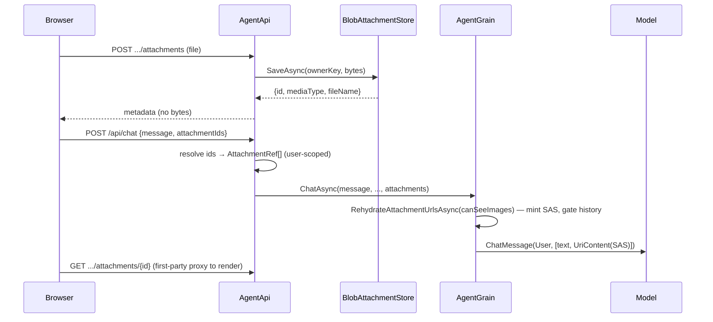

# Image attachments

> Attach images to a message; vision-capable models can see them. ADR 0004.

## What it is

You attach one or more images to a message. Vision-capable models see them; a model without
vision is told it can't. Image **bytes** live in a private Azure Storage container — they never
land in the conversation's grain state, which is capped at ~2 MB.

## How it works

Upload is a two-phase flow: the browser first POSTs the file (getting back an id), then sends
the chat turn referencing that id. The model sees images as short-lived SAS `UriContent` URLs.
The **vision gate covers history, not just the new turn** — so old image URLs are withheld
from a no-vision model and restored if you switch back to a vision model.



### Bytes stay out of the session

`SaveAsync` writes to an owner-scoped blob path and returns a lightweight ref:

```csharp
var id = Guid.NewGuid().ToString("n");
var blobPath = $"{ownerKey}/{id}";
...
await _container.GetBlobClient(blobPath)
    .UploadAsync(BinaryData.FromBytes(content), options, cancellationToken);
return new AttachmentRef(id, blobPath, mediaType, fileName);
```

The model-facing URL is a short-lived **user-delegation SAS** (identity-based in prod, no
account key):

```csharp
if (blob.CanGenerateSasUri)          // local Azurite: service SAS
    return blob.GenerateSasUri(sasBuilder);
var delegationKey = await GetDelegationKeyAsync(cancellationToken);   // prod: identity, no account key
var sas = sasBuilder.ToSasQueryParameters(delegationKey, _serviceClient.AccountName);
return new BlobUriBuilder(blob.Uri) { Sas = sas }.ToUri();
```

The chat endpoint re-resolves client ids into refs server-side — it never trusts a blob path
from the client:

```csharp
foreach (var id in request.AttachmentIds)
{
    var reference = await attachments.GetAsync(AgentKey(userId, conversationId), id);
    if (reference is not null) resolved.Add(reference);   // unknown ids skipped
}
```

### The vision gate — new turn and history

For the new turn, an image becomes `UriContent` only if the model has vision; otherwise it is
withheld but still recorded so a later vision model can see it:

```csharp
if (!canSeeImages) { skippedImages++; turnRefs.Add(attachment); continue; }  // withheld but kept for history
var url = await _attachments.GetReadUrlAsync(attachment);
contents.Add(new UriContent(url, attachment.MediaType));
turnRefs.Add(attachment);
```

History gets the same gate — SAS refreshed, image parts reversibly stripped or restored across
the whole session (the durable record is `TurnAttachments`):

```csharp
if (!includeImages) { StripImageParts(message); continue; }   // reversible: TurnAttachments is the durable record
...
var url = await _attachments.GetReadUrlAsync(refs[i]);
if (i < uriParts.Count) uriParts[i].Uri = url;
else message.Contents.Add(new UriContent(url, refs[i].MediaType));   // re-add one a no-vision turn stripped
```

## How the Agent Framework fits

- Attachments become `Microsoft.Extensions.AI.UriContent` parts inside a
  `ChatMessage(ChatRole.User, contents)`, consumed by `_agent.RunStreamingAsync(...)`.
- The framework's URL-based image content is deliberate: the model host re-fetches the SAS
  server-side each turn — which is exactly why `RehydrateAttachmentUrlsAsync` re-mints SAS
  before every model call.

## How Orleans fits

- `AttachmentRef` is `[GenerateSerializer]` / `[Alias]` because it crosses the grain boundary
  (in `ChatTurn` / `ChatAsync`). **Bytes never cross it** — `AttachmentContent` is a plain
  record shared endpoint↔store in the same process.
- Owner scoping is the grain key `{userId}/{conversationId}`, so one user can never read
  another's bytes.
- The 2 MB cap is the Orleans/Cosmos grain-state item written every turn; keeping bytes in blob
  is what respects it.
- `IAttachmentStore` is a process-wide singleton injected into the grain.

## Key files

| Concern | File |
|---------|------|
| Store abstraction | `src/Agent42.Agents/Attachments/IAttachmentStore.cs`, `AttachmentRef.cs` |
| Blob store | `src/Agent42.Backend/Attachments/BlobAttachmentStore.cs` |
| Endpoints | `src/Agent42.Backend/Attachments/AgentApi.Attachments.cs` |
| Vision gate | `src/Agent42.Agents/Attachments/AgentGrain.Attachments.cs` (`RehydrateAttachmentUrlsAsync`) |
