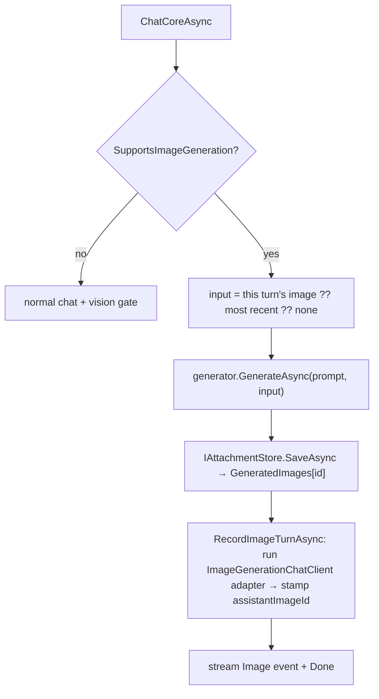

# Image generation

> Pick an image model to generate a picture from a prompt, or edit an existing image in the
> conversation. Generated images reappear when you reload. ADR 0020.

## What it is

When you pick a model declared with the `SupportsImageGeneration` capability, sending a message
**produces an image instead of a chat reply** — text-to-image, or image-to-image (edit)
against this turn's attachment, else the most recent image in the conversation. It is a
**dedicated model, not a tool** the text model calls.

## How it works

Image generation runs a **different API** (`IImageGenerationService` over the OpenAI SDK
`ImageClient`, not the chat client), so `ChatCoreAsync` branches to it **before** the vision
gate. The result is saved to the same `attachments` blob container on the assistant side, and
the turn is recorded into the session via a one-shot adapter (Agent Framework 1.13 has no
append-without-inference API). The assistant image is **id-keyed** at the message level.



### The branch runs before the vision gate

```csharp
if (_chatClientFactory.GetCapabilities(_modelId).SupportsImageGeneration)
{
    await foreach (var evt in GenerateImageTurnAsync(message, attachments))
        yield return evt;
    yield break;
}
```

### Choosing the input image and generating

```csharp
var inputRef = attachments?.FirstOrDefault(
        a => a.MediaType.StartsWith("image/", StringComparison.OrdinalIgnoreCase))
    ?? FindMostRecentImageRef();
...
var generated = await generator.GenerateAsync(message, input);
```

Bytes go to blob (reusing `IAttachmentStore`), keyed in state; the assistant turn carries only
a SAS `UriContent`:

```csharp
var reference = await _attachments.SaveAsync(ownerKey,
    "generated" + ImageMediaTypes.ExtensionFor(generated.MediaType), generated.MediaType, generated.Bytes);
_state.State.GeneratedImages[reference.Id] = reference;
...
var assistantUrl = await _attachments.GetReadUrlAsync(reference);
var assistantContents = new List<AIContent> { new UriContent(assistantUrl, reference.MediaType) };
```

### Recording the turn — one-shot adapter, then stamp the id

```csharp
await adapter.RunAsync([userMessage], adapterSession);
if (adapterSession.TryGetInMemoryChatHistory(out var messages) && messages is not null)
{
    var lastAssistant = messages.LastOrDefault(m => m.Role == ChatRole.Assistant);
    if (lastAssistant is not null)
        (lastAssistant.AdditionalProperties ??= [])[AssistantImageIdKey] = attachmentId;   // id-keyed, survives strip
}
```

The prod generator resolves inline bytes or a download URL and sniffs the real media type:

```csharp
var result = await client.GenerateImageAsync(prompt, new ImageGenerationOptions(), cancellationToken);
image = result.Value;
...
var bytes = await ResolveBytesAsync(image, cancellationToken);
return new Agent42.Agents.GeneratedImage(bytes, ImageMediaTypes.DetectMediaType(bytes));
```

Generated images ride the **same vision gate** as uploads on later turns, keyed by
`assistantImageId` rather than by message position (assistant messages are not 1:1 with turns):

```csharp
if (AssistantImageRef(message) is { } generated)
    await RehydrateAssistantImageAsync(message, generated, includeImages);
```

## How the Agent Framework fits

- Image generation uses a **different** API (`IImageGenerationService` over the SDK
  `ImageClient`), **not** the model's `IChatClient` — so it must branch before the framework
  chat call.
- To append a user+assistant pair into an `AgentSession` **without inference** (AF 1.13 has no
  such API), the code fabricates the assistant reply with a one-shot `IChatClient` adapter
  (`ImageGenerationChatClient`) and calls `ChatClientAgent.RunAsync`, letting the framework
  append both turns so the session serializes like any other turn.
- The interface is named `IImageGenerationService` (not `IImageGenerator`) to avoid a collision
  with `Microsoft.Extensions.AI.IImageGenerator`.
- The generated image is a framework `UriContent` (SAS), keeping the session small (ADR 0004).

## How Orleans fits

- Entirely inside `AgentGrain`; bytes persisted out-of-grain via `IAttachmentStore`, the
  id→ref map `GeneratedImages` lives in Orleans grain state.
- `GeneratedImage` / `ImageInput` are same-process records (grain↔generator), so plain records —
  no Orleans serializer needed.
- `SupportsImageGeneration` is resolved per-model by the factory; the generator is lazily built
  via `provider.ImageService?.Invoke(model)` → `new OpenAIImageGenerator(client.GetImageClient(model))`.

## Key files

| Concern | File |
|---------|------|
| Service abstraction | `src/Agent42.Agents/ImageGeneration/IImageGenerationService.cs` |
| Prod generator | `src/Agent42.Backend/ImageGeneration/OpenAIImageGenerator.cs` |
| One-shot adapter | `src/Agent42.Agents/ImageGeneration/ImageGenerationChatClient.cs` |
| Turn branch + recording | `src/Agent42.Agents/ImageGeneration/AgentGrain.ImageTurn.cs` (`GenerateImageTurnAsync`, `RecordImageTurnAsync`) |
| Capability wiring | `src/Agent42.Backend/Models/ChatClientFactory.cs` |
