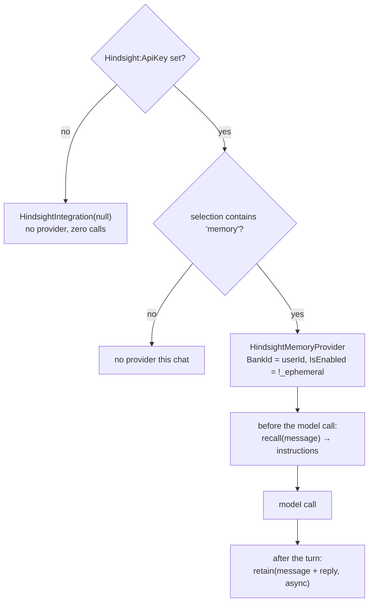

# Long-term memory

> The agent remembers facts across conversations: before each model call it recalls what it knows
> about you, and after each turn it retains what was said. Backed by Hindsight, switched on by
> the operator, selectable per user and per chat. There is **no delete path**. ADRs 0056 · 0057.

## What it is

With memory on, a chat can use things you told the agent in another chat ("my daughter is
called…", "I prefer metric units"). Memory spans all of one user's conversations. It is kept in a
per-user **bank** on the third-party Hindsight service.

Two switches control it:

1. **The operator's switch:** the `Hindsight:ApiKey` secret (`HINDSIGHT_API_KEY` in GitHub
   Actions). Without it, no provider is attached and no turn makes a single Hindsight call. This is
   the only switch that stops the egress for the whole deployment.
2. **The user's switch** (ADR 0057): `memory` is a selectable tool key at all three layers:
   Preferences → default tools, the composer's Tools popover, and a custom agent's tool set. It is
   **on** for anyone whose selection is still `null` (= all). Anyone who pressed Save before the key
   shipped has it **off** (ADR 0021).

> **Egress.** Once the key is set, every non-incognito turn with memory selected sends the user's
> message and the assistant's reply to Hindsight, and sends the message again as a recall query.
> That includes whatever the turn carried: document excerpts, a street address (ADR 0012), MCP and
> tool results. Reminder and agent-run turns are included, and they run with no user present. This is
> an ADR 0013 extension, and deliberately **not** "following ADR 0008": 0008 rejected an always-on,
> ungated provider.

> **No delete path.** Turning memory off stops future recall and retain. It does not remove what
> the bank already holds. A prompt injection that was retained is recalled into later turns.

## How it works



### Registration — the key is the switch

```csharp
var apiKey = configuration["Hindsight:ApiKey"];
if (string.IsNullOrWhiteSpace(apiKey))
{
    services.AddSingleton(new HindsightIntegration(null));   // null means "off", not "broken"
    return;
}
// ...
services.AddHttpClient(nameof(HindsightClient), http => http.Timeout = TimeSpan.FromSeconds(10))
    .RemoveAllResilienceHandlers();
```

The named client opts out of `AddServiceDefaults`' retry pipeline. `AgentGrain` is non-reentrant,
so retries against a stalled Hindsight would stall the user's turn several times over.
`Hindsight:Mission` (committed, empty by default) creates the bank with a mission on first use.
`Hindsight:BaseAddress` overrides the Hindsight cloud, for example for a self-hosted server.

There is deliberately no Agent42 port over the package: its `IHindsightClient` already is the seam,
faked in tests (`RecordingHindsightClient`). Agent42 adds only
`record HindsightIntegration(IHindsightClient? Client, string? Mission)`.

### The provider — built per chat, gated per turn

```csharp
private HindsightMemoryProvider? BuildMemoryProvider(ISet<string> enabled)
{
    if (_memory.Client is null || !enabled.Contains(ToolCatalog.Memory))
    {
        return null;
    }

    return new HindsightMemoryProvider(
        _memory.Client,
        new HindsightOptions
        {
            BankId = UserIdFromGrainKey(this.GetPrimaryKeyString()),
            Mission = _memory.Mission,
            IsEnabled = () => !_ephemeral,
        });
}
```

- **The operator gate is checked first.** With no key, the selection doesn't matter.
- **`IsEnabled` is a delegate**, read on every call. An incognito turn (ADR 0034) on a chat whose
  agent was built earlier makes zero calls, and the next normal turn resumes memory.
  `MemoryResumes_OnTheNormalTurnAfterAnEphemeralOne` is the test that catches a captured value.
- **The bank is the user id**, read from the grain key rather than `_userId`, so it doesn't depend
  on the order in which `OnActivateAsync` assigns fields.

`BuildAgent` adds it to the context providers after skills and document RAG:

```csharp
if (BuildMemoryProvider(enabled) is { } memoryProvider)
{
    contextProviders.Add(memoryProvider);
}
```

### Where memory is never attached

| Case | Why |
|------|-----|
| Incognito turn | `IsEnabled = () => !_ephemeral` |
| Image-generation turn | Recorded through a separate one-shot agent with no context providers |
| An agent called over MCP (`/api/agent-mcp`, ADR 0070) | `WithoutMemoryOrPush` removes the key: a key holder must not read or write the owner's bank |
| An agent chat bound before the key shipped | The bind snapshot is immutable (ADR 0003), so memory stays off. It fails safe. A continuous agent can only be reset by deleting its chat |

Memory is **not** intersected with model capability: a text-only model with `memory` selected still
gets it, because it is a context provider, not a tool. It is the only selectable key with that
exemption.

## How the Agent Framework fits

- `HindsightMemoryProvider` (from the `Hindsight.AgentFramework.Net` package, namespace
  `Hindsight.AgentFramework`) is an Agent Framework `AIContextProvider`. Before each model call it
  recalls from the bank and adds the result to the model's **instructions**, not to the session, so
  recalled text never enters the 2 MB session item (ADR 0004). After the turn it retains the
  exchange with `async: true`, so Hindsight extracts facts server-side without holding up the turn.
- Unlike RAG (ADR 0008), which runs only when the chat has documents, memory has no per-chat
  gate: with memory selected, every turn recalls and retains.

## How Orleans fits

- Nothing is stored in Orleans: the bank lives at Hindsight, keyed by the user id taken from the
  `AgentGrain` key `{userId}/{conversationId}`.
- The per-turn `_ephemeral` flag is a turn-scoped grain field. It is cleared in `ChatAsync`'s
  `finally` and reset on `EnqueuePromptAsync` and `ReceiveReminder` (both always persist), which is
  what keeps a later turn from inheriting "incognito".

## Configuration health

`/api/config-health` reports `Hindsight:ApiKey` as present ("configured; each user selects it per
chat") or missing ("off; the agent recalls and retains nothing"). It never shows the value.

## Key files

| Concern | File |
|---------|------|
| Registration (key, client, no retries) | `src/Agent42.Backend/Memory/HindsightRegistration.cs` |
| Integration record | `src/Agent42.Agents/Memory/HindsightIntegration.cs` |
| Provider construction | `src/Agent42.Agents/Memory/AgentGrain.Memory.cs` (`BuildMemoryProvider`) |
| Attachment | `src/Agent42.Agents/Tools/AgentGrain.BuildAgent.cs` |
| Selectable key | `src/Agent42.Agents/Tools/ToolCatalog.cs` (`Memory`) |
| MCP exclusion | `src/Agent42.Backend/Mcp/AgentMcpRunner.cs` (`WithoutMemoryOrPush`) |
| Health check | `src/Agent42.Backend/Configuration/ConfigHealth.cs` |
| Tests | `tests/Agent42.Tests/HindsightRegistrationTests.cs`, `RecordingHindsightClient.cs`, `AgentGrainTests.cs` |
| Package source | https://github.com/Expecho/Hindsight.AgentFramework.Net |
