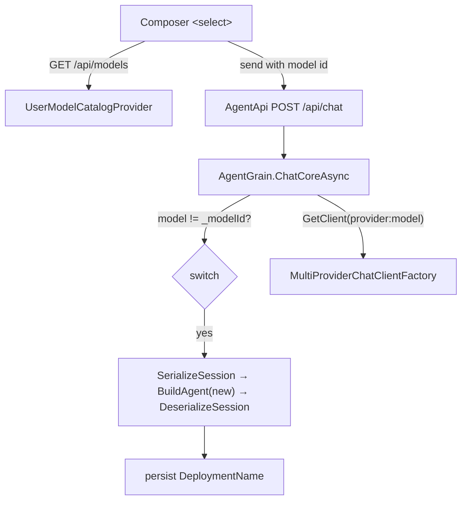

# Model picker

> Choose which model answers a conversation, and switch models mid-conversation without losing
> history.

## What it is

A grouped `<select>` in the composer lets you pick which model answers. You can switch
mid-conversation and the history carries over onto the new model. Models are named by a
qualified `provider:model` id; the catalog comes from your configured providers (see
[Bring your own models](bring-your-own-models.md)).

## How it works

Switching a model means building a **new** `ChatClientAgent` on the new client and migrating
the Agent Framework session across it. The selected model is durable grain state, so a resumed
conversation comes back on the model it was last using.



### Switching mid-conversation

Inside `ChatCoreAsync`, when the incoming model differs from the bound one, the grain
snapshots the session, rebuilds the agent on the new client, and restores the session so
history carries over. A downgrade to a no-tools model strips tool history so it isn't replayed
to a model that can't handle it:

```csharp
if (!string.IsNullOrWhiteSpace(model) && model != _modelId)
{
    var snapshot = await _agent.SerializeSessionAsync(_session);
    _modelId = model;
    _state.State.DeploymentName = model;
    _agent = BuildAgent(model);
    _session = await _agent.DeserializeSessionAsync(snapshot);

    if (!_chatClientFactory.GetCapabilities(model).SupportsTools)
        StripToolHistory();   // avoid replaying tool content to a no-tools model
}
```

The same snapshot→rebuild→restore dance is factored into `RebindModelAsync`, reused when a
provider is configured after activation and on the reminder path — so the model-resolution
logic is single-sourced across the live, background, and reminder paths.

### Resolving `provider:model`

The id is split on the **first** colon; a bare id (no colon) is a legacy id resolved against
the default provider:

```csharp
public static (string Provider, string Model) Parse(string id, string defaultProvider)
{
    var separator = id.IndexOf(':');
    return separator <= 0 ? (defaultProvider, id) : (id[..separator], id[(separator + 1)..]);
}
public static string Qualify(string provider, string model) => $"{provider}:{model}";
```

The factory resolves the id to a real provider, caching one client per qualified id, and
**falls back** to the default rather than throwing if the provider has left config:

```csharp
public IChatClient GetClient(string? modelId) =>
    _providers.Count == 0 ? NoModelChatClient.Instance : _clients.GetOrAdd(Resolve(modelId).QualifiedId, Build);

private (Provider Provider, string Model, string QualifiedId) Resolve(string? modelId)
{
    var id = string.IsNullOrWhiteSpace(modelId) ? DefaultModelId : modelId;
    var (providerKey, model) = ModelId.Parse(id, _defaultProvider);
    if (_providers.TryGetValue(providerKey, out var provider))
        return (provider, model, ModelId.Qualify(providerKey, model));
    // provider gone → fall back to default rather than throw
    var (defaultProviderKey, defaultModel) = ModelId.Parse(DefaultModelId, _defaultProvider);
    return (_providers[defaultProviderKey], defaultModel, DefaultModelId);
}
```

### The endpoints

```csharp
app.MapGet("/api/conversations/{conversationId}/model", async (string conversationId, IGrainFactory grains, HttpContext http) =>
    Results.Json(await grains.GetGrain<IAgentGrain>(AgentKey(http.GetUserId(), conversationId)).GetSelectedModelAsync()));

app.MapGet("/api/models", async (IUserModelCatalogProvider catalogs, HttpContext http, CancellationToken ct) =>
    await (await catalogs.GetForUserAsync(http.GetUserId(), ct)).GetAsync(ct));
```

The browser fills a grouped `<select>` (one `optgroup` per provider). Models are **grouped by
provider key** (ids are qualified by it), but each group is **labelled with the provider's display
name** (`ModelInfo.ProviderDisplayName`, from `StoredProvider`/`ProviderOptions.DisplayName`),
falling back to the raw key when a provider declares none — one shared `providerGroupLabel(m)` helper
feeds every provider-grouped select. An **agent chat** sends `model: null` (pinned server-side at
bind time) while a normal chat sends the picker's value.

## How the Agent Framework fits

- A `ChatClientAgent` is bound to exactly **one** `IChatClient` at construction. Switching
  models therefore means building a **new** `ChatClientAgent` and migrating the `AgentSession`
  across it via `SerializeSessionAsync` / `DeserializeSessionAsync`. The session is portable
  across agent instances — that portability is what makes mid-conversation switching preserve
  history.
- Model capability (`GetCapabilities`) drives which framework tools the new agent gets
  (function schema, hosted tools, vision gating).

## How Orleans fits

- The selected model is durable grain state — `AgentGrainState.DeploymentName`, a qualified
  `provider:model` id — written on every switch and read back into `_modelId` on activation.
- Per-user provider overlays are themselves Orleans grains, resolved per user by
  `UserModelCatalogProvider` / `UserChatClientFactoryProvider`, so a newly added provider shows
  up in the picker with no restart.
- Reminder-fired and background turns rebind to the default model through the same
  `RebindModelAsync`, keeping model resolution consistent across live, background, and reminder
  paths.

## Key files

| Concern | File |
|---------|------|
| Switch / rebind | `src/Agent42.Agents/Conversations/AgentGrain.cs` (`ChatCoreAsync`, `RebindModelAsync`) |
| Selected model state | `src/Agent42.Agents/Conversations/AgentGrainState.cs` (`DeploymentName`) |
| Id parsing | `src/Agent42.Backend/Models/ModelProviderOptions.cs` |
| Client resolution | `src/Agent42.Backend/Models/ChatClientFactory.cs` |
| Catalog | `src/Agent42.Backend/Models/ModelCatalog.cs`, `UserModelCatalogProvider.cs` |
| Endpoints / frontend | `src/Agent42.Backend/Models/AgentApi.Models.cs`, `wwwroot/js/models.js` |
