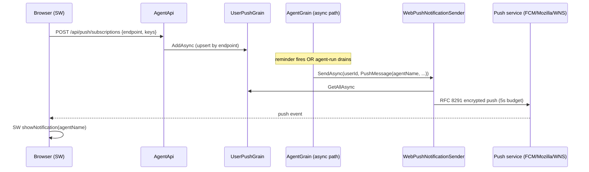

# Push notifications

> A Web Push notification, titled with the agent's name, when an agent finishes a reply while
> you're away (e.g. a fired reminder or an external run). ADR 0028. Installed Android/Chromium
> PWA only.

## What it is

When an agent finishes a reply on an **asynchronous** path — a fired reminder or an external
agent-run — and you're not watching, a Web Push notification titled with the agent's name is
delivered to your installed PWA. Tapping it opens the conversation.

## How it works

"Not online" is approximated by **one fact**: the app sends only on the two async paths, never
from the live stream (`ChatCoreAsync`) you're already watching. A server-side presence
heartbeat was considered and rejected.



### The send lives in the async callers only

Inside `EnqueuePromptAsync`'s `try` after the drain, gated on `_modelId` (so the no-model path
doesn't fire a false push), and after `ReceiveReminder`'s `WriteStateAsync`:

```csharp
if (!string.IsNullOrEmpty(_modelId))
{
    await SendAwayReplyPushAsync();
}
```

```csharp
private Task SendAwayReplyPushAsync() =>
    _pushSender.SendAsync(
        _userId,
        new PushMessage(
            _state.State.AgentName ?? "Agent 42",
            "Replied while you were away.",
            ConversationIdFromGrainKey(this.GetPrimaryKeyString())));
```

### Bounded, best-effort fan-out that prunes dead subscriptions

```csharp
using var budget = CancellationTokenSource.CreateLinkedTokenSource(cancellationToken);
budget.CancelAfter(SendBudget);
await Task.WhenAll(subscriptions.Select(
    subscription => SendOneAsync(grain, subscription, payload, budget.Token)));
```

```csharp
catch (PushDeliveryException ex) when (ex.StatusCode is 404 or 410)
{
    await grain.RemoveAsync(subscription.Endpoint);   // dead subscription pruned
}
```

### The VAPID key is optional

No private key → app boots, `GET /api/push/config` returns `enabled:false`, the UI hides the
toggle:

```csharp
var pushEnabled = !string.IsNullOrWhiteSpace(vapidPrivateKey) && !string.IsNullOrWhiteSpace(vapidPublicKey);
builder.Services.AddSingleton(new PushConfig(pushEnabled, vapidPublicKey, vapidSubject));
if (pushEnabled)
{
    builder.Services.AddHttpClient(WebPushClientAdapter.HttpClientName, http =>
        http.Timeout = WebPushNotificationSender.SendBudget)
        .RemoveAllResilienceHandlers();   // non-reentrant grain: no retry quadrupling
    // ... real sender
}
else { builder.Services.AddSingleton<IPushNotificationSender, NullPushNotificationSender>(); }
```

### The service worker always shows the notification

No suppress-if-focused — that would violate Chromium's `userVisibleOnly` budget contract and
risk subscription revocation:

```javascript
self.addEventListener("push", (event) => {
  let data = {};
  try { data = event.data ? event.data.json() : {}; } catch { data = {}; }
  const title = data.title || "Agent 42";
  event.waitUntil(
    self.registration.showNotification(title, {
      body: data.body || "",
      icon: "/icons/icon-192.png",
      badge: "/icons/icon-192.png",
      data: { conversationId: data.conversationId || "" },
    }));
});
```

## How the Agent Framework fits

- Indirect: the push fires only **after** an Agent-Framework turn (the `ChatClientAgent` run)
  completes and is persisted. The framework isn't in the send path itself; the invariant is
  *where* the send sits relative to the agent run — async callers only.

## How Orleans fits

- `IUserPushGrain` (state `push-subs`, shared `agent-state` provider, keyed by user id) holds a
  per-device subscription collection — deliberately not in the scalar `UserProfile`.
- The send runs **inside a non-reentrant `AgentGrain` activation**, which is why the sender
  bounds a 5s `SendBudget` and calls `RemoveAllResilienceHandlers()`.
- The sender POSTs to the browser-supplied subscription endpoint — an accepted **blind-SSRF**
  property of Web Push (authenticated, encrypted body, no response returned), deliberately not
  host-guarded.
- **Egress note:** the notification transits a third-party push service, but the payload is RFC
  8291 end-to-end encrypted — a materially smaller egress than picking a third-party model
  (though the title is the user-chosen agent name).

## Key files

| Concern | File |
|---------|------|
| Sender interface | `src/Agent42.Agents/Push/IPushNotificationSender.cs`, `NullPushNotificationSender.cs` |
| Subscription grain | `src/Agent42.Agents/Push/UserPushGrain.cs` |
| Web Push sender | `src/Agent42.Backend/Push/WebPushNotificationSender.cs`, `WebPushClientAdapter.cs` |
| Send call sites | `src/Agent42.Agents/Push/AgentGrain.Push.cs` (`SendAwayReplyPushAsync`) |
| Endpoints / SW | `src/Agent42.Backend/Push/AgentApi.Push.cs`, `wwwroot/sw.js`, `wwwroot/app.js` |
