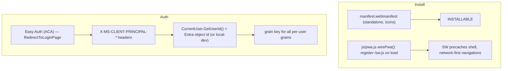

# PWA install & sign-in

> Install Agent42 as an app, and sign in with single sign-on (Entra ID) in production. ADR 0002.

## What it is

- **Install as an app** — Agent42 installs as a PWA (standalone window, home-screen icon),
  which is also the prerequisite for [push notifications](push-notifications.md) and the
  [Android Share sheet](android-share-target.md).
- **Sign-in** — single sign-on with Entra ID in production; the signed-in principal's object id
  is the isolation boundary for all per-user state.

## How it works

The manifest makes the app installable and a service worker caches an app shell. Auth is Azure
Container Apps **Easy Auth** sitting in front of the app — the identity arrives as request
headers, and its object id becomes the Orleans grain key for everything per-user.



### Service worker registration and navigation

```javascript
if ("serviceWorker" in navigator) {
  window.addEventListener("load", () => {
    navigator.serviceWorker.register("/sw.js").catch((err) =>
      console.warn("Service worker registration failed", err));
  });
}
```

Navigations are **network-first** so the Easy Auth 302 always reaches the network (cached shell
only when offline):

```javascript
if (req.mode === "navigate") {
  // Network-first: lets the Easy Auth 302 through; cached shell only when offline.
  event.respondWith(fetch(req).catch(() => caches.match("/index.html")));
  return;
}
```

The shell cache name is versioned (`agent42-shell-v9`) and bumped per shell change, so returning
users pick up new assets and old caches are cleaned on `activate`.

### Identity from Easy Auth headers, with a local-dev fallback

```csharp
public static string GetUserId(this HttpContext http)
    => http.Request.Headers.ResolveUserId();

private static string ResolveUserId(this IHeaderDictionary headers)
    => headers.TryGetValue(PrincipalIdHeader, out var id) && !string.IsNullOrWhiteSpace(id)
        ? id.ToString()
        : LocalDevelopmentUserId;   // "local-dev" — DevHost / standalone has no Easy Auth
```

```csharp
private const string PrincipalIdHeader = "X-MS-CLIENT-PRINCIPAL-ID";
private const string PrincipalNameHeader = "X-MS-CLIENT-PRINCIPAL-NAME";
private const string PrincipalIdpHeader = "X-MS-CLIENT-PRINCIPAL-IDP";
private const string PrincipalBlobHeader = "X-MS-CLIENT-PRINCIPAL";
```

The ingress strips inbound `X-MS-CLIENT-*` headers, so inside the app they can only come from
Easy Auth. Claims (email/name/roles) are parsed from the base64 JSON `X-MS-CLIENT-PRINCIPAL`
blob defensively (never throws). Locally there is no Easy Auth, so every request maps to the
single `local-dev` pseudo-user — which is exactly why the MCP-OAuth and Share endpoints must
stay **behind** Easy Auth (an `excludedPaths` carve-out would bind to `local-dev`).

### A second Entra account (ADR 0074)

`Identity:Aliases` is a committed config map from an additional Entra object id to the object id
that owns the data. `ResolveUserId` applies it for both grain keying and telemetry `user.id`, so
two accounts see one set of conversations. No data moves. This is an authorization grant: an alias
gets full access to the owner's data. Sign-in is invite-only (ADR 0121): "assignment required" on the enterprise app is the one allowlist, and guests from
other organisations are invited and assigned, so an alias
may only ever link accounts listed in `Access:Owners` (pinned by `UserIdAliasTests`). Owners are the people who also reach
`/dashboard`, `/logs` and config health; that tier is advisory, not a boundary.

## How the Agent Framework fits

- None directly — auth and the PWA shell are orthogonal to the agent runtime; they gate access
  to the endpoints that drive it.

## How Orleans fits

- `GetUserId()` — the Entra object id, or `local-dev` — is the **string grain key** for every
  per-user grain (`IUserProfileGrain`, `IUserProviderConfigGrain`, `IUserMcpConfigGrain`,
  `IUserPushGrain`, `IUserMcpOAuthPendingGrain`) and prefixes conversation `AgentGrain` keys. So
  Easy Auth identity is what isolates one user's Orleans state from another's.

## Key files

| Concern | File |
|---------|------|
| Manifest | `src/Agent42.Backend/wwwroot/manifest.webmanifest` |
| Service worker | `src/Agent42.Backend/wwwroot/sw.js` |
| SW registration | `src/Agent42.Backend/wwwroot/js/pwa.js` (`wirePwa`, called from `main.js`) |
| Identity | `src/Agent42.Backend/Api/CurrentUser.cs` |
