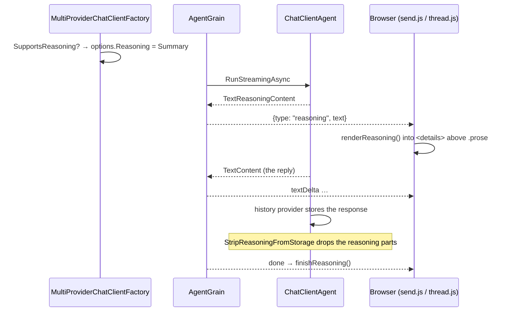

# Reasoning output

> A reasoning model's "thinking" streams into a collapsed section above the reply. It is shown
> live only: never saved, never replayed, never spoken. ADR 0071.

## What it is

When a model reasons before it answers, the reply bubble gets a collapsed **Thinking…** section
above the answer text that fills in as the model thinks. When the turn ends, the summary changes
to **Thought process** and stays collapsed. Reload the chat and the section is gone: only the
answer is part of the conversation.

A model is declared a reasoning model with the **reasoning** checkbox in the provider editor
(Preferences → model providers). The checkbox makes Agent42 *ask* for reasoning. It does not
gate the display: a model that reasons without being ticked still shows its thinking.

## How it works



### Asking for reasoning

The factory adds reasoning options only for a model declared `SupportsReasoning`:

```csharp
if (Provider.RequestsReasoning(provider.Options, model))
{
    builder = builder.ConfigureOptions(options =>
        options.Reasoning ??= new ReasoningOptions { Output = ReasoningOutput.Summary });
}
```

On the Responses API (ADR 0033) this becomes `"reasoning": {"summary": "concise"}` in the
request. On Chat Completions it changes nothing in the request: providers there (DeepSeek, for
example) send `reasoning_content` unasked.

### Projecting it onto the stream

The grain maps the framework's `TextReasoningContent` to its own event, on the same `Text` field
as a text delta. It is never appended to the `reply` text, so follow-ups (ADR 0036) and voice
(ADR 0037) never see it:

```csharp
case TextReasoningContent reasoning when !string.IsNullOrEmpty(reasoning.Text):
    return new AgentStreamEvent(AgentStreamEventType.Reasoning, Text: reasoning.Text);
```

### Keeping it out of storage

Agent Framework stores reasoning in the session by default. This was measured on both the
streaming and the `RunAsync` path. So the history provider gets a response-side storage filter:

```csharp
ChatHistoryProvider = new InMemoryChatHistoryProvider(new InMemoryChatHistoryProviderOptions
{
    StorageInputRequestMessageFilter = ExcludeInjectedContextMessages,
    StorageInputResponseMessageFilter = StripReasoningFromStorage,
}),
```

`StripReasoningFromStorage` removes every `TextReasoningContent` part. A message that had nothing
else is dropped instead of being stored empty. A message that was already empty passes through
untouched. This keeps reasoning out of the 2 MB session item (ADR 0004) and out of every later
request to the model.

### Rendering

`send.js` routes `reasoning` chunks to `renderReasoning`, and deliberately not to the voice
loop. `renderReasoning` (`thread.js`) creates `<details class="msg__thinking">` above the `.prose`
element on the first chunk and appends text with `textContent`, never `innerHTML`.
`finishReasoning` settles it, both on `done` and in the `finally` that also covers stop, stream
recovery and errors. The tool-call group (ADR 0072) settles in the same two places.

## How the Agent Framework fits

- Reasoning arrives as `Microsoft.Extensions.AI.TextReasoningContent` in the
  `AgentResponseUpdate` stream, from both the Chat Completions (`reasoning_content`) and the
  Responses clients. `ReasoningStreamTests` pins that it survives the `AsIChatClient()` adapter.
- `ChatOptions.Reasoning` (`ReasoningOptions { Output = Summary }`) is what turns it on for
  Responses. `includeReasoningEncryptedContent` is not the switch and stays `false`.
- The storage filter hooks the framework's `InMemoryChatHistoryProvider`, the component that
  decides what enters the serialized session.

## How Orleans fits

- `SupportsReasoning` is a trailing `[Id(7)]` field with a default on the stored model in the
  per-user provider overlay (`UserProviderConfig`), so older overlays read it as `false` with no
  migration.
- Nothing about reasoning reaches grain state: the grain streams it and the strip keeps it out
  of `SerializedSession`.

## Key files

| Concern | File |
|---------|------|
| Request option | `src/Agent42.Backend/Models/ChatClientFactory.cs` (`Build`, `Provider.RequestsReasoning`) |
| Model flag | `src/Agent42.Backend/Models/ModelProviderOptions.cs`, `src/Agent42.Agents/Models/UserProviderConfig.cs` |
| Stream projection + strip | `src/Agent42.Agents/Conversations/AgentGrain.cs` (`StripReasoningFromStorage`) |
| Filter wiring | `src/Agent42.Agents/Tools/AgentGrain.BuildAgent.cs` |
| Event type | `src/Agent42.Agents/Conversations/AgentStreamEvent.cs` |
| Frontend | `src/Agent42.Backend/wwwroot/js/send.js`, `thread.js` (`renderReasoning`, `finishReasoning`), `providers.js` (checkbox) |
| Tests | `tests/Agent42.Tests/ReasoningStreamTests.cs`, `StreamingEmptyChoicesTests.cs` |
