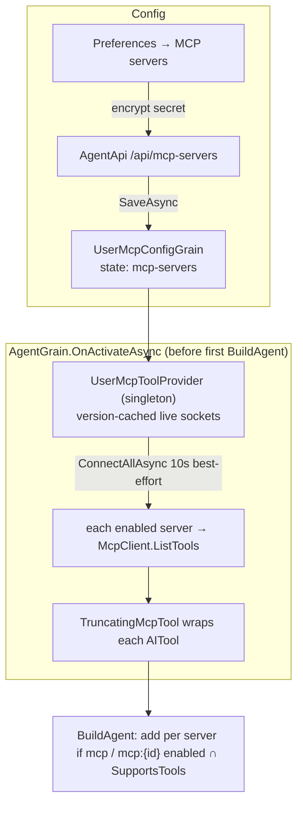

# Remote MCP servers

> Connect your own remote HTTP MCP servers; their tools become available to the agent with no
> extra setup. ADRs 0024 · 0025 · 0026.

## What it is

A signed-in user adds remote HTTP **MCP (Model Context Protocol)** servers in
**Preferences → MCP servers**. Their tools appear to the agent with **no per-server code** —
every MCP server speaks the same discovery protocol, and its tools convert to `AITool`. Auth
options: **none**, a **static header**, **client-credentials** (MSAL), or an **interactive
OAuth** sign-in flow. Secrets are stored encrypted. Each server can be turned on/off
individually in the tool picker.

## How it works

It is the MCP analogue of [user-configurable model providers](bring-your-own-models.md): a
per-user overlay grain holds the config, a singleton tool provider connects to enabled servers
(caching **live sockets** by version), and `AgentGrain` resolves the tools once on activation.



### Tools merged per server

```csharp
if (capabilities.SupportsTools)
{
    foreach (var server in _mcpServers)
    {
        if (ToolCatalog.IsMcpServerEnabled(server.ServerId, enabled))
        {
            tools.AddRange(server.Tools);
        }
    }
}
```

Per-server gate — the bare `mcp` key is a **wildcard** ("all servers"), or an explicit
`mcp:{id}`:

```csharp
public static bool IsMcpServerEnabled(string serverId, ISet<string> enabled)
    => enabled.Contains(Mcp) || enabled.Contains(McpServerKey(serverId));
```

### Version-cached provider holding live sockets

```csharp
var version = await _grains.GetGrain<IUserMcpConfigGrain>(userId).GetVersionAsync();
var cache = _caches.GetOrAdd(userId, _ => new UserCache());
await cache.Gate.WaitAsync(cancellationToken);
try
{
    if (cache.TryGet(version, out var hit)) return hit;
    var config = await _grains.GetGrain<IUserMcpConfigGrain>(userId).GetAsync();
    var (servers, connections) = await ConnectAllAsync(userId, config, cancellationToken);
    var set = new McpToolSet(servers, version);
    cache.Store(version, set, connections);
    await cache.EvictBeyondAsync(RetainedVersionsPerUser, _logger);
    return set;
}
```

### Tools convert to `AITool` via the SDK

The MCP SDK returns each tool as an `AIFunction`, so they cast straight to `AITool` — no
adapter is needed to merge them:

```csharp
var client = await McpClient.CreateAsync(transport, loggerFactory: _loggerFactory, cancellationToken: cancellationToken);
var tools = await client.ListToolsAsync(cancellationToken: cancellationToken);
IReadOnlyList<AITool> raw = [.. tools.Cast<AITool>()];
return new McpServerConnection(raw, client);
```

Each tool is wrapped in a `TruncatingMcpTool : DelegatingAIFunction` — forwarding
Name/Description/JsonSchema unchanged so the model's view is identical, bounding only the
**return value** (it's persisted into the 2 MB session).

### Auth staging

- **Header** auth rides `AdditionalHeaders` (no `DelegatingHandler`, so it doesn't inherit the
  resilience pipeline):

```csharp
if (mode == McpAuthMode.Header && ...)
{
    options.AdditionalHeaders = new Dictionary<string, string>
    {
        [server.HeaderName] = secrets.HeaderValue,
    };
}
```

- **Interactive OAuth** (ADR 0025) is an app-driven authorization-code + PKCE flow with PRM
  discovery across `GET /api/mcp/oauth/start` + `/callback` (both **behind Easy Auth**); tokens
  are persisted encrypted and refreshed at connect. The SDK's own OAuth is not used (its
  redirect delegate blocks). Manual prereq: register the callback URI in each provider's app
  registration.

## How the Agent Framework fits

- MCP tools arrive from the SDK as `AIFunction`s and merge directly into the `List<AITool>` that
  `BuildAgent` hands to `ChatClientAgent`'s `ChatOptions.Tools`.
- `TruncatingMcpTool` is a `DelegatingAIFunction`, so the framework treats it exactly like any
  other function — only the tool result is bounded.

## How Orleans fits

- `IUserMcpConfigGrain` (state `mcp-servers`) and `IUserMcpOAuthPendingGrain` (state
  `mcp-oauth-pending`) ride the shared `agent-state` provider, keyed by user id — no new Cosmos
  container.
- `IUserMcpToolProvider` is a **singleton** (not a grain) holding live sockets, invalidated by
  the grain's monotonic `Version`; it retains the last two versions per user and disposes older
  connections on eviction.
- Because `AgentGrain` is non-reentrant, resolution happens **once in `OnActivateAsync`**, before
  the first `BuildAgent`.
- The endpoint is deliberately **not SSRF-guarded** — it's the user's own config (may be
  `localhost`), not a model-supplied request.

## Key files

| Concern | File |
|---------|------|
| Stored config + grain | `src/Agent42.Agents/Mcp/UserMcpConfig.cs`, `UserMcpConfigGrain.cs` |
| Tool provider | `src/Agent42.Backend/UserMcpToolProvider.cs`, `McpConnectionFactory.cs` |
| Encryption | `src/Agent42.Backend/McpSecretProtector.cs` |
| Auth | `src/Agent42.Backend/McpAuthHeader.cs`, `McpOAuth.cs` |
| Endpoints | `src/Agent42.Backend/AgentApi.cs` (`/api/mcp-servers`, `/api/mcp/oauth/*`) |
