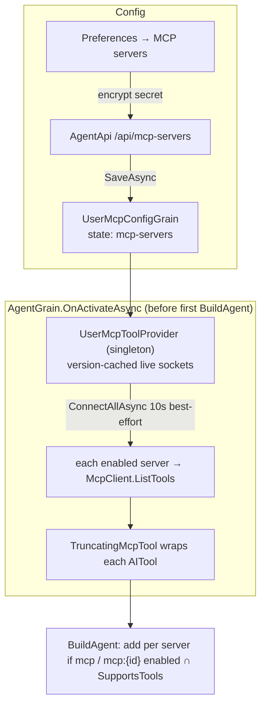
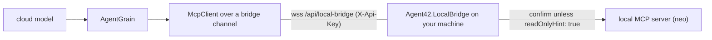
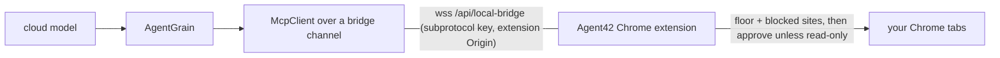

# Remote MCP servers

> Connect your own remote HTTP MCP servers; their tools become available to the agent with no
> extra setup. ADRs 0024 · 0025 · 0026 · 0076.

## What it is

A signed-in user adds remote HTTP **MCP (Model Context Protocol)** servers in
**Preferences → MCP servers**. Their tools appear to the agent with **no per-server code** —
every MCP server speaks the same discovery protocol, and its tools convert to `AITool`. Auth
options: **none**, a **static header**, **client-credentials** (MSAL), or an **interactive
OAuth** sign-in flow — or a **local bridge** for a server that runs only on your own machine.
Secrets are stored encrypted. Each server can be turned on/off
individually in the tool picker.

## How it works

It is the MCP analogue of [user-configurable model providers](bring-your-own-models.md): a
per-user overlay grain holds the config, a singleton tool provider connects to enabled servers
(caching **live sockets** by version), and `AgentGrain` resolves the tools once on activation.



### Tools merged per server

```csharp
if (capabilities.SupportsTools)
{
    foreach (var server in _mcpServers)
    {
        if (ToolCatalog.IsMcpServerEnabled(server.ServerId, enabled))
        {
            tools.AddRange(server.Tools);
        }
    }
}
```

Per-server gate — the bare `mcp` key is a **wildcard** ("all servers"), or an explicit
`mcp:{id}`:

```csharp
public static bool IsMcpServerEnabled(string serverId, ISet<string> enabled)
    => enabled.Contains(Mcp) || enabled.Contains(McpServerKey(serverId));
```

### Version-cached provider holding live sockets

```csharp
var version = await _grains.GetGrain<IUserMcpConfigGrain>(userId).GetVersionAsync();
var cache = _caches.GetOrAdd(userId, _ => new UserCache());
await cache.Gate.WaitAsync(cancellationToken);
try
{
    if (cache.TryGet(version, out var hit)) return hit;
    var config = await _grains.GetGrain<IUserMcpConfigGrain>(userId).GetAsync();
    var (servers, connections) = await ConnectAllAsync(userId, config, cancellationToken);
    var set = new McpToolSet(servers, version);
    cache.Store(version, set, connections);
    await cache.EvictBeyondAsync(RetainedVersionsPerUser, _logger);
    return set;
}
```

### Tools convert to `AITool` via the SDK

The MCP SDK returns each tool as an `AIFunction`, so they cast straight to `AITool` — no
adapter is needed to merge them:

```csharp
var client = await McpClient.CreateAsync(transport, loggerFactory: _loggerFactory, cancellationToken: cancellationToken);
var tools = await client.ListToolsAsync(cancellationToken: cancellationToken);
IReadOnlyList<AITool> raw = [.. tools.Cast<AITool>()];
return new McpServerConnection(raw, client);
```

Each tool is wrapped in a `TruncatingMcpTool : DelegatingAIFunction` — forwarding
Name/Description/JsonSchema unchanged so the model's view is identical, bounding only the
**return value** (it's persisted into the 2 MB session).

### Auth staging

- **Header** auth rides `AdditionalHeaders` (no `DelegatingHandler`, so it doesn't inherit the
  resilience pipeline):

```csharp
if (mode == McpAuthMode.Header && ...)
{
    options.AdditionalHeaders = new Dictionary<string, string>
    {
        [server.HeaderName] = secrets.HeaderValue,
    };
}
```

- **Interactive OAuth** (ADR 0025) is an app-driven authorization-code + PKCE flow with PRM
  discovery across `GET /api/mcp/oauth/start` + `/callback` (both **behind Easy Auth**); tokens
  are persisted encrypted. The SDK's own OAuth is not used (its redirect delegate blocks). Manual
  prereq: register the callback URI in each provider's app registration.
- **Refresh is per request** (ADR 0081, replacing 0025's connect-time refresh). An
  `InteractiveOAuthTokenProvider` feeds the bearer to `AuthHeaderHandler` on every request; on a 401
  it re-resolves once and resends. `McpOAuthTokenResolver` single-flights refreshes per (user,
  server) and writes the new tokens with a compare-and-swap `RecordOAuthTokensAsync` that never
  bumps the overlay version (so a refresh never drops live sockets). Only `invalid_grant` means
  "sign in again": the stream then emits a live-only `McpReauthRequired` event and the transcript
  shows a **Reconnect** button that opens the OAuth flow in a new tab.

### Test a connection (ADR 0064/0069)

`POST /api/mcp-servers/{id}/test` (`McpConnectionTester`) connects to one stored server, lists its
tools, records their names, and disconnects. It runs from the dialog's **Test** button, after a
successful save, and on the OAuth return. `GET /api/tools` still never connects (ADR 0058); the
test is the user-pressed exception. A test that finds at least one tool calls
`InvalidateToolCacheAsync`, which bumps the overlay version so warm chats pick up the new tool set.
A failed or zero-tool test changes nothing.

### Links from a server's results can be fetched (ADR 0067)

`StoredMcpServer.SeedsFetchableUrls` is a per-server opt-in, off by default ("let links from this
server be opened and read"). When on, `UrlHarvestingMcpTool` harvests http(s) URLs from that
server's tool results into `AgentGrainState.SeededFetchableUrls` (20 per result, 100 total, oldest
dropped first), and `read_web_document` accepts them like URLs the user typed.

### A server can ask the user for input (ADR 0095)

Agent42 declares MCP elicitation (form and URL mode). When a server asks for input during a tool call, an open
chat shows a dialog: either a form built from the server's schema, or a link to open. The link opens only on a
click and shows its host. The answer goes back to the server, and the call carries on. A run with nobody to ask
(background, reminder, agent-run, Copilot, or a browser that didn't advertise it) answers `cancel`. A remote
server's request is shown only when no other call to that server is in flight; when calls overlap it is
`cancel`. Elicitations from a local-bridge server always route exactly.

## Local bridge (a server on your own machine)

ADR 0076. Some MCP servers — BrowserOS neo, which drives your signed-in browser — listen only on
`127.0.0.1`, where production cannot reach them, and neo refuses any request that carries an `Origin`,
so a browser tab cannot relay either. Choose **Local bridge** as the auth mode instead:

1. Save the server (no endpoint). The dialog shows a **bridge key once** and the command to run.
2. Download the helper for your platform from the
   [GitHub Releases](https://github.com/Expecho/Agent42/releases?q=local-bridge&expanded=true)
   (`agent42-local-bridge-<version>-<platform>` — Windows, macOS and Linux, x64 and arm64). It is a single
   self-contained executable: **no .NET install needed**. It is not code-signed, so Windows SmartScreen
   asks you to confirm (*More info → Run anyway*) and on macOS you run
   `xattr -d com.apple.quarantine Agent42.LocalBridge` once. `SHA256SUMS.txt` sits next to the downloads.
3. On your computer, set `AGENT42_BRIDGE_KEY` to that key and run
   `./Agent42.LocalBridge --server https://chat.agent42.nl`
   (`--upstream <url>` if your server is not on `http://127.0.0.1:9210/mcp`; see
   `chrome://browseros/mcp`; `--auto-approve tool,tool` to skip prompts for named tools; `--yolo` to skip **every** prompt,
   including for tools that run JavaScript in your signed-in browser; `--version`).
   From a checkout, `dotnet run --project tools/Agent42.LocalBridge -- --server …` does the same.
4. Press **Test** — it reports the tool count, or "local bridge not connected" while the helper is off.



The helper dials **out**, so nothing on your machine is exposed. Before relaying any tool call that the
server has not declared read-only it **asks you in its console**, showing the full (sanitized) arguments;
declining, not answering within 60 s, or arguments too large to review all return an error result the
model can read. Answer `a` / `always` to allow that tool for the rest of the helper's session
(ADR 0076); anything that is not an exact allow word denies. Read-only tools — page text, screenshots, **browsing history** — run without asking and
their output goes to the model, so narrow the server's tools and keep "let links from this server be
opened and read" off. **Regenerate key** rotates the key and disconnects the running helper, which then
stops. A chat that was already open when the helper connected picks the tools up on its next activation.

### The Chrome extension (your own Chrome, no helper)

ADR 0109. Instead of the helper and neo, the **Agent42 Chrome extension** can be the bridge client: it dials
the same `/api/local-bridge` with the same key and **is** the MCP server, driving your real Chrome profile with
your sign-ins.

1. Save a **Local bridge** server as above and copy the key.
2. Download `agent42-chrome-extension-<version>.zip` from the
   [GitHub Releases](https://github.com/Expecho/Agent42/releases?q=chrome-extension&expanded=true), unzip it into a
   folder you keep, open `chrome://extensions`, turn on **Developer mode** and choose **Load unpacked**.
3. In the extension's options, enter your Agent42 address and paste the key. The badge reads `on` once it is
   connected, `key` when the key was rejected (it then stops; regenerate and paste again) and `set` while it is
   not configured.
4. Press **Test** in Agent42: it lists the extension's 14 tools.

The tools are `list_tabs`, `manage_tabs`, `navigate`, `snapshot`, `find`, `read_text`, `screenshot`, `click`,
`click_at`, `type`, `key`, `scroll`, `console` and `evaluate`. Actions that change a page open a small approval
window first, with *Allow once*, *Always allow this tool* (until Chrome closes) or *Deny*. No answer within 60 s is
a deny. **Know what it allows:**
- The agent can act on **every open tab**.
- **`evaluate` runs page JavaScript without asking.**
- Agent runs, API keys, reminders and inbound email can reach it, not only chats you watch.

Put sensitive sites on the options page's **blocked list** (nothing runs there, `evaluate` included; the Agent42
site is blocked by default), and narrow the bridge server's tools for agents others can reach. The extension never
acts on its own pages or on browser-internal pages, whatever the settings. While it drives a tab, Chrome shows a
"being debugged" banner, and dismissing it stops the extension on that tab until you close the tab.
The approval window names the tab (title and address) the action targets.



### Images from MCP tools

ADR 0109. When an MCP tool returns an image (the extension's `screenshot`, or any other server's), a vision
model is shown it **for the current turn only**. The conversation stores a short placeholder instead of the
image. A later turn sees the placeholder, and the model takes a new screenshot if it needs one. A model without
vision, a copilot chat and a fleet run get "image omitted" and should use `snapshot` or `read_text`. At most the
latest 3 images of a turn are sent, each at most 1 MiB.

## How the Agent Framework fits

- MCP tools arrive from the SDK as `AIFunction`s and merge directly into the `List<AITool>` that
  `BuildAgent` hands to `ChatClientAgent`'s `ChatOptions.Tools`.
- `TruncatingMcpTool` is a `DelegatingAIFunction`, so the framework treats it exactly like any
  other function — only the tool result is bounded.

## How Orleans fits

- `IUserMcpConfigGrain` (state `mcp-servers`) and `IUserMcpOAuthPendingGrain` (state
  `mcp-oauth-pending`) ride the shared `agent-state` provider, keyed by user id — no new Cosmos
  container.
- `IUserMcpToolProvider` is a **singleton** (not a grain) holding live sockets, invalidated by
  the grain's monotonic `Version`; it retains the last two versions per user and disposes older
  connections on eviction.
- Because `AgentGrain` is non-reentrant, resolution happens **once in `OnActivateAsync`**, before
  the first `BuildAgent`.
- The endpoint is deliberately **not SSRF-guarded** — it's the user's own config (may be
  `localhost`), not a model-supplied request.

## Key files

| Concern | File |
|---------|------|
| Stored config + grain | `src/Agent42.Agents/Mcp/UserMcpConfig.cs`, `UserMcpConfigGrain.cs` |
| Tool provider | `src/Agent42.Backend/Mcp/UserMcpToolProvider.cs`, `McpConnectionFactory.cs` |
| Encryption | `src/Agent42.Backend/Mcp/McpSecretProtector.cs` |
| Auth | `src/Agent42.Backend/Mcp/McpAuthHeader.cs`, `McpOAuth.cs` |
| Endpoints | `src/Agent42.Backend/Mcp/AgentApi.Mcp.cs` (`/api/mcp-servers`, `/api/mcp/oauth/*`) |
| OAuth refresh / test | `src/Agent42.Backend/Mcp/McpOAuthTokenResolver.cs`, `McpConnectionTester.cs` |
| Local bridge (backend) | `src/Agent42.Backend/Mcp/LocalBridgeEndpoint.cs`, `LocalBridgeSession.cs`, `LocalBridgeConnectionFactory.cs`, `LocalBridgeRegistry.cs` |
| Local bridge (helper) | `tools/Agent42.LocalBridge/BridgeClient.cs`, `ConfirmationGate.cs`, `UpstreamChannel.cs` |
| Local bridge release | `.github/workflows/release-local-bridge.yml` (automatic patch release when the helper changes on `main`; or tag `local-bridge-vX.Y.Z`) |
| Chrome extension | `tools/Agent42.ChromeExtension/background.js` (composition root), `lib/bridge.js`, `lib/gate.js`, `lib/tools.js`, `lib/config.js`, `browser.js` |
| Chrome extension release | `.github/workflows/release-chrome-extension.yml` (automatic patch release when the extension changes on `main`; or tag `chrome-extension-vX.Y.Z`) |
| MCP image results | `src/Agent42.Backend/Mcp/McpToolResultShaper.cs`, `src/Agent42.Agents/Models/ToolImageChatClient.cs` |
