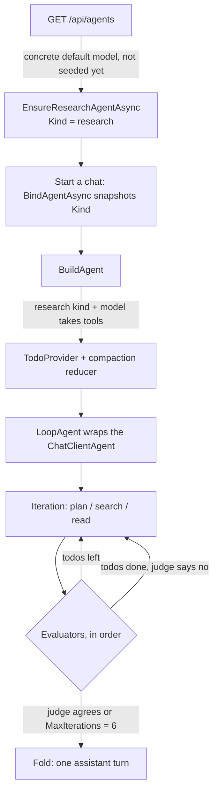

# Research agent

> Every user gets a built-in Research agent. It plans a question into steps, searches and reads the
> web for each one, checks its own answer, and shows a live checklist while it works. ADR 0082.

## What it is

- **Seeded, then yours.** A "Research" agent appears in your agent list the first time you open it
  with a model configured. You can edit its name, persona, model and tools. You can't change its kind
  or its per-chat history mode. If you delete it, it doesn't come back.
- **Plan, search, reflect, answer.** The agent writes a short plan as todos, works through them with
  web search and page reads, and ticks each one off. It answers once the plan is done and a judge
  agrees that the answer holds up.
- **A live checklist.** While the turn runs, a **Research plan · 2/4** panel sits at the top of the
  reply bubble. It is live only: a reloaded chat shows the answer and its tool calls (ADR 0080), not
  the checklist.
- **One answer per question.** However many rounds the loop takes, the chat keeps one assistant turn.
  Only the last round's text survives, and every search it made stays attached.
- **Always per-chat.** The editor disables the *continuous* toggle for a research agent. Its turns are
  the largest there are, so they can't share one ongoing history (ADR 0016).
- It is marked with a **research** badge in the agent list. It is seeded with only the `web_search`
  tool, which covers both searching and reading a page.

## How it works



### Seeding

`GET /api/agents` calls `EnsureResearchAgentAsync(model)` on the user's registry grain. It returns
early when the user has no concrete model yet (ADR 0019), so the agent is seeded by the first list
after a provider is added. A `ResearchAgentSeeded` flag in registry state makes it once-only.

The research kind is set only by seeding. A create that claims it gets a 400 (a create may claim only
`copilot`, ADR 0085), and update copies `Kind` from the stored definition. Update also forces
`Continuous = false` for a research kind. `Kind` is persona, so
`BindAgentAsync` snapshots it into the conversation (ADR 0003).

### The loop

When a research-kind chat runs on a model that supports tools, `BuildAgent` composes three building
blocks from `Research/AgentGrain.Research.cs`:

- **`TodoProvider`** gives the model `todos_add`, `todos_complete` and `todos_remove`, and holds the
  plan in the session. `BeginResearchRun` clears it at the start of each turn, so a second question
  doesn't inherit the first one's plan.
- **A context-window reducer on the chat client** (`ContextWindowCompactionStrategy`, 64k tokens
  with 8k kept free for output) bounds every model call in the tool loop. It sits below the
  function-invoking client, so RAG, memory and skills context all count against the budget.
- **`LoopAgent`** re-runs the agent. Its evaluators run in order, and the first one that asks for
  another iteration wins:

```csharp
new DelegateLoopEvaluator(ObserveResearchIteration), // records the iteration boundary, never continues
new TodoCompletionLoopEvaluator(),                    // continue while todos remain
new AIJudgeLoopEvaluator(                             // then ask the judge
    _chatClientFactory.GetClient(modelId),
    new AIJudgeLoopEvaluatorOptions { Criteria = [.. ResearchLimits.JudgeCriteria] }),
```

The judge checks that the answer states a conclusion, that its claims are backed by pages the agent
actually read, and that it says plainly what it couldn't confirm. `MaxIterations = 6` is a hard cap
that no evaluator can exceed. Each iteration can still make several tool calls, so the cap bounds
cost, not calls.

The loop's own feedback messages ("you still have incomplete todos…") are `user` messages authored
`agent42-research-loop`. The history provider drops them before storing, because they are model
input, not a user turn.

A model that doesn't support tools gets a plain agent: the todo tools are tools, so the capability
gate would drop them anyway.

### One turn, not six

`LoopAgent` persists every finished iteration into the session mid-turn. Two mechanisms keep the
invariant that one user turn produces one assistant turn, which stream recovery (ADR 0046) and
tool-call replay (ADR 0080) depend on:

- **Hide.** While a research run is in flight, `GetHistoryAsync` shows only the history before it
  (`VisibleHistory`), just as an ordinary turn reaches history only when it ends.
- **Fold.** When the run ends, `FoldResearchTurn` keeps text only on the assistant messages of the
  last iteration that produced text, and strips it from every earlier one. A message left empty is
  dropped. Tool calls and results stay, so every search of every iteration is replayed onto the one
  answer.

Both run sites do this: `ChatCoreAsync` for a chat turn, and `ReceiveReminder` for a scheduled
prompt (which runs through `RunAsync` with `NonStreamingReturnsLastResponseOnly`). Each pairs
`BeginResearchRun` with `ReleaseResearchRun(foldFirst:)` in a `finally`, so a failed turn is folded
too.

### Streaming

On a research turn the stream carries two extra events (see [Streaming replies](streaming-replies.md)):

| Event | When | Frontend |
|-------|------|----------|
| `todos` | A tool result changed the checklist. It carries the whole list, as `[{ id, title, done }]` | `research.js` `renderResearchTodos` replaces the panel |
| `textReset` | A later iteration started to speak, so the text so far was a draft | `send.js` clears the draft |

## How the Agent Framework fits

- `TodoProvider`, `LoopAgent`, `TodoCompletionLoopEvaluator`, `AIJudgeLoopEvaluator` and
  `ContextWindowCompactionStrategy` are all framework building blocks. They are `[Experimental]`
  (MAAI001), and the only use is a scoped `#pragma` in `AgentGrain.Research.cs`. A framework upgrade
  must re-run `ResearchAgentTests` and `StopGenerationTests`.
- The budget is a **chat-client reducer, not `CompactionProvider`**. `CompactionProvider` froze the
  request from the second turn on, so the model was sent the first question again (measured, ADR 0082).
- `ObserveResearchIteration` finds its run through `LoopContext.InitialMessages`, which holds the same
  `ChatMessage` reference the grain passed in. Runs are keyed on that reference in a
  `ConditionalWeakTable`, not `AgentRunOptions`: its `AdditionalProperties` leak into every
  model request body.
- The judge calls the conversation's own provider, so there is no new egress (rule 13). It does add
  one call for each finished iteration once the todos are done. If the user adds `memory`, Hindsight
  recall and retain run once per iteration, not once per turn.

## How Orleans fits

- `AgentDefinition.Kind` and `AgentGrainState.AgentKind` are trailing persisted fields with a default.
  A null or unknown kind is an ordinary agent (`AgentKinds.IsResearch`).
- `ResearchTodo` is our own `[GenerateSerializer]` record rather than the framework's `TodoItem`,
  because it crosses the Orleans boundary on the `Todos` stream event.
- `_researchInFlight` is activation-lived, turn-scoped state (rule 6). It is published with `??=` and
  cleared only if it is still the same run, so a reminder firing mid-stream can't unhide a chat's
  half-finished turn.

## Known limitations

- A research turn usually outlasts `send.js`'s ~30 s stream-recovery poll. A backgrounded turn shows
  "Transmission failed" even though it completes, and a reload shows the answer.
- Via `/api/agent-mcp` (ADR 0070), a research turn will often exceed the 120 s `RunTimeout`. The usual
  "still running" contract applies.
- The context budget is a constant: `ModelCapabilities` carries no window size. A provider with a
  smaller window still fails like any long chat.
- Overlapping runs (a reminder firing while the chat streams) share the todo list and history
  indices. This is accepted and not guarded.
- An abandoned stream is unhidden but not folded. Voice mode may already have spoken a draft
  before its `textReset`.
- `read_web_document` is not seeded: a document ingested mid-run can't reach retrieval until the turn
  ends. The user can still add it.

## Key files

| Concern | File |
|---------|------|
| Kind, defaults, limits | `src/Agent42.Agents/StoredAgents/AgentKinds.cs`, `src/Agent42.Agents/Research/ResearchAgentDefaults.cs`, `ResearchLimits.cs` |
| Loop, hide and fold, stream projection | `src/Agent42.Agents/Research/AgentGrain.Research.cs` |
| Checklist event payload | `src/Agent42.Agents/Research/ResearchTodo.cs`, `src/Agent42.Agents/Conversations/AgentStreamEvent.cs` |
| Seeding | `src/Agent42.Agents/StoredAgents/AgentRegistryGrain.cs` (`EnsureResearchAgentAsync`), `src/Agent42.Backend/StoredAgents/AgentApi.StoredAgents.cs` |
| Run sites | `src/Agent42.Agents/Conversations/AgentGrain.cs` (`ChatCoreAsync`, `ReceiveReminder`) |
| Frontend | `src/Agent42.Backend/wwwroot/js/research.js`, `send.js`, `agents.js` (badge, continuous toggle) |
| Tests | `tests/Agent42.Tests/ResearchAgentTests.cs`, `ResearchAssetsTests.cs`, `FakeChatClient.Research.cs` |
