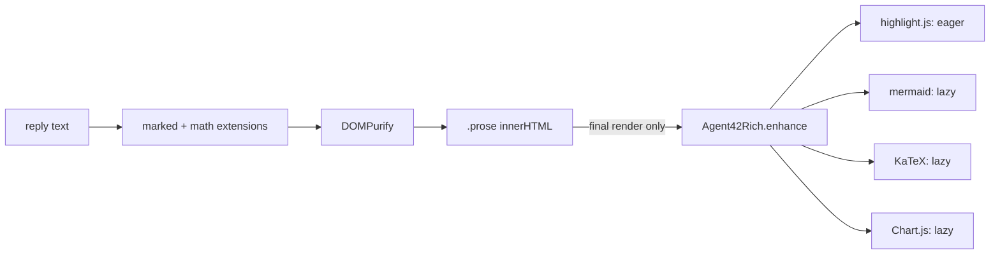

# Rich inline rendering

> Mermaid diagrams, highlighted code with a copy button, LaTeX math and charts render inside an
> assistant reply, in the chat and in the public share viewer. ADR 0083.

## What it is

When a reply is finished, these blocks turn into rendered content:

| In the reply | Renders as |
|---|---|
| ` ```mermaid ` fenced block | an SVG diagram |
| any other fenced code block | syntax highlighting, plus a **⧉** copy button that copies the raw code |
| `$…$`, `\(…\)` | inline math |
| `$$…$$`, `\[…\]` | display math |
| ` ```chart ` fenced block holding a Chart.js JSON config | a chart |

While a reply streams, these blocks show as plain code. They are rendered once, when the reply ends.
If a block can't be rendered (a mermaid syntax error, invalid chart JSON), its code stays visible
with a short red note under it, and the rest of the reply still renders.

A single `$` is math only when no space follows the opening `$` and none precedes the closing one,
and the closing `$` is not followed by a digit. "It costs $5 and $10" stays text.

## How it works



- **One renderer for both pages.** `wwwroot/shared/lib/richtext.js` is a classic script that exposes
  `window.Agent42Rich`. It lives under the public `/shared/lib/` so the share viewer can load it
  without signing in. The chat app loads the same file.
- **Final render only.** `setAgentMarkdown` (`js/thread.js`) calls `enhance` only when no caret is
  drawn. Every streaming call draws the caret, so the stream end, Stop, errors, history and stream
  recovery are all covered.
- **Lazy libraries.** mermaid (5 MB), KaTeX and Chart.js load the first time a reply needs them. The
  service worker then caches them. Only the renderer and highlight.js are in the offline shell.
- **Safety.** Mermaid runs in strict mode, and its SVG passes through DOMPurify. Any external
  `url()` or `@import` in the diagram's CSS is removed. A chart is
  `JSON.parse`d, so it can't contain code. KaTeX runs with `trust: false`. Every library is
  served from Agent42 itself; nothing is fetched from a CDN.
- **The model knows the `chart` format.** `AgentGrain.WithRenderingHints` appends a two-line hint
  to every chat's instructions, persona chats included.

```js
// js/thread.js
export function setAgentMarkdown(msg, text, { caret = false } = {}) {
  const prose = msg.querySelector(".prose");
  prose.innerHTML = renderMarkdown(text);
  if (caret) {
    /* … draw the caret … */
  } else {
    globalThis.Agent42Rich?.enhance(prose);
  }
}
```

## Try it offline

Run `dotnet run --project tools/Agent42.DevHost` and send **show rich**. The canned reply has one
of each block, plus a broken diagram and a currency sentence.
