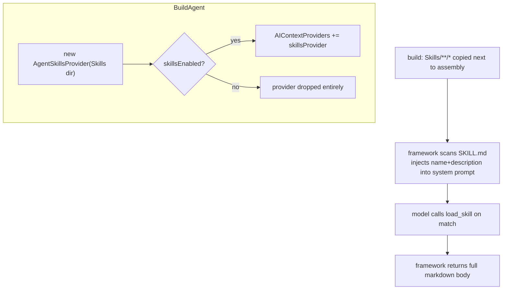

# Skills

> Reusable markdown playbooks the agent loads on demand when a task matches.

## What it is

A skill is a `SKILL.md` file with front-matter (name + description) and a markdown body. Its
name and description are advertised to the model up front; when a user request matches, the
model calls `load_skill` and gets the full body — a playbook it then follows. Two skills ship
today (`websearch`, `scheduledprompt`).

## How it works

Discovery, front-matter parsing, system-prompt injection, and the `load_skill` /
`read_skill_resource` / `run_skill_script` tools are all provided by the **Microsoft Agent
Framework** `AgentSkillsProvider`. Agent42's code only points it at a directory, disables the
load approval prompt, and gates whether the provider is attached.



### Construction and the gate

```csharp
var skillsProvider = new AgentSkillsProvider(
    Path.Combine(AppContext.BaseDirectory, "Skills"),
    options: new AgentSkillsProviderOptions { DisableLoadSkillApproval = true });
```

Skills is a **tool**, so both model capability and user selection must allow it:

```csharp
var skillsEnabled = capabilities.SupportsTools && enabled.Contains(ToolCatalog.Skills);
```

Registration is asymmetric with the RAG provider — either, both, or neither may be attached:

```csharp
AIContextProviders = (skillsEnabled, _state.State.DocumentNames.Count > 0) switch
{
    (true, true) => [skillsProvider, BuildDocumentSearchProvider()],
    (true, false) => [skillsProvider],
    (false, true) => [BuildDocumentSearchProvider()],
    (false, false) => [],
},
```

### The SKILL.md shape

```markdown
---
name: scheduledprompt
description: Schedule and cancel prompts for the current conversation with the schedule_prompt...
metadata:
  author: agent42
  version: "1.0"
---
```

A csproj copy rule makes on-disk discovery work — the `Skills/` tree lands next to the
assembly:

```xml
<Content Include="Skills\**\*">
  <CopyToOutputDirectory>PreserveNewest</CopyToOutputDirectory>
</Content>
```

The provider's three tool names all map to the single `skills` catalog key so the
key-coverage guard stays green:

```csharp
["load_skill"] = Skills,
["read_skill_resource"] = Skills,
["run_skill_script"] = Skills,
```

## How the Agent Framework fits

- `AgentSkillsProvider` / `AgentSkillsProviderOptions` are **framework** types (from
  `Microsoft.Agents.AI`) — there is no Agent42 class for them. Disk discovery, front-matter
  parsing, system-prompt injection (progressive disclosure), and the `load_skill` /
  `read_skill_resource` / `run_skill_script` tools are all framework-provided.
- It is registered as an `AIContextProvider` on `ChatClientAgentOptions`.
- `DisableLoadSkillApproval = true` means there is no human-in-the-loop gate, so `load_skill`
  auto-approves.

## How Orleans fits

- Thin. The provider is constructed **per grain activation** inside `BuildAgent`, so each
  conversation grain gets its own instance and re-evaluates `skillsEnabled` whenever the grain
  rebuilds (tool-selection change, model switch).
- The skills themselves are stateless disk files — nothing is persisted in grain state. (The
  two shipped skills happen to *document* Orleans-backed tools; `scheduledprompt` describes the
  durable-reminder tool.)

## Key files

| Concern | File |
|---------|------|
| Construction + gate | `src/Agent42.Agents/AgentGrain.cs` (`BuildAgent`) |
| Copy rule | `src/Agent42.Agents/Agent42.Agents.csproj` |
| Shipped skills | `src/Agent42.Agents/Skills/websearch/SKILL.md`, `.../scheduledprompt/SKILL.md` |
| Catalog mapping | `src/Agent42.Agents/ToolCatalog.cs` |
