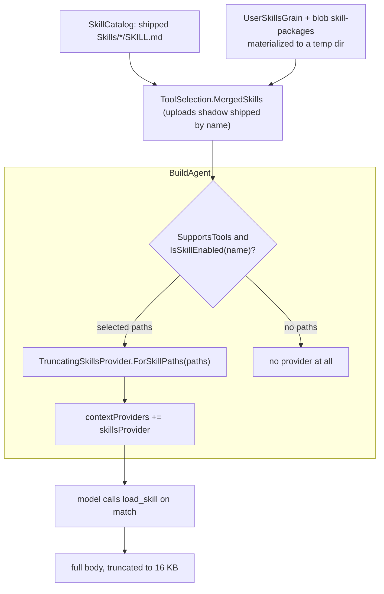

# Skills

> Reusable markdown playbooks the agent loads on demand when a task matches. Two ship with the app,
> and each user can upload their own. ADRs 0021 · 0048 · 0049.

## What it is

A skill is a `SKILL.md` file with front-matter (name + description) and a markdown body. Its
name and description are advertised to the model up front; when a user request matches, the
model calls `load_skill` and gets the full body — a playbook it then follows. Two skills ship
today (`websearch`, `scheduledprompt`).

Users can upload their own from **Preferences → Skills** (ADR 0049): a bare `SKILL.md`, or a
`.zip` with one or more skill directories and their resource files. An upload with the same name
as a shipped skill replaces it for that user. Every skill is its own entry in the tool picker
(`skill:{name}`, ADR 0048).

## How it works

Discovery, front-matter parsing, system-prompt injection, and the `load_skill` /
`read_skill_resource` / `run_skill_script` tools are all provided by the **Microsoft Agent
Framework** `AgentSkillsProvider`. Agent42 picks which skill directories to hand it, wraps it to
bound its output, and drops it entirely when no skill is selected.



### Construction and the gate

Skills is a **tool**, so both model capability and user selection must allow it. The gate is
per skill: a skill is kept when the selection holds the `skills` wildcard (`null == all`, or a
legacy selection) or its own `skill:{name}` key:

```csharp
// ToolSelection.SelectedSkills: none on a no-tools model, else the merged catalog filtered per skill.
var selectedSkillPaths = SelectedSkills(capabilities, enabled).Select(s => s.Path).ToList();

var skillsProvider = selectedSkillPaths.Count > 0
    ? TruncatingSkillsProvider.ForSkillPaths(selectedSkillPaths)
    : null;
```

An empty selection must drop the provider, not just advertise nothing, because the provider
would still hand the model a `load_skill` schema it cannot use.

`ForSkillPaths` sets the framework options and the safety rules in one place:

```csharp
new AgentSkillsProvider(
    skillPaths,
    fileOptions: new AgentFileSkillsSourceOptions { AllowedScriptExtensions = [] },   // no script is ever discovered
    options: new AgentSkillsProviderOptions
    {
        DisableLoadSkillApproval = true,
        DisableReadSkillResourceApproval = true,   // uploaded skills carry resources (ADR 0049)
    });
```

`run_skill_script` stays approval-wrapped and no script runner is registered, so calling it
throws. `TruncatingSkillsProvider` caps each result (`SkillToolLimits`: 16 KB for a skill
body, 8 KB for a resource), because tool results are persisted into the 2 MB session (ADR 0004).

The context providers are then assembled as a list: skills (when selected), document RAG (when
the conversation has documents, ADR 0008/0066), and long-term memory (when selected, ADR 0057).

### Uploaded skills (ADR 0049)

`POST /api/skills` (`AgentApi.UserSkills.cs`) takes a `SKILL.md` or a `.zip`. `SkillPackage`
normalizes either one into one zip per skill, whose top-level directory is the front-matter
`name`. Entries that don't conform, and scripts, are dropped and the drop is reported. The
upload limits are in `SkillToolLimits`.

- The zip is stored at `{userId}/{skillId}.zip` in the `skill-packages` blob container. The index
  lives in `UserSkillsGrain` (state `user-skills`).
- Every upload gets a fresh skill id, including a replace, so the materialized directory
  `{temp}/agent42-skills/{skillId}/{name}/` never changes and needs no cache invalidation. The
  picker key stays `skill:{name}`, so a user's selection survives a re-upload.
- The container filesystem is a cache. A restart wipes it and the next activation
  re-materializes the skills from blob storage.

### The SKILL.md shape

```markdown
---
name: scheduledprompt
description: Schedule and cancel prompts for the current conversation with the schedule_prompt...
metadata:
  author: agent42
  version: "1.0"
---
```

A csproj copy rule makes on-disk discovery of the shipped skills work — the `Skills/` tree lands
next to the assembly:

```xml
<Content Include="Skills\**\*">
  <CopyToOutputDirectory>PreserveNewest</CopyToOutputDirectory>
</Content>
```

The provider's three tool names all map to the `skills` catalog key so the key-coverage guard
stays green. Per-skill selection works on the directory list, not on the tool names:

```csharp
["load_skill"] = Skills,
["read_skill_resource"] = Skills,
["run_skill_script"] = Skills,
```

## How the Agent Framework fits

- `AgentSkillsProvider` / `AgentSkillsProviderOptions` are **framework** types (from
  `Microsoft.Agents.AI`). Disk discovery, front-matter parsing, system-prompt injection
  (progressive disclosure), and the `load_skill` / `read_skill_resource` / `run_skill_script`
  tools are all framework-provided. Agent42's only wrapper is `TruncatingSkillsProvider`, a
  delegating `AIContextProvider` that caps tool results and keeps each tool's name and schema.
- Each supplied path is a search root, so handing the provider only the selected directories is
  what filters the set.
- It is registered as an `AIContextProvider` on `ChatClientAgentOptions`.
- The grain has no human-in-the-loop step, so `load_skill` and `read_skill_resource`
  auto-approve.

## How Orleans fits

- The provider is constructed inside `BuildAgent`, so each conversation grain gets its own
  instance and re-evaluates the selection whenever the grain rebuilds (tool-selection change,
  model switch).
- Shipped skills are stateless disk files. A user's uploads are indexed in `UserSkillsGrain`
  (keyed by user id, on the shared `agent-state` provider, no dedicated Cosmos container) and
  resolved once when an `AgentGrain` activates.

## Key files

| Concern | File |
|---------|------|
| Construction + gate | `src/Agent42.Agents/Tools/AgentGrain.BuildAgent.cs` (`BuildAgent`) |
| Copy rule | `src/Agent42.Agents/Agent42.Agents.csproj` |
| Shipped skills | `src/Agent42.Agents/Skills/websearch/SKILL.md`, `.../scheduledprompt/SKILL.md` |
| Catalog mapping / shipped discovery | `src/Agent42.Agents/Tools/ToolCatalog.cs`, `SkillCatalog.cs` |
| Provider wrapper + limits | `src/Agent42.Agents/UserSkills/TruncatingSkillsProvider.cs`, `SkillToolLimits.cs` |
| Uploads | `src/Agent42.Agents/UserSkills/SkillPackage.cs`, `UserSkillsGrain.cs`, `src/Agent42.Backend/UserSkills/AgentApi.UserSkills.cs` |
