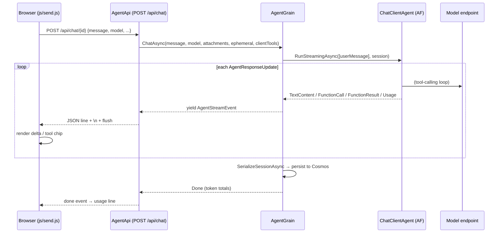

# Streaming replies

> Chat answers stream token-by-token as NDJSON; tool calls and token usage show up as they
> happen.

## What it is

When you send a message, the reply streams into the UI incrementally — text appears
token-by-token, tool-call chips light up as the agent invokes a tool, and a token-usage line
lands at the end. The transport is **NDJSON** (one JSON event per line) over a plain HTTP
response, not SSE or WebSockets.

## How it works

The grain runs the Agent Framework streaming loop and translates each framework content item
into a small `AgentStreamEvent`. The minimal-API endpoint serializes each event as one line
and flushes it. The browser reads the response stream, splits on newlines, and dispatches by
event type.



### The event contract

The core events are `TextDelta`, `ToolCallStart`, `ToolCallEnd`, `Image` and `Done`
(`AgentStreamEventType`). Several later ones are **live-only**: they are never persisted and
never replayed from history.

| Event | What it carries | ADR |
|-------|-----------------|-----|
| `Suggestions` | Up to 3 follow-up prompts, sent just before `Done` on interactive turns | 0036 |
| `Reasoning` | Reasoning text, shown in a collapsed disclosure ([Reasoning output](reasoning-output.md)) | 0071 |
| `McpReauthRequired` | The id of an OAuth MCP server whose grant is dead; the UI shows **Reconnect** | 0081 |
| `Todos` | The [Research agent](research-agent.md)'s whole checklist, whenever a tool call changed it | 0082 |
| `TextReset` | A later research iteration started speaking; the client clears the draft | 0082 |

The wire format is camelCase with nulls omitted:

```csharp
private static readonly JsonSerializerOptions StreamEventJson = new(JsonSerializerOptions.Web)
{
    DefaultIgnoreCondition = JsonIgnoreCondition.WhenWritingNull,
    Converters = { new JsonStringEnumConverter(JsonNamingPolicy.CamelCase) },
};
```

### The endpoint — one line per event, flushed

```csharp
http.Response.ContentType = "application/x-ndjson";
await foreach (var evt in agent.ChatAsync(
    request.Message, model, attachmentRefs, request.Ephemeral,
    clientTools: KnownClientTools(request.ClientTools)))
{
    await http.Response.WriteAsync(JsonSerializer.Serialize(evt, StreamEventJson) + "\n");
    await http.Response.Body.FlushAsync();
}
```

### The grain — mapping framework content to events

The Agent Framework streams `AgentResponseUpdate`s; the grain fans each content type out to
an event and accumulates token usage across all LLM turns (a tool-calling run has several):

```csharp
await foreach (AgentResponseUpdate update in _agent.RunStreamingAsync([userMessage], _session))
{
    foreach (AIContent content in update.Contents)
    {
        switch (content)
        {
            case TextContent text when !string.IsNullOrEmpty(text.Text):
                yield return new AgentStreamEvent(AgentStreamEventType.TextDelta, Text: text.Text);
                break;
            case FunctionCallContent call:
                yield return new AgentStreamEvent(AgentStreamEventType.ToolCallStart,
                    ToolName: call.Name, ToolCallId: call.CallId, ToolInput: SerializeOrNull(call.Arguments));
                break;
            case FunctionResultContent result:
                yield return new AgentStreamEvent(AgentStreamEventType.ToolCallEnd,
                    ToolCallId: result.CallId, ToolResult: SerializeOrNull(result.Result));
                break;
            case UsageContent usage:
                inputTokens  += usage.Details.InputTokenCount.GetValueOrDefault();
                outputTokens += usage.Details.OutputTokenCount.GetValueOrDefault();
                cachedTokens += usage.Details.CachedInputTokenCount.GetValueOrDefault();
                break;
        }
    }
}
```

Usage is emitted only on `Done`, **after** the session is persisted:

```csharp
var serializedSession = await _agent.SerializeSessionAsync(_session);
_state.State.SerializedSession = JsonSerializer.Serialize(serializedSession);
await _state.WriteStateAsync();

yield return new AgentStreamEvent(AgentStreamEventType.Done,
    InputTokens: inputTokens > 0 ? inputTokens : null,
    OutputTokens: outputTokens > 0 ? outputTokens : null,
    CachedTokens: cachedTokens > 0 ? cachedTokens : null);
```

### The browser — read, split, dispatch

```javascript
const reader = res.body.getReader();
const decoder = new TextDecoder();
let buffer = "";
for (;;) {
  const { done, value } = await reader.read();
  if (done) break;
  buffer += decoder.decode(value, { stream: true });
  const lines = buffer.split("\n");
  buffer = lines.pop() ?? "";
  for (const line of lines) {
    if (!line.trim()) continue;
    const chunk = JSON.parse(line);
    if (chunk.type === "textDelta") { answer += chunk.text; setAgentMarkdown(agentMsg, answer, { caret: true }); }
    else if (chunk.type === "toolCallStart") { addToolCall(agentMsg, chunk); }
    else if (chunk.type === "toolCallEnd")   { completeToolCall(agentMsg, chunk); }
    else if (chunk.type === "image")         { addAgentImage(agentMsg, activeId, chunk.attachmentId); }
    else if (chunk.type === "done")          { showUsage(agentMsg, chunk); }
  }
}
```

### Stopping a reply (ADR 0078)

The Stop button calls `POST /api/chat/{conversationId}/stop` → `IAgentGrain.StopAsync()`, which
cancels the turn's `CancellationTokenSource`. The framework persists nothing on a cancelled run, so
the grain catches the cancellation, appends the partial turn to the session by hand, and persists
it like any other. The stream ends with a normal `Done` carrying `stopped: true`. What the user saw
is what the conversation keeps.

### A stream that dies mid-reply (ADR 0046)

A backgrounded PWA can lose its connection while the grain keeps running the turn to completion.
Recovery is client-side only: on a non-abort stream failure, `send()` re-reads the conversation
history and adopts the persisted reply into the bubble it was streaming into. Only if nothing shows
up does it paint the error.

### Tool calls in the UI (ADR 0072/0080)

Each turn's tool chips live in one `<details>` group. Once a turn makes more than 3 calls the group
gets an "N tool calls" summary, and it collapses when the turn ends. On reload, `GetHistoryAsync`
projects the stored calls onto each assistant turn (`ChatTurn.ToolCalls`, `ChatToolCall` DTO) in
exactly the live `toolCallStart`/`toolCallEnd` shape, so the replay feeds the same
`addToolCall`/`completeToolCall` functions.

## How the Agent Framework fits

- The grain wraps an `AIAgent` (`ChatClientAgent`) and an `AgentSession`.
- Streaming is the framework's `AIAgent.RunStreamingAsync(messages, session)`, returning
  `AgentResponseUpdate`s whose `Contents` are `Microsoft.Extensions.AI` types (`TextContent`,
  `FunctionCallContent`, `FunctionResultContent`, `UsageContent`).
- The framework drives the whole tool-calling loop; the grain just projects its content
  stream onto the wire event contract.

## How Orleans fits

- `AgentGrain` is `Grain, IAgentGrain, IRemindable`. `ChatAsync` is declared as
  `IAsyncEnumerable<AgentStreamEvent>` on the grain interface — Orleans streams the
  async-enumerable across the grain boundary to the endpoint.
- The grain is **non-reentrant**, so a streaming turn holds the activation; the session lives
  in memory per activation and is persisted via `IPersistentState<AgentGrainState>` (the
  `agent-state` provider, Cosmos in prod) at the end of each turn.
- The grain key `{userId}/{conversationId}` isolates conversations per user, so one user's
  conversation id can never resolve to another user's chat.

## Key files

| Concern | File |
|---------|------|
| Endpoint | `src/Agent42.Backend/Conversations/AgentApi.Conversations.cs` (`POST /api/chat/{conversationId}`) |
| Event DTO | `src/Agent42.Agents/Conversations/AgentStreamEvent.cs` |
| Streaming core | `src/Agent42.Agents/Conversations/AgentGrain.cs` (`ChatCoreAsync`) |
| Grain contract | `src/Agent42.Agents/Conversations/IAgentGrain.cs` |
| Frontend reader | `src/Agent42.Backend/wwwroot/js/send.js` (`send()`, `stopGeneration()`) |
