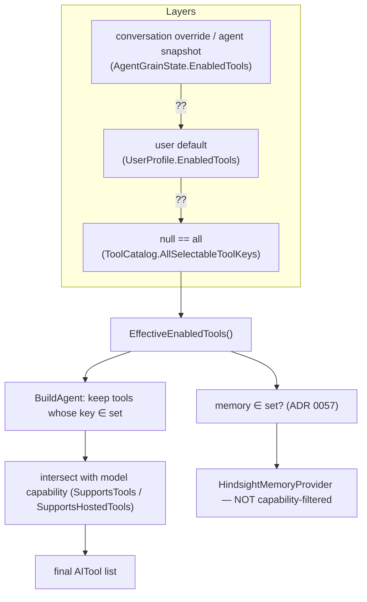

# Tool selection

> Choose which tools an assistant may use — a personal default, a per-conversation override, or
> baked into a custom agent. Availability is also capped by what the chosen model supports.
> ADRs 0021 · 0026 · 0057 · 0066 · 0075.

## What it is

You pick which of the curated tools (`web_search`, `location`, `scheduling`, `skills`,
`code_interpreter`, `memory`, `read_web_document`, `push_notification`, plus your MCP servers) an
assistant may use, remembered at three layers:

- **User default** (Preferences → default tools) — every new regular chat.
- **Per-conversation override** (the composer's "Tools" popover) — non-agent chats only.
- **Per-agent set** (agent editor) — snapshotted into the conversation.

`get_date` and document RAG stay **always-on**. Selection can only *narrow*, never grant: it is
intersected with model capability.

Two keys are worth knowing about specifically, because turning them on grants more than a tool:
`read_web_document` (ADR 0066) lets the assistant fetch a document **from our own container** and keep
what it finds, and `push_notification` (ADR 0075) lets it put **text it writes itself** on your
device's lock screen. Both are off in any selection you saved before they shipped — press Save once in
Preferences → Tools to pick them up.

**`memory` is the one documented exception to that intersection** (ADR 0057). Long-term memory is not a
tool — it is an `AIContextProvider` injected before the call — so it never passes through the capability
filter: a text-only model with `memory` selected still gets memory. It is also gated underneath by the
operator's `Hindsight:ApiKey`; with no key, selecting it makes zero calls.

## How it works

`ToolCatalog` is the single source of truth for keys. `EnabledTools` is a nullable list where
**`null == all`** (so no migration was needed). The grain resolves
**override ?? user-default ?? all**, then intersects with model capability.



The `memory` arm leaves the flow before `CAP` on purpose: it is a context provider, not a tool, so the
capability intersection never applies to it.

### The catalog keys and the null==all set

```csharp
public const string WebSearch = "web_search";
public const string Location = "location";
public const string Scheduling = "scheduling";
public const string Skills = "skills";
public const string CodeInterpreter = "code_interpreter";
public const string Memory = "memory";         // ADR 0057 — the first key that is NOT a tool
...
public static IReadOnlyList<string> AllSelectableToolKeys { get; } =
    [WebSearch, Location, Scheduling, Skills, CodeInterpreter, Mcp, Memory];
```

### Three-layer resolution

```csharp
private IReadOnlyList<string> EffectiveEnabledTools()
    => _state.State.EnabledTools          // per-conversation override / agent snapshot
        ?? _userDefaultEnabledTools       // user default (read once on activation)
        ?? ToolCatalog.AllSelectableToolKeys;  // null == all
```

### The gate — selection ∩ capability

Capability is the outer, authoritative gate; selection is intent only:

```csharp
var enabled = EffectiveEnabledTools().ToHashSet(StringComparer.Ordinal);
tools = [.. tools.Where(t => ToolCatalog.IsToolEnabled(t.Name, enabled))];
...
Tools = capabilities.SupportsTools ? tools : [],
```

`IsToolEnabled` keeps `get_date` (unmapped) always, and requires the key for everything mapped:

```csharp
public static bool IsToolEnabled(string toolName, ISet<string> enabled)
    => KeyFor(toolName) is not { } key || enabled.Contains(key);
```

### The per-user tool catalog and per-conversation override

`GET /api/tools` returns the static descriptors plus one `mcp:{id}` descriptor per enabled MCP
server (ADR 0026):

```csharp
app.MapGet("/api/tools", async (IGrainFactory grains, HttpContext http) =>
{
    var overlay = await grains.GetGrain<IUserMcpConfigGrain>(http.GetUserId()).GetAsync();
    var mcpDescriptors = overlay.Servers.Where(s => s.Enabled)
        .Select(s => new ToolDescriptor(ToolCatalog.McpServerKey(s.Id), s.Name, RequiresHostedTools: false));
    return Results.Json<IReadOnlyList<ToolDescriptor>>([.. ToolCatalog.Descriptors, .. mcpDescriptors]);
});
```

```csharp
app.MapPut("/api/conversations/{conversationId}/tools", async (string conversationId, ToolSelectionRequest request, IGrainFactory grains, HttpContext http) =>
{
    var agent = grains.GetGrain<IAgentGrain>(AgentKey(http.GetUserId(), conversationId));
    await agent.SetEnabledToolsAsync(request.Tools);
    return Results.Json(await agent.GetEnabledToolsAsync());
});
```

Server-side `Sanitize` drops invented keys but leaves `null` as `null`:

```csharp
public static IReadOnlyList<string>? Sanitize(IReadOnlyList<string>? tools)
    => tools is null
        ? null
        : [.. AllSelectableToolKeys.Where(tools.Contains), .. tools.Where(IsMcpServerKey).Distinct()];
```

The `mcp` **wildcard** must be expanded into explicit `mcp:{id}` keys on read
(`GetEnabledToolsAsync` → `ExpandMcpWildcard`), or a no-op picker Save would silently disable
every server — the picker has no bare `mcp` checkbox.

## How the Agent Framework fits

- Selection resolves to a concrete `List<AITool>` (plus hosted-tool markers) that becomes
  `ChatClientAgentOptions.ChatOptions.Tools`. The framework is what turns "present in the list"
  into "advertised to the model."
- Two arms gate a framework `AIContextProvider` in/out of `AIContextProviders`, and they differ: the
  **skills** arm is filtered by capability *and* selection (it exposes `load_skill`, so it is a tool);
  the **memory** arm is filtered by selection only (ADR 0057). Document RAG is a third arm, filtered by
  neither — document presence alone (ADR 0008).
- The framework has no notion of the catalog — Agent42's filter runs *before* handing the final
  list to `ChatClientAgent`.

## How Orleans fits

- `EnabledTools` is grain-persisted state (`AgentGrainState`, nullable, `null == all`). The
  per-conversation override and agent snapshot live in the conversation grain; the user default
  lives in `IUserProfileGrain` (fetched once per activation); the MCP server list in
  `IUserMcpConfigGrain`.
- Because resolution reads these on activation and `BuildAgent` intersects with model
  capability, a Preferences change reflects in a warm chat only on its next activation (accepted
  staleness). **That staleness is worth knowing for `memory` specifically:** switching the default off
  stops recall and retain on the *next* activation of an already-warm chat, not immediately — and memory
  is the widest egress in the app. The per-conversation override and the agent snapshot both rebuild
  eagerly; only the user-default layer is deferred.
- Every mutation persists and rebuilds the agent via the snapshot→rebuild→restore-session
  dance, so the selection survives deactivation.

## Key files

| Concern | File |
|---------|------|
| Catalog (source of truth) | `src/Agent42.Agents/Tools/ToolCatalog.cs` |
| Resolution + gate | `src/Agent42.Agents/Tools/AgentGrain.BuildAgent.cs` (`EffectiveEnabledTools`, `BuildAgent`) |
| Memory gate (ADR 0057) | `src/Agent42.Agents/Memory/AgentGrain.Memory.cs` (`BuildMemoryProvider`) |
| Endpoints | `src/Agent42.Backend/Tools/AgentApi.Tools.cs` (`/api/tools`, `/api/conversations/{id}/tools`, `/api/profile`) |
| State | `src/Agent42.Agents/Conversations/AgentGrainState.cs`, `UserProfile.cs` |
