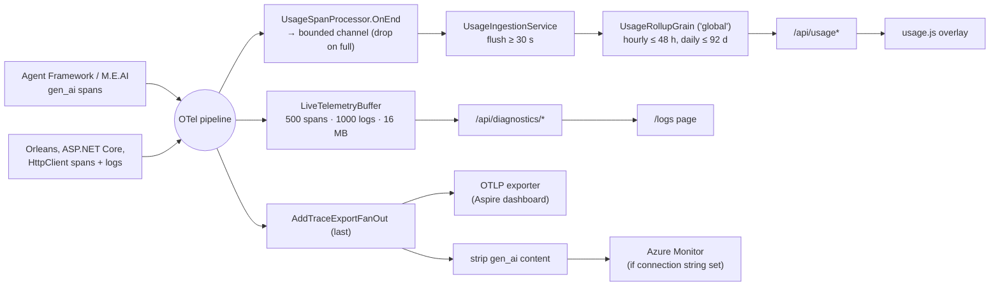

# Usage & diagnostics

> Where to look when you want to know what the app did: a token-usage dashboard, a live
> OpenTelemetry console at `/logs`, the Orleans dashboard at `/dashboard`, and an optional,
> content-stripped export to Application Insights. ADRs 0009 · 0010 · 0031 · 0054 · 0062 · 0077 · 0110.

## What it is

| View | Where | Who can see it | What it shows |
|------|-------|----------------|---------------|
| Token usage | The usage overlay in the app (`#usageView`) | **Each signed-in user, their own data only** (ADR 0121) | Token and tool-call counts per model and application (agent), over 24 h / 7 d / 30 d / all |
| Live console | `/logs` (a standalone page) | **Owners** (`Access:Owners`), across all users | The most recent traces, logs and a metrics snapshot, including full prompts and replies of owners (non-owners' content is redacted) |
| Orleans dashboard | `/dashboard` | **Owners** (`Access:Owners`) | Grain types, activations, reminders, silo health |
| App Insights | Azure portal | Whoever has access to the resource | Traces and metrics with all conversation content removed |

Anyone with a Microsoft account can sign in (ADR 0121), so nothing here is cross-user for a plain user: usage
shows only your own data, and `/logs`, `/dashboard`, `/api/diagnostics/*` and `/api/config-health` are **owner-only**
(404 for everyone else). **The owner tier is advisory, not a security boundary**: any signed-in user can run commands in
the service's own environment through the Copilot shell, which can forge the principal header, so an adversarial user can
become an owner. It stops accidental and casual access.

**Usage is scoped by the Entra object id, never the email** (an email claim is mutable and not unique across tenants). One
`UsageUserKey` function labels rows and matches legacy buckets, so the projector's write and the endpoint's read cannot
drift. Buckets from before the id existed match by the old email key for an owner only.

## How it works

Everything is fed from the OpenTelemetry spans Agent Framework and `Microsoft.Extensions.AI`
already emit; there is no hand-written token counter in `AgentGrain`.



### Token usage (ADR 0031)

`UsageSpanProjector` counts only two kinds of span, because Agent Framework's
`orchestrate_tools` span re-reports the sums of its children and would double-count:

```csharp
switch (operation)
{
    case ChatOperation:           // gen_ai.operation.name == "chat": input/output tokens, model, provider
        return new UsageEvent(UsageEventKind.Token, timestamp, app, ...);
    case ExecuteToolOperation:    // "execute_tool": one tool call, by gen_ai.tool.name
        return new UsageEvent(UsageEventKind.Tool, timestamp, app, ...);
    default:
        return null;              // orchestrate_tools and everything else
}
```

`UsageSpanProcessor` runs in `OnEnd` (usage is only set when the span completes) and never blocks
or does I/O: it writes to a bounded, drop-on-full channel. `UsageIngestionService` drains that
channel at least every 30 seconds into `UsageRollupGrain.ApplyAsync`. The **application** filter
is the agent name: `PublishUsageApplication` puts it in the Orleans `RequestContext`, and it is
stamped on spans as `agent42.application`. The **user** is the email, falling back to name or id.

### Estimated cost (ADR 0110)

Both the per-turn token line and the usage overlay show an **estimated** USD cost. It is derived
from tokens and a checked-in, effective-dated price table (`ModelPricing`), and is never stored, so
a price correction is a table edit. The table is keyed on the **provider kind** as well as the model,
because `gen_ai.provider.name` reads `"openai"` for both Azure OpenAI and OpenAI-compatible endpoints:
`ProviderKindTagChatClient` stamps `agent42.provider.kind` on each `chat` span, and the token buckets
keep it.

| Provider kind | Shown as |
|---------------|----------|
| Azure OpenAI, Anthropic | `≈ $0.0123` (Azure Global list price; Anthropic list price, cache writes at 1.25× input) |
| GitHub Copilot | `included` (the user's subscription) |
| OpenAI-compatible (GitHub Models, Ollama, vLLM), or a model with no row | `—`, never `$0` |

A model missing from the table shows `—` until someone adds a row. A reprice adds a row with a
later `ValidFrom` and never edits one. Usage recorded before this feature has no provider kind, so
it stays unpriced. On `/usage`, Anthropic cache writes are billed at the input rate, because no span
tag carries them; the per-turn line prices them in full.

### The live console (ADR 0054)

`LiveTelemetryBuffer` is an in-process ring buffer bounded by count **and** bytes: 500 spans and
1000 log records, 16 MB split evenly, and any tag value over 4 KB truncated. Metrics are a
snapshot that is replaced wholesale. `/logs` polls `/api/diagnostics/{traces,logs,metrics}` with
a cursor, and renders everything with `textContent` / `createElement`, never `innerHTML`.

- **Sensitive:** `gen_ai` spans carry `gen_ai.input.messages` (the whole conversation sent to the
  model) and the tool definitions, including what was said in incognito chats. `NonOwnerContentRedactor` removes that
  from every span whose `user.id` is not an owner (and from a span with no `user.id`) before it reaches the OTLP
  collector or this ring; it is registered through ServiceDefaults' `beforeTraceExporters` hook so it runs ahead of every
  exporter. It covers span content only: log records and http-client URLs can still carry model-chosen queries.
- **Single replica:** the buffer and its cursors live in one process. `infra/main.bicep` pins
  min = max = 1 replica; scaling out would split the buffer.
- The production log level is `Warning`, so the Logs tab is often empty. The page says so.

### The Orleans dashboard (ADR 0062)

The official `Microsoft.Orleans.Dashboard` package, mounted at `/dashboard` in both silo hosts.
Never use the community `OrleansDashboard` package: it crashes the silo on Orleans 10.x. Easy Auth
already covers the path, and `OwnerGate` (ADR 0121, generalising ADR 0062's `DashboardOwnerGate`) adds an owner check
on top, over `/dashboard`, `/logs`, `/api/diagnostics` and `/api/config-health`:

```csharp
public bool IsOwner(string? userId)
    => !string.IsNullOrWhiteSpace(userId) && _owners.Contains(userId.Trim()); // OrdinalIgnoreCase set
```

- It fails closed: an empty `Access:Owners` (or no `IOwnerPolicy` registered) denies everyone, with a 404.
- The check runs on the post-alias `GetUserId()`, so an aliased account is the same person (ADR 0074).
- There is no environment branch. DevHost and the AppHost set the owner to `local-dev`, the id
  `CurrentUser.GetUserId` falls back to without an Easy Auth header, so offline is open through the
  same rule. **Never list `local-dev` in the committed `Access:Owners`.**
- The gate is installed with `UseWhen(...StartsWithSegments(prefix))` **before** the
  static-file middleware, so no dashboard or `/logs` asset is served ungated.

### Application Insights export (ADR 0077)

Optional: set the `APPLICATIONINSIGHTS_CONNECTION_STRING` secret and traces and metrics (not logs)
also go to Azure Monitor. `AddTraceExportFanOut` must be the **last** processor registered. It
exports to OTLP first (non-owner prompt text is already gone by then, ADR 0121), then strips each `gen_ai` span in place down to an exact-key allowlist
(model, token counts, tool names, ids, finish reason, `user.*`, `agent42.application`), then
hands it to Azure Monitor. Message, instruction, tool-definition and tool-I/O content never
reaches App Insights. Other spans (HTTP, Orleans) are not stripped, so one known residual remains:
the URL that `read_web_document` fetches shows up on its HTTP span. Statsbeat and Live Metrics
are off.

## How the Agent Framework fits

- The framework's OpenTelemetry instrumentation is the only source of usage data: the `chat`,
  `execute_tool` and `orchestrate_tools` spans follow the OTel `gen_ai` semantic conventions.
- Cache and reasoning token counts are recorded as zero, because the framework doesn't emit them.
- The same spans carry the full conversation, which is why `/logs` is sensitive and why the App
  Insights export has to strip them.

## How Orleans fits

- `UsageRollupGrain` is a single **global** grain (`"global"`, state `usage-rollups` on the shared
  `agent-state` provider, no dedicated container). It prunes on every write, to at most 48 hours of
  hourly buckets and 92 days of daily ones, which keeps it under the 2 MB Cosmos item limit.
- The agent name travels from the grain to the span through the Orleans `RequestContext`.
- `/dashboard` is Orleans' own view of the cluster: grain types, activation counts, and reminder
  names that include grain keys (user ids and conversation ids), which is why it is owner-only.

## Key files

| Concern | File |
|---------|------|
| Usage projection + grain | `src/Agent42.Agents/Telemetry/UsageSpanProjector.cs`, `UsageRollupGrain.cs` |
| Price table + cost formula | `src/Agent42.Agents/Telemetry/ModelPricing.cs`, `src/Agent42.Backend/Models/ProviderKindTagChatClient.cs` |
| Usage ingestion | `src/Agent42.Backend/Telemetry/UsageSpanProcessor.cs`, `UsageIngestionService.cs` |
| Usage + diagnostics endpoints | `src/Agent42.Backend/Telemetry/AgentApi.Telemetry.cs`, `AgentApi.Diagnostics.cs` |
| Live buffer | `src/Agent42.Backend/Telemetry/LiveTelemetryBuffer.cs`, `LiveTelemetryContracts.cs` |
| Frontend | `src/Agent42.Backend/wwwroot/js/usage.js`, `src/Agent42.Backend/wwwroot/logs/` |
| Orleans dashboard | `src/Agent42.Backend/Orleans/DashboardOwnerGate.cs`, `DashboardRegistration.cs` |
| App Insights export | `src/Agent42.ServiceDefaults/AzureMonitorTraceExport.cs`, `src/Agent42.Backend/Telemetry/BackendTelemetryExtensions.cs` |
| User identity on spans | `src/Agent42.Backend/Telemetry/UserTelemetrySpanProcessor.cs`, `src/Agent42.Agents/Telemetry/UserTelemetryContext.cs` |
