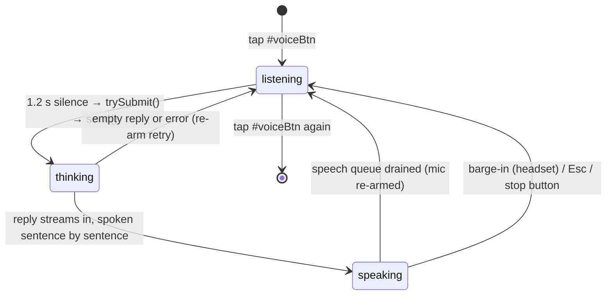

# Voice & speech

> Dictate a message, or talk hands-free: the reply is spoken back and the app listens again.
> Speech runs in the browser by default, or on a text-to-speech model you configure.
> ADRs 0006 · 0037 · 0038 · 0079.

## What it is

- **Dictation** — the mic button (`#micBtn`) turns speech into composer text. You review and send
  it yourself.
- **Hands-free voice mode** — the voice button (`#voiceBtn`) starts a loop: listen → auto-send
  after a pause → speak the reply → listen again. Talking over the reply interrupts it
  (barge-in) when the sound goes to a headset.
- **Server-side voice** — pick a **default speech model** in Preferences → model providers, and
  the reply is spoken by that model instead of the browser's built-in voice.

Speech recognition is always the browser's. No audio from the microphone is sent to Agent42.

## How it works

Dictation and the voice loop are **frontend-only** (ADR 0006/0037): the browser's Web Speech API
(`SpeechRecognition` to listen, `speechSynthesis` to speak), with no endpoint, grain or Azure
resource. The one server piece is `POST /api/speech` (ADR 0038), used only when the user has a
speech model.



### Dictation, and the Android workaround

Chrome on Android reports interim growth stages as `isFinal: true` with `confidence: 0`
("Hoe" → "Hoe laat"), which would append the text twice. On Android only, a final result is
trusted only when its confidence is above zero. Desktop engines can legitimately report 0 on a
real final, so the rule is not applied there:

```javascript
const distrustZeroConfidenceFinals = /android/i.test(navigator.userAgent);
// ...
res.isFinal && (!distrustZeroConfidenceFinals || (res[0].confidence ?? 0) > 0);
```

### The voice loop

Voice mode uses a **second** `SpeechRecognition` instance, so the dictation instance's logic stays
untouched; the two are mutually exclusive. `SILENCE_MS = 1200` is the end-of-utterance debounce.
The streamed reply is buffered, split on the last sentence terminator, stripped of markdown, and
spoken one sentence at a time. Chrome ends continuous recognition on silence, so the `end` handler
restarts it, unless the mic was muted on purpose.

### Half-duplex on speakers, full-duplex on a headset (ADR 0079)

On speakers the microphone hears the reply and would transcribe it. So the mic closes **at
auto-send**, not when speech starts, because the trailing result of the sentence just sent also
arrives in that window:

```javascript
function trySubmit() {
  // ...
  state = "thinking";
  resetTurn();
  cancelSpeech();
  if (!outputIsHeadset) muteMic();   // close it here, not when speech starts
  refreshOutputKind();               // for the NEXT turn
  setUi();
  send(t);
}

function muteMic() {
  if (muted) return;
  muted = true;
  try { vr.abort(); } catch { /* not started */ }   // abort(), not stop(): drop trailing results
}
```

The output is a headset when the label of the **default** `audiooutput` device matches
`/bluetooth|headset|headphone|earphone|earbud|\bbuds\b|airpod|hands.?free/i`. Chrome hides device
labels until the page has media permission, so voice mode opens `getUserMedia({ audio: true })`
once to unlock them. On a headset the mic stays open and barge-in works; `isSelfOrEcho` still
drops a result when 60% or more of its words match what is being spoken.

With the mic closed, three gestures interrupt instead: **Esc**, the composer's **stop** button
(ADR 0078), and the **voice** button. `maybeArmListening()` retries every 150 ms while a stream is
running or speech is playing, so a turn that ends with nothing to say still reopens the mic.

### Server-side text-to-speech (ADR 0038)

When `userDefaultSpeechModel` is set, each sentence goes to `POST /api/speech` instead of
`speechSynthesis`. Audio fetches are pipelined and played in order, and a barge-in aborts both
through one `AbortController`. Any failure (409, 400, network) falls back to the browser voice
for that sentence.

```csharp
app.MapPost("/api/speech", async (SpeechRequest request, IServiceProvider services, HttpContext http, CancellationToken ct) =>
{
    if (string.IsNullOrWhiteSpace(request.Text))
        return Results.Text("No text to synthesize.", "text/plain", statusCode: 400);

    var factories = services.GetService<IUserChatClientFactoryProvider>();
    var speech = factories is null ? null : (await factories.GetForUserAsync(http.GetUserId(), ct)).GetSpeechService();
    if (speech is null)
        return Results.Text("No speech model configured.", "text/plain", statusCode: 409);

    var audio = await speech.SynthesizeAsync(request.Text, ct);
    return Results.File(audio.Bytes, audio.MediaType);
}).DisableAntiforgery();
```

The factory is resolved optionally (`GetService`), so a host without it still boots.
`OpenAISpeechService` calls the OpenAI SDK's `AudioClient.GenerateSpeechAsync` with a fixed voice
(`Alloy`) and MP3 output.

The speech model mirrors the embedding model (ADR 0030): a model declares `SupportsSpeech` in the
provider editor, which **only filters the picker** and is deliberately not part of
`ModelCapabilities`, so it never touches chat resolution. The user's choice is
`UserProviderConfig.SpeechDefault`, set with `PUT /api/default-speech-model` and validated by
`UserProviderResolver.EffectiveSpeechDefault`: an id only resolves when it names a declared speech
model.

> Egress: with a speech model set, the reply text is sent to that model's provider. With none,
> nothing leaves the browser for speech.

## How the Agent Framework fits

- Not at all on the speech path. The voice loop drives the same `send()` → `POST /api/chat`
  stream as a typed message, so the agent sees an ordinary user turn.
- Speech synthesis goes through the OpenAI SDK's `AudioClient`, behind Agent42's own
  `ISpeechService`, not through Agent Framework.

## How Orleans fits

- Only for configuration: `SpeechDefault` is a trailing `[Id(4)]` field on the per-user
  `IUserProviderConfigGrain` state, so old overlays read it as `null` with no migration.
  `SetSpeechDefaultAsync` bumps the overlay `Version`, which rekeys the per-user factory cache.
- Nothing about a spoken turn is persisted beyond the chat turn itself.

## Key files

| Concern | File |
|---------|------|
| Dictation | `src/Agent42.Backend/wwwroot/js/speech.js` |
| Voice loop, half-duplex, barge-in, TTS queue | `src/Agent42.Backend/wwwroot/js/voice.js` |
| Chat send / stop | `src/Agent42.Backend/wwwroot/js/send.js` |
| Speech model default (UI) | `src/Agent42.Backend/wwwroot/js/providers.js` |
| Endpoint | `src/Agent42.Backend/Speech/AgentApi.Speech.cs`, `SpeechContracts.cs` |
| Synthesis | `src/Agent42.Backend/Speech/OpenAISpeechService.cs`, `src/Agent42.Agents/Speech/ISpeechService.cs` |
| Config | `src/Agent42.Agents/Models/UserProviderConfig.cs`, `IUserProviderConfigGrain.cs`, `src/Agent42.Backend/Models/UserProviderResolver.cs` |
