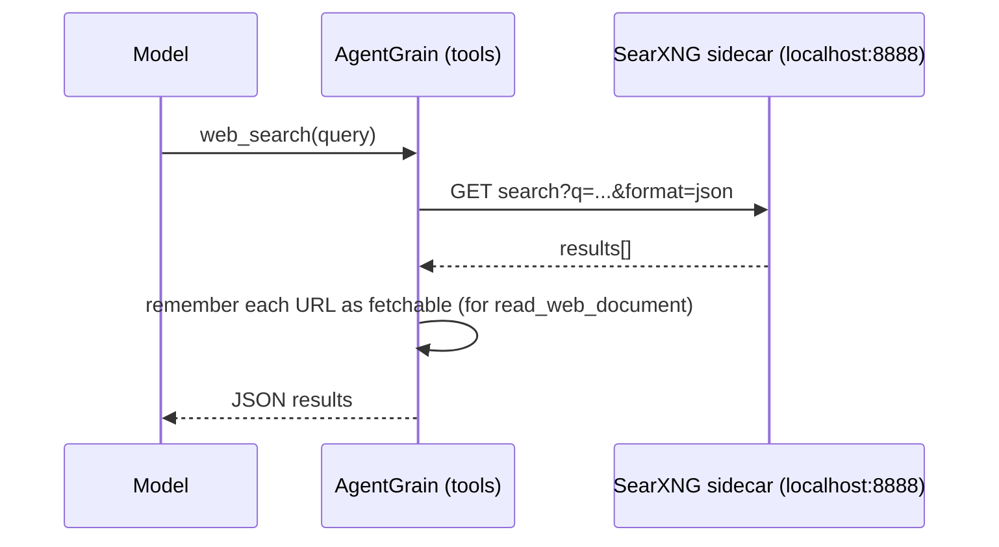

# Web search

> One model-invoked tool, `web_search`, that searches the web for current facts, prices and recent
> events. There is **no page-fetch tool**: the old one and its paid scrape
> dependency were removed (ADR 0125). ADRs 0011 · 0015 · 0125.

## What it is

`web_search` runs a query against a self-hosted **SearXNG** metasearch sidecar (no API key, no
per-user attribution) and returns a short list of titles, URLs and snippets. The model answers from the
snippets. Ordinary web pages can't be read in full: the model says when a snippet isn't enough and asks
the user to paste the text. Documents are the exception, `read_web_document` (ADR 0066, see
[Document Q&A](document-qa.md)) reads a PDF, Office or text file, and still rejects `text/html`.

> **Security boundary:** `read_web_document` only accepts a URL whose **exact** URL came back from a
> `web_search` result, appeared in the user's own message, or was seeded by an opted-in MCP server
> (ADR 0067), a whole-URL allowlist. Every tool return value is persisted into the 2 MB session, so
> results are budget-capped.

## How it works

The tool is an Agent Framework `AIFunction` built in `AgentGrain.BuildAgent` and invoked inside the
conversation grain. On a Responses-API model it is **swapped** for the framework's native
`HostedWebSearchTool` (ADR 0015), which surfaces under the same `web_search` name.



### The wire-API swap (ADR 0015)

```csharp
if (capabilities.SupportsHostedTools)
{
    tools.Add(new HostedWebSearchTool());
    tools.Add(new HostedCodeInterpreterTool());
}
else
{
    tools.Add(webSearch);
}
```

### `web_search` — every result URL becomes readable as a document

```csharp
var results = await _webSearch.SearchAsync(query, WebToolLimits.MaxSearchResults);
if (results.Count == 0)
    return $"The web search for '{query}' returned no results. Try different search terms.";
foreach (var result in results)
    RememberFetchableUrl(result.Url);
return JsonSerializer.Serialize(results);
```

The SearXNG client asks for JSON explicitly and treats a 403 as "JSON format disabled", not
an auth failure:

```csharp
var take = Math.Clamp(maxResults, 1, WebToolLimits.MaxSearchResults);
var requestUri = $"search?q={Uri.EscapeDataString(query)}&format=json";
using var response = await httpClient.GetAsync(requestUri, cancellationToken);
if (response.StatusCode == HttpStatusCode.Forbidden)
    throw new InvalidOperationException("SearXNG returned 403 ... `json` must be listed under `search.formats` ...");
```

The allowlist is **whole-URL, not host** (a host allowlist would be bypassable: search for
`attacker.example <secret>`, then read a URL on that host):

```csharp
private bool IsFetchableUrl(Uri uri) =>
    _state.State.FetchableUrls.Contains(Normalize(uri), StringComparer.Ordinal);
```

### HTTP client wiring

The SearXNG client is a named `HttpClient` with an explicit short timeout and **retries stripped** —
because the grain is non-reentrant, a slow lookup would serialize the whole conversation turn:

```csharp
builder.Services.AddHttpClient(SearxngWebSearch.HttpClientName, http => {
    http.BaseAddress = new Uri(webSearchEndpoint); http.Timeout = TimeSpan.FromSeconds(10);
}).RemoveAllResilienceHandlers();
```

`WebToolLimits` caps the footprint (`MaxSearchResults=5`, plus `MaxSearchPayloadLength` as a backstop for the
fleet's search tool) because every tool result lands in the 2 MB session Cosmos item.

## How the Agent Framework fits

- `web_search` is an `AIFunction` built via `AIFunctionFactory.Create(...)` and placed in
  `ChatClientAgentOptions.ChatOptions.Tools`.
- `ChatClientAgent.RunStreamingAsync` drives the tool-call loop, emitting
  `FunctionCallContent` / `FunctionResultContent` the grain surfaces as `ToolCallStart` /
  `ToolCallEnd` stream events.
- On the Responses API it is swapped for the framework's built-in `HostedWebSearchTool`,
  which surfaces under the same protocol name `web_search`, so one `ToolCatalog` key controls
  both realizations.

## How Orleans fits

- The tool is an instance method on `AgentGrain`, so it reads/writes grain state
  (`_state.State.FetchableUrls`) directly — the allowlist is durable per-conversation state,
  capped at `MaxFetchableUrls = 50`.
- `IWebSearch` is a process singleton injected into the grain.
- The grain's non-reentrancy is why the HTTP client has a short timeout and no retries.
- SearXNG is an Aspire-managed sidecar; its endpoint is forwarded to the backend as
  `WebSearch__Endpoint`.

## Which engines are enabled (ADR 0060)

Three: **Google, DuckDuckGo and Bing**. Getting there needed more than a list, and the trap is worth
knowing before you touch `infra/searxng/settings.yml`.

`use_default_settings.engines.keep_only` **filters** upstream's engine list - it enables nothing. That
list named all three from the start, but upstream shipped two of them off, using two flags that behave
differently:

| flag | what it does | can `settings.yml` override it? |
|---|---|---|
| `inactive: true` | `load_engines` skips the entry outright. Never registered, absent from `/config`, never queried - and **never reported in `unresponsive_engines` either**, so it fails invisibly. | **No.** Only a base-image bump. |
| `disabled: true` | Loads and registers, but sits out the default query set; answers only a `!bang`. | Yes. |

Google was `inactive`, Bing was `disabled`. **DuckDuckGo was the only engine that ever answered a
query**, which is why `web_search` had been returning empty lists once DuckDuckGo started serving
CAPTCHAs to the datacenter IP - the failure ADR 0059's UI was built to make visible.

The fix was two changes with different jobs, and it is worth keeping them apart. The top-level
`engines:` override is what restores search — measured, it brings Bing back on the **old** image too. The
image bump buys **Google alone**, because an `inactive` engine is unreachable from config at any setting.
An override entry is matched by `name` and merged onto the upstream default, so set **one key** and
inherit the rest - never paste a whole engine definition in, or the next bump silently freezes that
engine's config.

Measured after the change: **Bing returns the results**; Google and DuckDuckGo both CAPTCHA. Google is
kept on anyway because it now *reports* its failure into `unresponsive_engines` and the `/searxng/` UI
instead of being invisible.

To check the engine set, run the image and read **`/config`** - it lists exactly which engines loaded
and whether each is enabled. Reading the yaml will mislead you.

## Seeing what the sidecar actually returned (ADR 0059)

`web_search` gives you a result list and nothing else, so an empty or odd answer has no explanation.
The sidecar's own HTML search UI is proxied at **`/searxng/`**, linked from
**Preferences -> Configuration**, beside the SearXNG reachability check. Use it to see which engines
answered and which failed - an engine serving a CAPTCHA to the datacenter IP looks identical to
"no results" from the tool's side.

Four things to know before relying on it:

- It is **behind Easy Auth**, like every other browser surface, and is deliberately *not* in
  `excludedPaths`. There is still one ingress and port 8888 is still unpublished.
- Every proxied response carries a CSP with two halves - a `sandbox` that puts the page in an opaque
  origin (so the third-party image cannot read the app's IndexedDB or `fetch` `/api`), and a
  `form-action` pinned to `/searxng/` (so it cannot POST a form to `/api` either, which the sandbox
  alone does not prevent). **Nothing you can see is lost by this**: it would disable SearXNG's
  autocomplete, but this image already ships with autocomplete off.
- **Your preferences there are yours alone** (cookies are namespaced `sxng_` and scoped to
  `/searxng/`) and they do **not** affect `web_search`, which dials the sidecar directly with no
  cookie. The instance itself is shared.
- Offline (DevHost) the route answers a curated 503 - there is no sidecar to proxy to. Use the
  AppHost run instead.

## Key files

| Concern | File |
|---------|------|
| Tool defs + allowlist | `src/Agent42.Agents/Web/AgentGrain.WebTools.cs` (`WebSearchAsync`, `IsFetchableUrl`) |
| SearXNG client | `src/Agent42.Backend/Web/SearxngWebSearch.cs` |
| UI proxy rules + route | `src/Agent42.Backend/Web/SearxngProxy.cs`, `src/Agent42.Backend/Web/AgentApi.Web.cs` |
| Limits | `src/Agent42.Agents/Web/WebToolLimits.cs` |
| DI + sidecar | `src/Agent42.Backend/Program.cs`, `src/Agent42.AppHost/AppHost.cs` |
