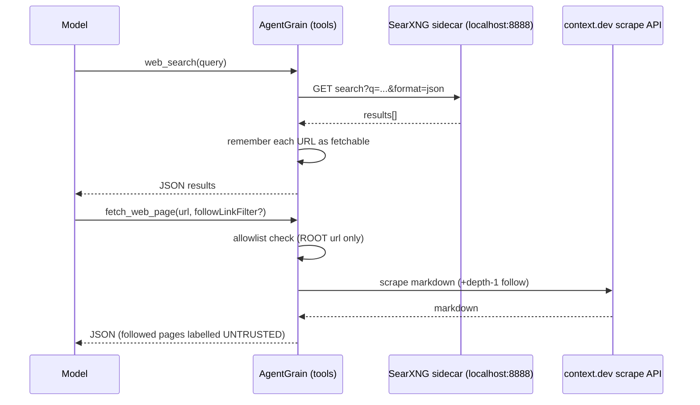

# Web search

> Two model-invoked tools — `web_search` and `fetch_web_page` — that search the web and read
> pages for current facts, prices, and recent events, following a named link one click deeper.
> ADRs 0011 · 0027 · 0015.

## What it is

The agent can search the web and read the resulting pages. `web_search` runs a query against
a self-hosted **SearXNG** metasearch sidecar (no API key, no per-user attribution).
`fetch_web_page` reads a specific page through the hosted **context.dev** scrape API, which
returns clean markdown and can follow depth-1 links whose text matches a model-supplied
`followLinkFilter` (up to `WebToolLimits.MaxFollowedLinks`).

> **Security boundary:** a page can only be fetched if its **exact** URL came back from a
> `web_search` result or appeared in the user's own message — a whole-URL allowlist. Followed
> links are deliberately exempt (an accepted, hard-capped residual risk, ADR 0027). Every tool
> return value is persisted into the 2 MB session, so results are budget-capped.

## How it works

Both tools are Agent Framework `AIFunction`s built in `AgentGrain.BuildAgent` and invoked
inside the conversation grain. On a Responses-API model they are **swapped** for the
framework's native `HostedWebSearchTool` (ADR 0015), which surfaces under the same
`web_search` name.



### The wire-API swap (ADR 0015)

```csharp
List<AITool> tools =
[
    schedulePrompt, cancelScheduledPrompt, cancelAllScheduledPrompts, getDateTime, getCurrentLocation,
];
if (capabilities.SupportsHostedTools)
{
    tools.Add(new HostedWebSearchTool());
    tools.Add(new HostedCodeInterpreterTool());
}
else
{
    tools.Add(webSearch);
    tools.Add(fetchWebPage);
}
```

### `web_search` — every result URL becomes fetchable

```csharp
var results = await _webSearch.SearchAsync(query, WebToolLimits.MaxSearchResults);
if (results.Count == 0)
    return $"The web search for '{query}' returned no results. Try different search terms.";
foreach (var result in results)
    RememberFetchableUrl(result.Url);
return JsonSerializer.Serialize(results);
```

The SearXNG client asks for JSON explicitly and treats a 403 as "JSON format disabled", not
an auth failure:

```csharp
var take = Math.Clamp(maxResults, 1, WebToolLimits.MaxSearchResults);
var requestUri = $"search?q={Uri.EscapeDataString(query)}&format=json";
using var response = await httpClient.GetAsync(requestUri, cancellationToken);
if (response.StatusCode == HttpStatusCode.Forbidden)
    throw new InvalidOperationException("SearXNG returned 403 ... `json` must be listed under `search.formats` ...");
```

### `fetch_web_page` — root-URL allowlist gate

```csharp
// The allowlist check is on the ROOT URL only — followed links are deliberately exempt (ADR 0027).
if (!IsFetchableUrl(uri))
{
    _logger.LogWarning("...refused to fetch '{Url}': not a URL from a search result or a user message", ...);
    return $"I won't fetch '{url}'. A page can only be read if that exact URL came back from a web_search ...";
}
var page = await _webPageFetcher.FetchAsync(url, followLinkFilter, maxFollowedLinks);
```

The context.dev fetcher follows depth-1 links only when a filter is supplied, clamped to the
limit:

```csharp
var following = !string.IsNullOrWhiteSpace(followLinkFilter);
var root = await ScrapeOneAsync(url, includeLinks: following, cancellationToken);
...
var take = Math.Clamp(maxFollowedLinks, 0, WebToolLimits.MaxFollowedLinks);
var chosen = candidates.Take(take).ToList();
var followedResults = await Task.WhenAll(chosen.Select(async link => { ... }));
```

The allowlist is **whole-URL, not host** (a host allowlist would be bypassable):

```csharp
private bool IsFetchableUrl(Uri uri) =>
    _state.State.FetchableUrls.Contains(Normalize(uri), StringComparer.Ordinal);
```

### HTTP client wiring

Both clients are named `HttpClient`s with explicit short timeouts and **retries stripped** —
because the grain is non-reentrant, a slow lookup would serialize the whole conversation turn:

```csharp
builder.Services.AddHttpClient(SearxngWebSearch.HttpClientName, http => {
    http.BaseAddress = new Uri(webSearchEndpoint); http.Timeout = TimeSpan.FromSeconds(10);
}).RemoveAllResilienceHandlers();
builder.Services.AddHttpClient(ContextWebPageFetcher.HttpClientName, http => {
    ContextWebPageFetcher.ConfigureClient(http, contextApiKey); http.Timeout = TimeSpan.FromSeconds(30);
}).RemoveAllResilienceHandlers();
```

`WebToolLimits` caps the footprint: `MaxSearchResults=5`, `MaxPageTextLength=8*1024`,
`MaxFollowedLinks=3`, `MaxTotalPageTextLength=24*1024` — because every tool result lands in the
2 MB session Cosmos item.

## How the Agent Framework fits

- `web_search` / `fetch_web_page` are `AIFunction`s built via `AIFunctionFactory.Create(...)`
  and placed in `ChatClientAgentOptions.ChatOptions.Tools`.
- `ChatClientAgent.RunStreamingAsync` drives the tool-call loop, emitting
  `FunctionCallContent` / `FunctionResultContent` the grain surfaces as `ToolCallStart` /
  `ToolCallEnd` stream events.
- On the Responses API these are swapped for the framework's built-in `HostedWebSearchTool`,
  which surfaces under the same protocol name `web_search`, so one `ToolCatalog` key controls
  both realizations.

## How Orleans fits

- The tools are instance methods on `AgentGrain`, so they read/write grain state
  (`_state.State.FetchableUrls`) directly — the allowlist is durable per-conversation state,
  capped at `MaxFetchableUrls = 50`.
- `IWebSearch` / `IWebPageFetcher` are process singletons injected into the grain.
- The grain's non-reentrancy is why the HTTP clients have short timeouts and no retries.
- SearXNG is an Aspire-managed sidecar; its endpoint is forwarded to the backend as
  `WebSearch__Endpoint`.

## Seeing what the sidecar actually returned (ADR 0059)

`web_search` gives you a result list and nothing else, so an empty or odd answer has no explanation.
The sidecar's own HTML search UI is proxied at **`/searxng/`**, linked from
**Preferences -> Configuration**, beside the SearXNG reachability check. Use it to see which engines
answered and which failed - an engine serving a CAPTCHA to the datacenter IP looks identical to
"no results" from the tool's side.

Four things to know before relying on it:

- It is **behind Easy Auth**, like every other browser surface, and is deliberately *not* in
  `excludedPaths`. There is still one ingress and port 8888 is still unpublished.
- Every proxied response carries `Content-Security-Policy: sandbox allow-scripts allow-forms`, which
  puts the page in an opaque origin so the third-party image cannot touch the app's IndexedDB or
  `/api`. **The one visible cost: SearXNG's autocomplete does not work.** That is expected.
- **Your preferences there are yours alone** (cookies are namespaced `sxng_` and scoped to
  `/searxng/`) and they do **not** affect `web_search`, which dials the sidecar directly with no
  cookie. The instance itself is shared.
- Offline (DevHost) the route answers a curated 503 - there is no sidecar to proxy to. Use the
  AppHost run instead.

## Key files

| Concern | File |
|---------|------|
| Tool defs + allowlist | `src/Agent42.Agents/Web/AgentGrain.WebTools.cs` (`WebSearchAsync`, `FetchWebPageAsync`) |
| SearXNG client | `src/Agent42.Backend/Web/SearxngWebSearch.cs` |
| context.dev fetcher | `src/Agent42.Backend/Web/ContextWebPageFetcher.cs` |
| UI proxy rules + route | `src/Agent42.Backend/Web/SearxngProxy.cs`, `src/Agent42.Backend/Web/AgentApi.Web.cs` |
| Limits | `src/Agent42.Agents/Web/WebToolLimits.cs` |
| DI + sidecar | `src/Agent42.Backend/Program.cs`, `src/Agent42.AppHost/AppHost.cs` |
