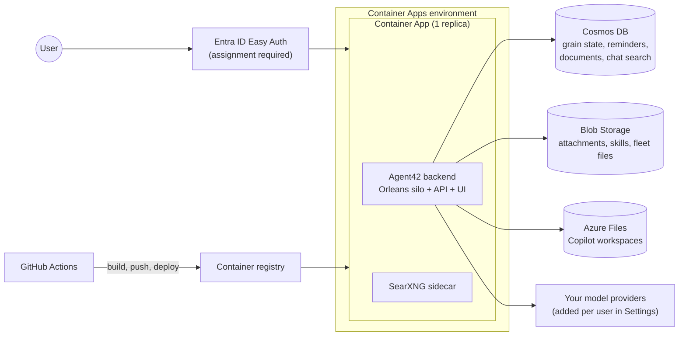

# Deploy Agent42 to Azure

A step-by-step guide to running your own copy on Azure Container Apps, with Entra ID sign-in, deployed by GitHub Actions.
It takes about an hour the first time, most of it waiting for the first deploy. Without an Azure account, use
[Run locally](local.md) instead.

This guide is the walkthrough. The complete reference for every secret and variable, and what each missing one does, is
[`docs/features/azure-deployment.md`](../features/azure-deployment.md).

## What you get



Created in your resource group: the Container App, a Cosmos DB account, two storage accounts, and (unless you reuse
existing ones) a container registry, a Log Analytics workspace and a Container Apps environment. The app runs a single
replica on purpose: several features keep in-process state (ADR 0128, and the single-replica rule in `CLAUDE.md`).
Expect an always-on bill for the replica, Cosmos DB and storage; check the Azure pricing calculator for your region.

## Before you start

You need:

- An **Azure subscription** where you are **Owner** (or User Access Administrator plus Contributor).
- Permission to **create app registrations** in the Entra tenant.
- The **Azure CLI** (`az`), the **GitHub CLI** (`gh`) and `bash` (Git Bash or WSL on Windows).
- A **fork** of this repository that you can push to, cloned locally.

```bash
az login
gh auth login
gh repo fork Expecho/Agent42 --clone && cd Agent42
```

Choose these up front:

| Choice | Notes |
|---|---|
| Resource group name and region | For example `rg-myagent` in `westeurope`. The bootstrap creates the group. |
| App name prefix | Default `agent42`; names the Entra apps `<name>-easyauth` and `<name>-deploy`. |
| Reuse a registry and environment? | Optional. By default the first deploy creates its own. Reuse only if you already run a Container Apps environment, and then set all three of `ACR_NAME`, `CAE_NAME`, `CAE_RESOURCE_GROUP`. |
| Custom domain? | Optional, and can be added later. Without one the app uses an `azurecontainerapps.io` address. |
| Who are the owners? | The Entra object ids that may open `/dashboard`, `/logs` and diagnostics. You can set this after your first sign-in. |

## Step 1. Bootstrap Azure and Entra (you run it)

This step creates role assignments and Entra objects, so **you run it by hand**, never CI and never an AI agent. Read
`infra/bootstrap.sh` first.

```bash
infra/bootstrap.sh init --resource-group rg-myagent --location westeurope
```

It creates, idempotently where Azure allows: the resource group; the needed resource providers; the Easy Auth app
registration `<name>-easyauth` (single tenant, ID tokens on, **assignment required**); and a deploy service principal
`<name>-deploy` with Contributor and Role Based Access Control Administrator on that one resource group, and no Microsoft
Graph permissions.

It ends by printing the commands that set your GitHub secrets and variables. **Run them in your fork:**

```bash
gh secret set AZURE_CLIENT_ID --body '...'
gh secret set AZURE_CLIENT_SECRET --body '...'
gh secret set AZURE_SUBSCRIPTION_ID --body '...'
gh secret set AZURE_TENANT_ID --body '...'
gh secret set AAD_CLIENT_SECRET --body '...'
gh secret set SEARXNG_SECRET --body '...'
gh variable set AZURE_RESOURCE_GROUP --body 'rg-myagent'
gh variable set AUTH_CLIENT_ID --body '...'
```

Re-running `init` prints fresh client secrets (the old ones stay valid until they expire).

## Step 2. Set the optional secrets and variables

Everything below is optional, and a missing value switches only its own feature off. Set what you want now, or add it
later and redeploy.

| Want | Set | Kind |
|---|---|---|
| Owners (dashboard, `/logs`) | `ACCESS_OWNERS` = comma-separated object ids | variable |
| A second account mapped to the same data | `IDENTITY_ALIASES` = `{"<alias id>":"<owner id>"}` | variable |
| Web Push | `VAPID_PRIVATE_KEY` (secret), `VAPID_PUBLIC_KEY` and `VAPID_SUBJECT` (variables). Generate with `npx web-push generate-vapid-keys` | both |
| Long-term memory | `HINDSIGHT_API_KEY` (**always-on egress** of conversation content) | secret |
| Location with addresses | `GOOGLE_MAPS_API_KEY` | secret |
| "Sign in with GitHub" (Copilot) | `GH_OAUTH_CLIENT_SECRET` (secret) and `GH_OAUTH_CLIENT_ID` (variable) | both |
| Inbound email to agents | `MAILGUN_SIGNING_KEY` (secret), `EMAIL_INBOUND_DOMAIN` (variable) | both |
| App Insights export | `APPLICATIONINSIGHTS_CONNECTION_STRING` | secret |
| OpenTelemetry collector | `OTLP_ENDPOINT` | variable |
| Pin the Cosmos region | `COSMOS_LOCATION` (immutable once created) | variable |
| Reuse a registry and environment | `ACR_NAME`, `CAE_NAME`, `CAE_RESOURCE_GROUP` (all three) | variable |

```bash
gh variable set ACCESS_OWNERS --body '<object id>'
gh secret set GOOGLE_MAPS_API_KEY --body '<key>'
```

The full table, with every meaning, is in [`azure-deployment.md`](../features/azure-deployment.md#secrets). Integrations
that need an account or registration have their own guides in [`docs/integrations/`](../integrations/README.md).

## Step 3. Deploy

Push to `main` of your fork, or run the workflow by hand:

```bash
git push origin main
# or: gh workflow run Deploy
gh run watch
```

The Deploy workflow runs, in order:

1. **preflight**: fails fast, naming the variable, if a required variable is missing, the shared-infra trio is
   half-set, or `ACCESS_OWNERS` contains `local-dev`. Nothing is created before it passes.
2. **shared infra**: creates the registry and environment, or reuses yours.
3. **build and push**: builds the backend and search images and pushes them to the registry.
4. **deploy**: deploys `infra/main.bicep` (Container App, Cosmos, storage, Copilot file share, role assignments).

Find the app's address once it finishes:

```bash
az containerapp show -n ca-agent42-backend -g rg-myagent --query properties.configuration.ingress.fqdn -o tsv
```

### Alternative: deploy the published images, with no fork and no GitHub Actions

Every push to `main` and every `v*` tag publishes the two images to the GitHub Container Registry
(`ghcr.io/expecho/agent42-backend` and `ghcr.io/expecho/agent42-searxng`, amd64 and arm64). If you would rather not fork
and build, import them into your own Azure Container Registry and deploy the Bicep by hand. It needs only `az`, `jq` and
`bash`, and it is the same infrastructure the workflow deploys. The images hold no configuration, so the same image runs
in any tenant.

```bash
git clone https://github.com/Expecho/Agent42.git && cd Agent42
RG=rg-myagent

# 1. Bootstrap (step 1 above). Keep the values it prints: AUTH_CLIENT_ID, AAD_CLIENT_SECRET and SEARXNG_SECRET.
infra/bootstrap.sh init --resource-group $RG --location westeurope

# 2. Shared infrastructure: the registry, a Log Analytics workspace and a Container Apps environment.
outputs=$(az deployment group create -g $RG --template-file infra/shared.bicep --query properties.outputs -o json)
ACR=$(jq -r .registryName.value <<< "$outputs")
CAE=$(jq -r .environmentName.value <<< "$outputs")
CAE_RG=$(jq -r .environmentResourceGroup.value <<< "$outputs")

# 3. Copy the images into your registry. The registry pulls them itself, so you need no local Docker. Pin a version
#    (1.2.3 or sha-abc1234) rather than `latest`: the Container App only rolls a new revision when its image tag changes.
TAG=latest
for image in agent42-backend agent42-searxng; do
  az acr import --name $ACR --source ghcr.io/expecho/$image:$TAG --image $image:$TAG
done

# 4. Deploy the app.
az deployment group create -g $RG --template-file infra/main.bicep --parameters   imageTag=$TAG searxngImageTag=$TAG   containerRegistryName=$ACR containerAppsEnvironmentName=$CAE containerAppsEnvironmentResourceGroup=$CAE_RG   acrAdminUsername=$ACR acrAdminPassword="$(az acr credential show -n $ACR --query 'passwords[0].value' -o tsv)"   authClientId=<AUTH_CLIENT_ID> authClientSecret=<AAD_CLIENT_SECRET> searxngSecret=<SEARXNG_SECRET>
```

Then carry on with step 4 below (the redirect), and assign users. To update, import a newer tag and re-run the last
command with it. Optional features take the same parameters `deploy.yml` passes (`accessOwners`, `vapidPublicKey`,
`customDomainName` and so on; see [`azure-deployment.md`](../features/azure-deployment.md)), and a parameter you leave out
is off, exactly as an unset variable is in the workflow. The package must be public for the import to work without
credentials; if you run a fork that publishes its own images, use `ghcr.io/<your-user>/...` instead.

## Step 4. Register the sign-in redirect

The redirect URI needs the host, which does not exist until the first deploy:

```bash
infra/bootstrap.sh redirect --app-id <AUTH_CLIENT_ID> --host <the fqdn from step 3>
```

Until you do this, signing in fails with a redirect-URI mismatch (`AADSTS50011`).

## Step 5. Assign users

Sign-in is invite-only: the enterprise application must assign each user. The script assigns nobody.

1. Entra admin center → **Enterprise applications** → `<name>-easyauth` → **Users and groups** → **Add user/group**.
2. Add yourself and anyone else. People from other organisations must be invited as guests first.

An unassigned user sees `AADSTS50105`.

## Step 6. Sign in, become an owner, add a model

1. Open `https://<fqdn>` and sign in.
2. To open `/dashboard` and `/logs`, find your **object id** (Entra admin center → Users → your user → Object ID), then:

   ```bash
   gh variable set ACCESS_OWNERS --body '<your object id>'
   gh workflow run Deploy
   ```

   With no owners set, those pages answer 404 to everyone, by design. Never list `local-dev`.
3. Open **Preferences → model providers** and add a provider. There is no operator model: every user brings their own,
   and until you do the composer is disabled.
4. Open **Preferences → Configuration** to see which features are on, degraded or off. It never shows a secret.

## Custom domain (optional)

Binding is a one-time CLI step, because Bicep cannot create the managed certificate:

```bash
az containerapp hostname add  -n ca-agent42-backend -g rg-myagent --hostname chat.example.com
az containerapp hostname bind -n ca-agent42-backend -g rg-myagent --hostname chat.example.com \
  --environment <cae> --validation-method CNAME
az containerapp env certificate list -n <cae> -g <cae resource group>      # note the certificate name
gh variable set CUSTOM_DOMAIN_NAME --body 'chat.example.com'
gh variable set CUSTOM_DOMAIN_CERTIFICATE_NAME --body '<certificate name>'
infra/bootstrap.sh redirect --app-id <AUTH_CLIENT_ID> --host chat.example.com
```

Set the two variables together. If the certificate is ever recreated, update its name before the next deploy or the
domain is unbound.

## Operating it

- **Update:** push to `main`. Changes under `src/**`, `infra/**` and the workflow trigger a deploy.
- **Rotate a secret:** `gh secret set NAME`, then `gh workflow run Deploy`. Rotate the sign-in secret with
  `az ad app credential reset --id <AUTH_CLIENT_ID>` and update `AAD_CLIENT_SECRET`.
- **Logs:** `az containerapp logs show -n ca-agent42-backend -g rg-myagent`, or `/logs` as an owner.
- **Tear down:** `az group delete -n rg-myagent`. Then delete the two Entra apps
  (`az ad app delete --id <id>`), because they are not in the resource group.

## Troubleshooting

| Symptom | Cause and fix |
|---|---|
| Deploy fails in `preflight` naming a variable | An absent variable expands to an empty string, which means "off". Set it (see step 2) and re-run. |
| Revision never becomes healthy | `SEARXNG_SECRET` is missing or empty: the search sidecar crash-loops, and Container Apps gates health on every container. |
| Sign-in: `AADSTS50011` | The redirect URI is not registered. Run step 4 with the exact host. |
| Sign-in: `AADSTS50105` | The user is not assigned to the enterprise application (step 5). |
| Sign-in loops or 401 | `AAD_CLIENT_SECRET` is stale or wrong, or `AUTH_CLIENT_ID` points at another app. |
| `/dashboard` or `/logs` answer 404 | No owner set, or your object id is not in `ACCESS_OWNERS` (step 6). Check after a redeploy. |
| Deploy fails creating role assignments | The deploy principal lacks Role Based Access Control Administrator on the resource group. Re-run `bootstrap.sh init`. |
| Cosmos region error | The region is immutable. Keep `COSMOS_LOCATION` equal to the existing account's region. |
| Deploy unbinds the custom domain | `CUSTOM_DOMAIN_NAME` or the certificate name is unset or stale. Preflight catches the domain, not a stale certificate name. |
| Composer disabled, picker empty | No model provider yet: add one under Preferences. |

## See also

- [`azure-deployment.md`](../features/azure-deployment.md): the secrets and variables reference.
- [ADR 0128](../../.agentic/decisions/0128-tenant-portable-azure-iac.md): why the IaC is built this way.
- [`.agentic/gotchas.md`](../../.agentic/gotchas.md): Azure traps (Cosmos, RBAC, the search sidecar).
